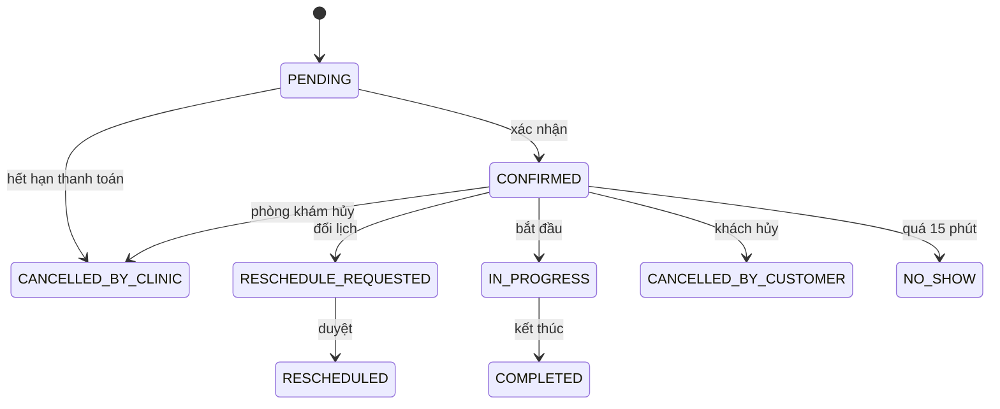

# MHCA — Tài liệu tổng hợp dự án và quy trình xử lý từng bài toán

2026-10-12 · thu tâm

## 1. Tổng quan dự án

MHCA là hệ thống web cho phép khách hàng tự đặt lịch tư vấn tâm lý, thanh toán và hủy/đổi lịch, đồng thời giúp phòng khám điều phối lịch, thu tiền, hoàn tiền và bảo vệ dữ liệu sức khỏe tinh thần. Tài liệu này gom toàn bộ dự án và mô tả cách hệ thống xử lý từng bài toán; đặc tả đầy đủ nằm trong `MASTER-SRS.md` (mã FR, BR, UC được dẫn kèm).

**Ba trụ cột nghiệp vụ**

1. Vòng đời lịch hẹn có máy trạng thái chặt, mọi chuyển trạng thái đều có lịch sử.
2. Không bao giờ có hai lịch chồng thời gian của cùng một chuyên viên, kể cả khi hai người đặt cùng lúc.
3. Dữ liệu sức khỏe tinh thần được bảo vệ: phân quyền tối thiểu, mã hóa trường nhạy cảm, audit mọi lần đọc hồ sơ tư vấn.

**Phạm vi MVP và ngoài phạm vi**

| Trong MVP | Ngoài MVP |
| --- | --- |
| Xác thực, RBAC, khách hàng, chuyên viên, dịch vụ | Chatbot, AI, RAG, chẩn đoán tự động |
| Lịch làm việc, ngày nghỉ, sinh slot | Ứng dụng mobile native |
| Đặt, đổi, hủy, bắt đầu, hoàn thành, no-show | Thẻ/ví điện tử, trả góp |
| Thanh toán VietQR qua SePay (demo) và tiền mặt | Hoàn tiền tự động qua API ngân hàng |
| Hủy lịch và hoàn tiền thủ công theo bậc thang | Voucher, hóa đơn, tư vấn video, đa chi nhánh |
| Hồ sơ buổi tư vấn, thông báo, đánh giá, dashboard, audit |  |

**Các quyết định đã chốt (CR-001)**

- Có thanh toán: chuyển khoản VietQR qua SePay (tài khoản test/demo, quét mã QR thật) và tiền mặt tại quầy.
- Lịch chờ thanh toán giữ chỗ 10 phút; quá hạn thì tự hủy và nhả slot.
- Hoàn tiền khi khách hủy lịch đã trả online: còn từ 24 giờ hoàn 100%, từ 12 đến dưới 24 giờ hoàn 50%, dưới 12 giờ hoặc không đến hoàn 0%. Lịch chưa trả thì hủy thẳng.
- Hoàn tiền thực hiện thủ công bởi Staff/Admin.

Các mốc giờ, tỷ lệ hoàn và nhiều tham số khác là giả định có thể chỉnh trong cấu hình, chờ phòng khám xác nhận.

## 2. Tác nhân và phân quyền

Hệ thống có 4 vai trò đăng nhập, mỗi người dùng đúng một vai trò. Quy tắc chung: từ chối mặc định, kiểm tra quyền ở server cho mọi yêu cầu, và kiểm tra thêm phạm vi dữ liệu (của mình, được phân công, hoặc tất cả).

| Tác nhân | Làm gì | Cách tạo tài khoản |
| --- | --- | --- |
| Guest | Xem dịch vụ, chuyên viên, đánh giá; đăng ký | Không có |
| Customer | Đặt, thanh toán, đổi, hủy lịch của mình; đánh giá | Tự đăng ký, hoặc Staff tạo hộ |
| Specialist | Quản lý giờ làm việc; xem lịch được phân công; Start/Complete; ghi hồ sơ tư vấn | Admin tạo |
| Staff | Điều phối lịch, đặt hộ, thu tiền mặt, đối soát, xử lý hoàn tiền | Admin tạo |
| Admin | Người dùng, dịch vụ, chuyên viên, cấu hình, kiểm duyệt đánh giá, báo cáo, audit | Admin tạo |
| System Scheduler | Hết hạn giữ chỗ, nhắc lịch (ghi actor = SYSTEM) | Không có |

**Ma trận quyền rút gọn**

| Chức năng | Customer | Specialist | Staff | Admin |
| --- | --- | --- | --- | --- |
| Xem lịch hẹn | của mình | được phân công | tất cả | tất cả |
| Đặt lịch | cho mình | - | đặt hộ | đặt hộ |
| Hủy lịch | của mình, trước giờ hẹn | - | do phòng khám | do phòng khám |
| Start buổi tư vấn | - | được phân công | có | có |
| Complete buổi tư vấn | - | được phân công | - | - |
| Đọc và ghi hồ sơ tư vấn | - | được phân công | - | - |
| Thu tiền mặt, xác nhận hoàn tiền, đối soát | - | - | có | có |
| Quản lý dịch vụ, chuyên viên, người dùng, cấu hình | - | - | - | có |
| Xem audit, báo cáo doanh thu | - | - | - | có |

**Điểm cần nhớ về phạm vi dữ liệu**

- Staff thấy thông tin liên hệ của khách nhưng không thấy ghi chú đặt lịch và không đọc được hồ sơ tư vấn.
- Admin cũng không đọc nội dung hồ sơ tư vấn theo mặc định (quyền khẩn cấp là câu hỏi mở OQ-11).
- Specialist chỉ thấy tối thiểu về khách của lịch mình phụ trách, và chỉ thấy trạng thái thanh toán, không thấy số tiền hay tài khoản ngân hàng.
- Truy cập tài nguyên theo mã của người khác trả về 404, không cho biết tài nguyên có tồn tại.

Bảng đầy đủ 49 dòng nằm ở mục 16 và 28A.12 của `MASTER-SRS.md`.

## 3. Bài toán 1: Tài khoản và đăng nhập (FR-AUTH)

Chỉ tài khoản ACTIVE được đăng nhập và đặt lịch. Trạng thái tài khoản đi từ PENDING_VERIFICATION sang ACTIVE, và có thể bị LOCKED (khóa tạm hoặc Admin khóa) hoặc DISABLED (Admin vô hiệu hóa).

**Đăng ký (khách hàng)**

1. Khách nhập họ tên, email, mật khẩu, ngày sinh, số điện thoại (tùy chọn) và tick đồng ý chính sách quyền riêng tư.
2. Hệ thống kiểm tra: email duy nhất không phân biệt hoa/thường; mật khẩu ít nhất 8 ký tự gồm chữ hoa, chữ thường, chữ số; tuổi từ 18 trở lên (giả định AS-05, câu hỏi mở OQ-04).
3. Tạo tài khoản role CUSTOMER cùng hồ sơ khách hàng, ghi phiên bản và thời điểm đồng ý chính sách.
4. Nếu bật xác thực email thì trạng thái PENDING_VERIFICATION và gửi link; nếu tắt thì ACTIVE ngay.
5. Ngoại lệ: email đã dùng (thông báo trung tính), mật khẩu yếu, chưa đồng ý, dưới 18 tuổi, vượt giới hạn tần suất.

**Đăng nhập**

1. Kiểm tra tài khoản có đang bị khóa tạm không.
2. So khớp mật khẩu đã băm; sai thì báo chung "Email hoặc mật khẩu không đúng" và tăng bộ đếm.
3. Đủ 5 lần sai liên tiếp thì khóa 15 phút; lần thứ 6 bị từ chối kể cả khi đúng mật khẩu.
4. Đúng thì kiểm tra trạng thái, tạo phiên mới, reset bộ đếm, ghi audit, chuyển tới dashboard theo vai trò.

**Quên và đặt lại mật khẩu**

1. Khách nhập email; hệ thống luôn trả cùng một thông báo dù email có tồn tại hay không.
2. Nếu tồn tại, tạo token dùng một lần, có hạn, chỉ lưu bản băm, gửi link.
3. Khách đặt mật khẩu mới; token bị đánh dấu đã dùng và mọi phiên cũ bị hủy.

**Quản lý trạng thái tài khoản (Admin)**

- Khóa, mở khóa, vô hiệu hóa phải có lý do và hộp xác nhận.
- Không được tự vô hiệu hóa hay hạ quyền chính mình, và hệ thống luôn còn ít nhất một Admin hoạt động.

Các quy tắc liên quan: BR-011 đến BR-018, BR-059.

## 4. Bài toán 2: Lịch làm việc, sinh slot và chuyên viên nghỉ đột xuất (FR-SCHEDULE)

Slot không lưu thành bảng riêng mà được **sinh động** từ lịch làm việc, ngoại lệ và thời lượng dịch vụ. Cách này tránh hai nguồn dữ liệu lệch nhau; việc chống đặt trùng dựa vào bảng lịch hẹn (mục 5).

**Các khái niệm**

| Khái niệm | Ý nghĩa |
| --- | --- |
| Working schedule | Ca làm lặp hằng tuần: thứ, giờ bắt đầu và kết thúc, một giờ nghỉ giữa ca, thời gian hiệu lực |
| Schedule exception | Ngày nghỉ cả ngày, chặn một khoảng giờ, hoặc ngày lễ toàn phòng khám |
| Thời lượng và đệm | Thời lượng lấy từ dịch vụ; đệm sau mỗi buổi mặc định 10 phút |
| Bước slot | Khoảng cách giữa hai thời điểm bắt đầu, mặc định 60 phút |

**Cách sinh slot**

1. Lấy ca làm việc hiệu lực của ngày đó, trừ giờ nghỉ giữa ca.
2. Trừ ngoại lệ: ngày lễ, nghỉ cả ngày, chặn giờ.
3. Sinh các thời điểm bắt đầu theo bước slot; giữ thời điểm nào mà bắt đầu cộng thời lượng không vượt hết ca.
4. Loại slot chồng với lịch đang giữ chỗ của chuyên viên (có tính đệm).
5. Loại slot trước giờ hiện tại cộng 2 giờ hoặc quá 30 ngày kể từ hôm nay.
6. Chuyên viên hoặc dịch vụ không hoạt động, hoặc chuyên viên không cung cấp dịch vụ đó: không có slot.

Ví dụ: ca 09:00 đến 12:00, buổi 50 phút, đệm 10 phút cho các slot 09:00, 10:00, 11:00.

**Khi lịch bị hủy slot có trở lại không?** Có. Lịch rời nhóm giữ chỗ (đã hủy, đổi, no-show, hoàn thành) thì slot tự tính lại là khả dụng nếu vẫn trong ca làm, chưa qua giờ và trong cửa sổ đặt, không cần thao tác thủ công.

**Chuyên viên nghỉ đột xuất**

1. Specialist (hoặc Staff tạo hộ) tạo ngày nghỉ, đánh dấu đột xuất.
2. Hệ thống tính trước danh sách lịch bị ảnh hưởng (lịch chờ thanh toán, đã xác nhận, đang chờ đổi) và hiển thị để xác nhận.
3. Sau khi lưu, slot mới bị chặn ngay.
4. Các lịch bị ảnh hưởng được gắn cờ cần xử lý và Staff, Admin nhận thông báo. Lịch đang diễn ra không bị đụng.
5. Staff xử lý từng lịch: đổi sang slot khác, hoặc hủy do phòng khám kèm lý do (khách được hoàn 100% nếu đã trả).
6. Hệ thống không tự hủy hàng loạt, vì có thể còn phương án đổi lịch.

Tương tự khi Admin vô hiệu hóa một chuyên viên hoặc khai báo ngày lễ. Các quy tắc liên quan: BR-040 đến BR-045, BR-056.

## 5. Bài toán 3: Đặt lịch và chống đặt trùng (FR-APPT-001 đến 003)

Danh sách slot hiển thị chỉ mang tính tham khảo; quyết định thật được đưa ra ở server khi khách bấm đặt.

**Luồng đặt lịch của khách**

1. Chọn dịch vụ, chuyên viên, ngày, rồi slot; nhập ghi chú tùy chọn (tối đa 500 ký tự).
2. Chọn phương thức thanh toán: VietQR hoặc tiền mặt (xem mục 7).
3. Bấm đặt. Server mở một giao dịch, khóa theo chuyên viên, tính lại toàn bộ điều kiện và kiểm tra chồng thời gian.
4. Tạo lịch hẹn cùng lịch sử trạng thái, thông báo và audit trong cùng giao dịch; nếu có lỗi thì hoàn tác toàn bộ.
5. Trả mã lịch cho khách.

**Điều kiện hợp lệ khi đặt**

- Dịch vụ và chuyên viên đang hoạt động, chuyên viên có cung cấp dịch vụ đó.
- Giờ bắt đầu cách hiện tại ít nhất 2 giờ và không quá 30 ngày.
- Khách không có lịch khác chồng giờ và còn dưới 3 lịch đang giữ chỗ.
- Gửi lặp cùng một yêu cầu chỉ tạo tối đa một lịch (khóa idempotency).
- Lịch lưu ảnh chụp thời lượng, đệm và giá tại lúc đặt; sửa dịch vụ sau đó không đổi lịch cũ.

**Bảy lớp chống đặt trùng**

| Lớp | Nội dung |
| --- | --- |
| 1. Hiển thị | Slot trống chỉ để tham khảo |
| 2. Kiểm tra lại ở server | Tính lại khi submit, không tin dữ liệu từ trình duyệt |
| 3. Giao dịch | Kiểm tra, ghi lịch, ghi lịch sử và audit cùng một giao dịch |
| 4. Khóa và ràng buộc | Khóa dòng chuyên viên để các giao dịch đặt cùng chuyên viên chạy lần lượt; thêm ràng buộc duy nhất `slot_lock_key` chỉ có giá trị khi lịch đang giữ chỗ |
| 5. Phản hồi xung đột | HTTP 409 mã `APPOINTMENT_SLOT_UNAVAILABLE` kèm tối đa 5 slot gợi ý |
| 6. Thông báo cho khách | "Khung giờ này vừa được người khác đặt. Vui lòng chọn khung giờ khác." |
| 7. Audit | Ghi sự kiện xung đột, không kèm ghi chú |

Kết quả khi hai người đặt cùng slot đồng thời: đúng một người nhận 201, người kia nhận 409, và dữ liệu không bao giờ có hai lịch giữ chỗ chồng nhau. Lịch ở trạng thái chờ thanh toán, đã xác nhận, chờ đổi và đang diễn ra đều tính là đang giữ chỗ.

**Staff đặt hộ:** cùng luồng và cùng chống trùng, nhưng lịch vào thẳng trạng thái đã xác nhận (mặc định tiền mặt) và Staff không thấy ghi chú của khách.

## 6. Bài toán 4: Vòng đời lịch hẹn và chuyển trạng thái (state machine)

Mọi thay đổi của lịch hẹn đều là một lần chuyển trạng thái hợp lệ, do đúng vai trò được phép thực hiện, và đều ghi nhật ký. Hệ thống từ chối mọi chuyển trạng thái không nằm trong sơ đồ dưới đây.

| Từ | Đến | Ai thực hiện, điều kiện |
| --- | --- | --- |
| PENDING | CONFIRMED | Hệ thống khi webhook khớp thanh toán; Staff xác nhận thủ công; với tiền mặt thì vào CONFIRMED ngay khi đặt |
| PENDING | CANCELLED_BY_CLINIC | Tác vụ định kỳ khi quá 10 phút chưa thanh toán |
| CONFIRMED | RESCHEDULE_REQUESTED | Khách xin đổi lịch (tối thiểu 24 giờ trước, tối đa 2 lần) |
| RESCHEDULE_REQUESTED | RESCHEDULED | Staff duyệt và chọn slot mới còn trống |
| CONFIRMED | IN_PROGRESS | Chuyên viên bắt đầu ca (cho phép sớm tối đa 15 phút) |
| IN_PROGRESS | COMPLETED | Chuyên viên kết thúc ca và ghi hồ sơ |
| CONFIRMED | CANCELLED_BY_CUSTOMER | Khách hủy trước giờ bắt đầu; hoàn tiền theo mục 7 |
| CONFIRMED | CANCELLED_BY_CLINIC | Staff hoặc Admin hủy (chuyên viên nghỉ); hoàn 100% |
| CONFIRMED | NO_SHOW | Quá 15 phút sau giờ bắt đầu mà khách không đến; không hoàn |

**Slot và trạng thái.** Slot chỉ bị giữ khi lịch ở PENDING, CONFIRMED, RESCHEDULE_REQUESTED hoặc IN_PROGRESS. Vào trạng thái kết thúc là slot được nhả và có thể đặt lại.

**Đặt lịch không trùng (double-booking).** Bảy lớp chặn: kiểm tra khi hiển thị slot, kiểm tra lại ở máy chủ, giao dịch cơ sở dữ liệu, khóa dòng chuyên viên cùng khóa duy nhất `slot_lock_key`, trả lỗi 409 `APPOINTMENT_SLOT_UNAVAILABLE`, thông báo rõ cho khách, và ghi kiểm toán. Slot được sinh động từ lịch làm việc, ngày nghỉ, thời lượng dịch vụ và thời gian đệm, không lưu sẵn.

## 7. Bài toán 5: Thanh toán VietQR/SePay, tiền mặt và xử lý ngoại lệ (CR-001, FR-PAY)

**Luồng 1: Chuyển khoản VietQR (SePay, tài khoản thử nghiệm)**

1. Khách chọn chuyên viên, dịch vụ, giờ trống và phương thức "Chuyển khoản QR". Hệ thống kiểm tra lại slot, tạo lịch trạng thái PENDING, `payment_status` = UNPAID và giữ chỗ 10 phút.
2. Hệ thống sinh mã QR VietQR động: số tài khoản của phòng khám, số tiền phải trả (sau voucher nếu có) và nội dung duy nhất `DATLICH{appointment_id}`. Khách thấy đồng hồ đếm ngược.
3. Khách chuyển khoản. SePay gọi webhook về hệ thống: kiểm tra header Apikey, bỏ qua giao dịch tiền ra (`transferType=out`), loại trùng theo mã giao dịch `id`, tìm mã `DATLICH…` trong nội dung và so khớp đúng số tiền.
4. Khớp: `payment_status` = PAID, lịch chuyển CONFIRMED, thông báo cho khách và chuyên viên, trả `{"success": true}` với mã 200 hoặc 201.
5. Quá 10 phút mà chưa thanh toán: tác vụ định kỳ chuyển lịch sang CANCELLED_BY_CLINIC (lý do hết hạn thanh toán) và nhả slot. Cơ chế hết hạn khi đọc đảm bảo slot không bị giữ sai dù tác vụ định kỳ chậm.

**Luồng 2: Tiền mặt tại quầy**

1. Khách chọn "Tiền mặt". Lịch vào CONFIRMED ngay, `payment_status` = UNPAID; khách nhận thông báo đặt lịch thành công và đến trước 10 phút.
2. Staff tìm lịch theo tên hoặc số điện thoại trên dashboard.
3. Sau khi buổi tư vấn hoàn thành (COMPLETED) và đã nhận tiền, Staff hoặc Admin bấm "Xác nhận đã thu tiền": `payment_status` = PAID, ghi `collected_by` và thời điểm thu. Chỉ lịch đã COMPLETED mới được xác nhận thu.

**Ngoại lệ giao dịch**

| Tình huống | Xử lý |
| --- | --- |
| Webhook gửi lặp | Loại trùng theo mã giao dịch, vẫn trả thành công |
| Không tìm thấy mã lịch trong nội dung | Ghi UNMATCHED, Staff đối soát thủ công |
| Sai số tiền | Ghi AMOUNT_MISMATCH, không tự xác nhận; Staff xử lý |
| Thanh toán muộn (sau khi lịch hết hạn) | Nếu slot còn trống: kích hoạt lại lịch; nếu slot đã có người đặt: tạo yêu cầu hoàn 100% |
| Webhook thất bại hoặc chậm | Staff dùng chức năng xác nhận thủ công (FR-PAY-008) sau khi đối chiếu sao kê |
| Khách bấm hủy khi đang chờ thanh toán | Hủy trực tiếp, nhả slot, không có hoàn tiền |

**Hủy lịch và hoàn tiền.** Khách được hủy bất kỳ lúc nào trước giờ bắt đầu; tỷ lệ hoàn tính theo T = giờ bắt đầu trừ giờ hủy.

| Thời điểm hủy | Hoàn |
| --- | --- |
| T từ 24 giờ trở lên | 100% |
| T từ 12 đến dưới 24 giờ | 50% |
| T dưới 12 giờ hoặc No-show | 0% |

Số tiền hoàn = làm tròn xuống (số đã thanh toán × tỷ lệ). Hệ thống hiển thị pop-up tính hoàn tiền trước khi khách xác nhận, khách nhập thông tin ngân hàng (lưu mã hóa, hiển thị che). Lịch chuyển CANCELLED_BY_CUSTOMER và `payment_status` = REFUND_PENDING. Staff hoặc Admin chuyển khoản lại thủ công, rồi bấm "Xác nhận đã hoàn tiền" để chuyển sang REFUNDED. Lịch tiền mặt chưa thu thì hủy trực tiếp, không phát sinh hoàn. Khi phòng khám hủy (chuyên viên nghỉ), khách được hoàn 100%.

**Bảo mật thanh toán.** Khóa API chỉ lưu trong biến môi trường, không ghi vào mã nguồn hay log; mọi thao tác thu và hoàn đều ghi nhật ký kiểm toán.

## 8. Bài toán 6: Hủy lịch, hoàn tiền và đổi lịch (FR-PAY-009 đến 011, FR-APPT-008 đến 010)

Khách được hủy bất cứ lúc nào trước giờ hẹn; thời gian còn lại T = giờ bắt đầu trừ thời điểm bấm hủy quyết định số tiền hoàn. Sau giờ bắt đầu thì không hủy được.

**Chính sách hoàn tiền (khách hủy lịch đã trả online)**

| Trường hợp | Hoàn | Ví dụ giá 500.000 đ |
| --- | --- | --- |
| T từ 24 giờ trở lên | 100% | 500.000 |
| T từ 12 đến dưới 24 giờ | 50% | 250.000 |
| T dưới 12 giờ, hoặc không đến (no-show) | 0% | 0 |
| Lịch chưa trả (tiền mặt, hoặc đang chờ thanh toán) | Không có | Hủy thẳng |
| Phòng khám hủy lịch đã thu tiền (giả định AS-24) | 100% | 500.000 |

Số hoàn bằng số đã trả nhân tỷ lệ, làm tròn xuống đến đồng. Server tính, trình duyệt chỉ hiển thị.

**Luồng khách hủy và hoàn tiền**

1. Khách bấm "Yêu cầu hủy"; hệ thống gọi bước xem trước và hiện số tiền hoàn theo mốc thời gian.
2. Nếu số hoàn lớn hơn 0, khách nhập tên ngân hàng, số tài khoản, tên chủ tài khoản. Nếu bằng 0 hoặc chưa trả, chỉ xác nhận hủy.
3. Khi xác nhận, hệ thống tính lại số tiền. Nếu khác với số khách đã thấy (do vừa qua mốc giờ) thì báo lại để khách xác nhận lần nữa.
4. Trong một giao dịch: lịch chuyển sang đã hủy bởi khách, slot được nhả; nếu có hoàn thì tạo yêu cầu hoàn tiền và trạng thái thanh toán là chờ hoàn.
5. Staff, Admin nhận thông báo; yêu cầu hiện ở danh sách "Yêu cầu hoàn tiền".
6. Nhân viên chuyển khoản lại cho khách theo thông tin trên form, rồi bấm "Xác nhận đã hoàn tiền"; trạng thái chuyển sang đã hoàn, không hoàn tác được. Ghi người xử lý, thời điểm, mã tham chiếu chuyển khoản.
7. Thông tin ngân hàng được mã hóa, che còn 4 số cuối ở danh sách, và nên xóa hoặc che sau khi hoàn xong.

**Khi phòng khám hủy lịch đã thu tiền:** hệ thống tạo yêu cầu hoàn 100% nhưng chưa có thông tin ngân hàng, khách nhận thông báo để bổ sung rồi Staff xử lý như trên.

**Đổi lịch**

1. Khách chỉ đổi được lịch đã xác nhận, còn ít nhất 24 giờ, đổi chưa quá 2 lần, và giữ nguyên dịch vụ và chuyên viên.
2. Khách chọn slot mới; hệ thống giữ cả slot cũ lẫn slot mới trong lúc chờ duyệt (trạng thái chờ đổi).
3. Staff duyệt: lịch cũ chuyển sang đã đổi, tạo lịch mới đã xác nhận có liên kết với lịch cũ; khoản thanh toán chuyển sang lịch mới, không thu thêm, không hoàn.
4. Staff từ chối hoặc khách rút: lịch về đã xác nhận, slot mới được nhả.
5. Phòng khám chủ động đổi (do chuyên viên nghỉ): Staff chọn slot mới, có hiệu lực ngay, kèm lý do; khách được thông báo.

Các quy tắc liên quan: BR-030 đến BR-034, BR-073 đến BR-083.

## 9. Bài toán 7: Thực hiện buổi tư vấn, hồ sơ tư vấn và no-show (FR-APPT-011 đến 013, FR-CONSULT)

**Bắt đầu buổi tư vấn**

1. Specialist (hoặc Staff, Admin) bấm Start trên lịch đã xác nhận.
2. Chỉ cho phép trong khoảng từ 15 phút trước giờ hẹn đến hết giờ kết thúc; ngoài khoảng đó trả lỗi `START_NOT_ALLOWED`.
3. Lịch chuyển sang đang diễn ra, ghi giờ bắt đầu, lịch sử và audit.

**Hoàn thành buổi tư vấn**

1. Chỉ Specialist phụ trách bấm Complete, và chỉ khi lịch đang diễn ra; Complete khi chưa Start bị từ chối.
2. Lịch chuyển sang hoàn thành, slot được nhả, khách nhận lời mời đánh giá.
3. Với lịch tiền mặt chưa thu, lịch hiện trong bộ lọc "đã hoàn thành, chưa thu tiền" của Staff (xem mục 7).

**Hồ sơ buổi tư vấn**

- Chỉ chuyên viên phụ trách tạo và sửa, khi lịch đang diễn ra hoặc đã hoàn thành; mỗi lịch tối đa một hồ sơ.
- Nội dung tối thiểu: tóm tắt, kế hoạch theo dõi, có cần theo dõi tiếp hay không. Tóm tắt và kế hoạch được mã hóa khi lưu.
- Chỉ chuyên viên phụ trách đọc được. Staff, Admin, khách đều bị từ chối.
- Mọi lần đọc và ghi được audit (chỉ ghi tên trường đổi, không ghi nội dung). Nếu ghi audit thất bại thì thao tác bị hủy.
- Nội dung hồ sơ không xuất hiện trong danh sách, báo cáo, thông báo, nhật ký hay file xuất.

**Khách không đến (no-show)**

1. Specialist, Staff hoặc Admin chỉ đánh dấu được khi đã qua giờ hẹn cộng 15 phút chờ.
2. Lịch chuyển sang no-show (trạng thái cuối), slot được nhả.
3. Tiền đã thu được giữ lại (hoàn 0%); lịch tiền mặt giữ trạng thái chưa thu, không thu tiền.

**Việc thường quên:** nếu chuyên viên quên Complete sau giờ kết thúc thì hiện chưa có quy tắc tự xử lý (ghi `[TBD]` trong SRS).

## 10. Bài toán 8: Thông báo, đánh giá, dashboard và báo cáo

**Thông báo.** Thông báo trong ứng dụng là kênh bắt buộc; email là tùy chọn có thể tắt. Thông báo được tạo trong cùng giao dịch với sự kiện nghiệp vụ; lỗi gửi email không làm hỏng luồng chính, chỉ ghi nhận và thử lại tối đa 3 lần.

| Sự kiện | Người nhận |
| --- | --- |
| Tạo lịch chờ thanh toán | Khách |
| Thanh toán thành công, lịch được xác nhận | Khách, chuyên viên |
| Hết hạn thanh toán, lịch bị hủy | Khách |
| Giao dịch bất thường (không khớp, sai tiền, thanh toán muộn) | Staff, Admin |
| Có yêu cầu hoàn tiền; cần bổ sung thông tin ngân hàng; đã hoàn tiền | Staff, Admin; khách |
| Khách hủy, yêu cầu đổi lịch, phòng khám đổi lịch | Staff, chuyên viên, khách tùy trường hợp |
| Nhắc lịch trước 24 giờ | Khách |
| Lịch bị ảnh hưởng do chuyên viên nghỉ | Staff, Admin |

Email không chứa tên dịch vụ, ghi chú hay nội dung chuyên môn; chỉ có mã lịch, ngày giờ, tên chuyên viên và số tiền.

**Nhắc lịch và hết hạn tự động.** Một tác vụ định kỳ quét lịch cần nhắc (mỗi lịch nhắc đúng một lần) và lịch chờ thanh toán quá hạn. Nếu hosting không chạy được tác vụ định kỳ thì việc nhắc là chức năng mức Should và có cách xử lý thủ công; việc hết hạn giữ chỗ vẫn đúng nhờ cơ chế hết hạn khi đọc (mục 7).

**Đánh giá**

1. Khách chỉ đánh giá lịch của mình đã hoàn thành, trong 30 ngày, mỗi lịch một đánh giá, 1 đến 5 sao kèm nhận xét tùy chọn.
2. Đánh giá hiển thị công khai ẩn danh; khách không sửa hoặc xóa.
3. Admin chỉ ẩn hoặc hiện lại kèm lý do, không sửa nội dung; đánh giá bị ẩn không tính vào điểm trung bình công khai.

**Dashboard và báo cáo**

- Admin: tổng khách, chuyên viên hoạt động, lịch theo trạng thái, lịch hôm nay, lịch cần xử lý, doanh thu thuần (tổng đã thu trừ tổng đã hoàn), số tiền chờ hoàn.
- Staff: hàng đợi lịch cần xử lý, yêu cầu đổi lịch, lịch hôm nay, lịch tiền mặt chờ thu.
- Specialist: lịch hôm nay và tuần này của mình. Customer: lịch sắp tới và thông báo mới.
- Báo cáo và file CSV chỉ chứa số liệu tổng hợp, không có tên, email, ghi chú hay nội dung tư vấn, và chống chèn công thức độc hại vào ô CSV.

## 11. Bài toán 9: Bảo mật, quyền riêng tư, kiểm toán; tóm tắt dữ liệu và API

**Phân quyền (RBAC).** Bốn vai trò Customer, Specialist, Staff, Admin, cộng Guest và System Scheduler. Mọi kiểm tra quyền thực hiện ở máy chủ, không dựa vào giao diện; truy cập tài nguyên của người khác trả về lỗi từ chối, không tiết lộ tài nguyên có tồn tại hay không.

**Xác thực.** Mật khẩu băm, khóa tài khoản sau 5 lần sai trong 15 phút, phiên có thời hạn, đặt lại mật khẩu bằng liên kết dùng một lần.

**Hồ sơ tư vấn (dữ liệu nhạy cảm nhất)**

1. Nội dung được mã hóa ở mức trường.
2. Chỉ chuyên viên được giao ca mới đọc được; Admin và Staff không đọc được nội dung.
3. Mỗi lần đọc và ghi đều ghi nhật ký kiểm toán.
4. Không đưa dữ liệu nhạy cảm vào log hay email (BR-051, BR-053, BR-084).
5. Quyền truy cập khẩn cấp (break-glass) chưa chốt (OQ-11).

**Nhật ký kiểm toán.** Ghi người thực hiện, hành động, đối tượng, thời điểm, kết quả cho: đăng nhập, đổi trạng thái lịch, thu và hoàn tiền, xử lý giao dịch bất thường, thao tác Admin, đọc hồ sơ tư vấn. Nhật ký chỉ thêm, không sửa, không xóa.

**Tóm tắt dữ liệu và API**

| Hạng mục | Số lượng |
| --- | --- |
| Thực thể dữ liệu | 22 |
| Điểm cuối API | 83, chia thành các nhóm; nhóm I là thanh toán và hoàn tiền |
| Màn hình | 51 |
| Yêu cầu chức năng (FR) | 75 |
| Use case, user story | 29, 49 |
| Quy tắc nghiệp vụ, yêu cầu phi chức năng | 85, 36 |

Lỗi nghiệp vụ trả mã rõ ràng, ví dụ 409 `APPOINTMENT_SLOT_UNAVAILABLE` khi slot đã bị đặt. Các thao tác ghi quan trọng (đặt lịch, webhook, xác nhận thu, xác nhận hoàn) có tính lũy đẳng để gọi lặp không tạo kết quả trùng.

## 12. Rủi ro, câu hỏi mở, cải tiến đề xuất, phần chưa xong và mở rộng tương lai

**Rủi ro chính**

| Rủi ro | Hướng giảm thiểu |
| --- | --- |
| Webhook SePay chậm, mất hoặc gửi lặp | Loại trùng theo mã giao dịch; Staff xác nhận thủ công sau khi đối chiếu sao kê |
| Tác vụ định kỳ không chạy trên hosting | Cơ chế hết hạn khi đọc; kiểm tra lại khi có yêu cầu |
| Hai khách đặt cùng slot | Bảy lớp chống double-booking |
| Lộ hồ sơ tư vấn hoặc thông tin ngân hàng | Mã hóa, che dữ liệu, phân quyền chặt, không ghi vào log |
| Hoàn tiền thủ công dễ sai sót | Ghi nhật ký kiểm toán, màn hình đối soát, có nút xác nhận đã hoàn |
| Phạm vi quá rộng so với thời gian đồ án | Đồng bộ theo MoSCoW; chatbot chỉ ở mục mở rộng |

**Quyết định đã chốt** (12/10/2026) và câu hỏi còn mở

1. Không cho Admin truy cập khẩn cấp (break-glass) hồ sơ tư vấn: OQ-11 đóng. Chỉ chuyên viên được giao ca mới đọc được.
2. Dùng các mức mặc định: đặt tối thiểu trước 2 giờ, đặt trước tối đa 30 ngày, đổi lịch tối đa 2 lần, tối đa 3 lịch đang hoạt động, chờ no-show 15 phút, cửa sổ đánh giá 30 ngày (vẫn cấu hình được).
3. Thực hiện chính sách hoàn tiền 100%, 50%, 0%.
4. Còn mở: hosting có chạy được tác vụ định kỳ (cron) hay không, xem giải thích ngay dưới đây.

**Giải thích câu 4.** Hệ thống cần một đoạn chương trình tự chạy định kỳ (ví dụ mỗi phút) để hủy lịch quá 10 phút chưa thanh toán và gửi nhắc lịch. Một số hosting miễn phí hoặc rẻ không cho đặt tác vụ này. Nếu chạy được thì dùng bình thường; nếu không, hệ thống vẫn đúng nhờ cơ chế hết hạn khi đọc (mỗi lần mở slot hoặc lịch, hệ thống tự kiểm tra lịch quá hạn), chỉ mất tính năng nhắc lịch tự động. Bạn chỉ cần cho biết sẽ triển khai ở đâu (máy cá nhân demo, hosting miễn phí, hay VPS); nếu chưa biết, cứ giữ cơ chế dự phòng như hiện tại.

**Cải tiến đề xuất (chưa đưa vào đặc tả).** Đặt cọc một phần rồi trả phần còn lại tại quầy; quy đổi thành tín dụng dịch vụ thay vì hoàn tiền; chỉ cho đổi lịch miễn phí và ngoại lệ do Staff duyệt. Chi tiết và bảng mô phỏng nằm trong file Excel đã gửi.

**Phần chưa hoàn thành**

- File `MASTER-SRS.md` mới có các mục 1 đến 41 cộng mục 28A (thanh toán); thiếu các mục 42 đến 57 (đặc tả UI/UX, UML, tiêu chí chấp nhận, kịch bản kiểm thử, ma trận truy vết, backlog, lộ trình MVP, sổ rủi ro, quy trình thay đổi, hợp đồng cho AI coding agent, Definition of Done, danh mục rà soát và ký duyệt).
- Bảng quy tắc nghiệp vụ có một dòng BR-023 bị trùng cần gộp.
- Báo cáo bài tập lớn còn các chỗ trống `[ĐIỀN]` và `[CẦN BỔ SUNG]` cho thông tin cá nhân và số liệu khảo sát.
- Chưa viết mã nguồn; giai đoạn code chỉ bắt đầu sau khi bạn rà soát và duyệt đặc tả.

**Mở rộng tương lai.** Chatbot hỗ trợ sức khỏe tinh thần chỉ là đề xuất mở rộng, không thuộc MVP: không có trong yêu cầu, cơ sở dữ liệu, API, giao diện, backlog hay kiểm thử. Muốn làm thì phải qua quy trình thay đổi yêu cầu.
