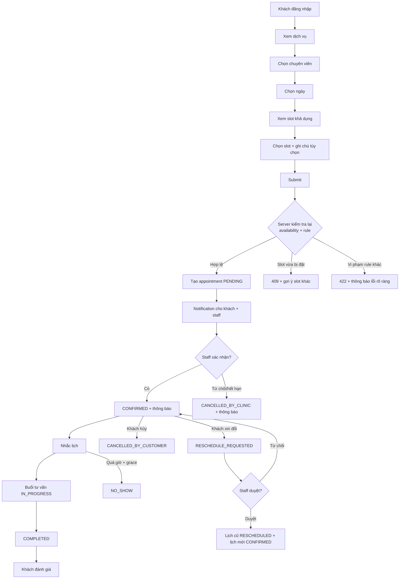
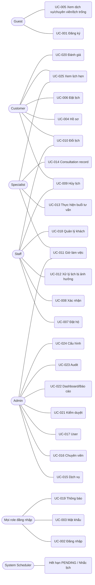
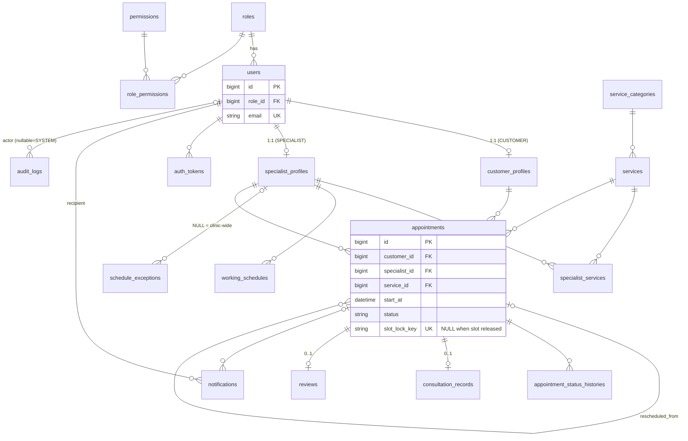

# MASTER-SRS — BA Standardized Edition

> **Project:** Xây dựng ứng dụng đặt lịch tư vấn sức khỏe tinh thần và quản lý phòng khám tâm lý trên nền tảng Web  
> **Status:** DRAFT — chờ review & sign-off  
> **Source:** MASTER-SRS.md do người dùng cung cấp  
> **BA rule:** Không biến ASSUMPTION thành confirmed requirement; giữ OPEN QUESTION/TBD/RECOMMENDATION; Chatbot/AI chỉ FUTURE / NOT MVP.

# MASTER-SRS — Mental Health Consultation Appointment & Clinic Management Web Application (MHCA)

> **Tên đề tài:** Xây dựng ứng dụng đặt lịch tư vấn sức khỏe tinh thần và quản lý phòng khám tâm lý trên nền tảng Web
> **Giai đoạn:** BA/SRS Documentation — **KHÔNG CODE**
> **Nguồn yêu cầu chính (Source of Truth):** `MASTER-BA-PROMPT_Mental-Health-Clinic-Final.md`
> **Chatbot / AI:** ❌ **KHÔNG thuộc MVP** — chỉ ghi nhận tại mục 53 (Future Extension)

**Quy ước nhãn:** `[ASSUMPTION]` giả định chưa xác nhận · `[OPEN QUESTION]` cần người dùng/khách hàng quyết định · `[TBD]` chưa quyết định · `[RECOMMENDATION]` đề xuất của BA · `[MANDATORY]` bắt buộc · `[TARGET]` chỉ tiêu đề xuất, chưa phải SLA · `FUTURE / NOT MVP` ngoài phạm vi MVP.

**Quy ước ID:** BG (Business Goal) · BO (Objective) · BREQ (Business Requirement) · UC · US · FR-`<DOMAIN>`-nnn · BR (Business Rule) · NFR · SCR (màn hình) · API (nhóm endpoint) · TC (Test Case) · AS (Assumption) · OQ (Open Question) · RISK · PB (Product Backlog).

---

## 1. Document Control

| Thuộc tính | Giá trị |
|---|---|
| Tên tài liệu | MASTER-SRS (Software Requirements Specification) |
| Dự án | MHCA — Mental Health Consultation Appointment & Clinic Management Web Application |
| Phiên bản | 0.1 — **DRAFT, chờ review và xác nhận** |
| Ngày lập | 2026-10-05 |
| Người lập | Senior BA / System Analyst (AI-assisted) |
| Trạng thái | Chưa được phê duyệt. **Chỉ sau khi chủ dự án review và xác nhận mới được chuyển sang Coding.** |
| Cấu trúc file | Một file duy nhất (single-file SRS). Các tài liệu con (`docs/*.md`) **chưa tách**; có thể tách sau theo mục 1.3 nếu cần. |
| Ngôn ngữ | Tiếng Việt; thuật ngữ chuyên ngành ghi tiếng Anh trong ngoặc. |
| Múi giờ hệ thống | `[ASSUMPTION]` Asia/Ho_Chi_Minh (UTC+7). Lưu timestamp thống nhất, hiển thị GMT+7. |

### 1.1. Lịch sử phiên bản

| Version | Ngày | Nội dung | Tác giả |
|---|---|---|---|
| 0.1 | 2026-10-05 | Bản nháp đầu tiên đầy đủ 57 mục | BA |

### 1.2. Cách đọc theo vai trò

| Vai trò | Đọc mục |
|---|---|
| Developer | 16, 20-38 (FR theo domain), 39-41, 44, 54 |
| UI/UX Designer | 15-17, 42, 44 |
| Tester | 22, 45-47 |
| Database Designer | 39, 40, 22, 36 |
| AI Coding Agent | **Toàn bộ**, đặc biệt 54, 55 |

### 1.3. Ánh xạ sang tài liệu con (nếu tách file sau này)

`BUSINESS-REQUIREMENTS` (3-14) · `FUNCTIONAL-REQUIREMENTS` (20, 23-35) · `BUSINESS-RULES` (22) · `USE-CASES` (18) · `USER-STORIES` (19) · `DATA-MODEL` (39) · `DATA-DICTIONARY` (40) · `API-SPECIFICATION` (41) · `UI-UX-SPECIFICATION` (42) · `UML` (43, 44) · `TEST-ACCEPTANCE` (45, 46) · `TRACEABILITY-MATRIX` (47) · `PRODUCT-BACKLOG` (48-50) · `RISK-REGISTER` (51) · `ASSUMPTIONS-OPEN-QUESTIONS` (13, 14) · `FUTURE-EXTENSION-CHATBOT` (53).

---

## 2. Executive Summary

MHCA là hệ thống web giúp **một phòng khám tâm lý** (giả định một cơ sở) cho phép **khách hàng tự đặt lịch tư vấn** với chuyên viên, đồng thời giúp **nhân viên, chuyên viên và quản trị viên** quản lý lịch làm việc, lịch hẹn, thông báo, đánh giá và báo cáo.

Trọng tâm nghiệp vụ gồm ba điểm:

1. **Appointment lifecycle** có state machine chặt (mục 28, 44).
2. **Không double booking** — hai lịch hợp lệ không được chiếm cùng thời gian của một chuyên viên, kể cả khi hai request đồng thời (mục 28.3).
3. **Bảo vệ dữ liệu sức khỏe tinh thần** — least privilege, tách *Appointment* (lịch hành chính) với *Consultation Record* (nội dung chuyên môn), audit, không đưa dữ liệu nhạy cảm vào log và email (mục 35-37).

MVP **không phụ thuộc AI trả phí**, **không có chatbot**. Chatbot chỉ là hướng mở rộng tương lai (mục 53), được đảm bảo khả thi nhờ các API nghiệp vụ đã có (dịch vụ, chuyên viên, lịch trống, tạo yêu cầu đặt lịch).

---

## 3. Business Context

- Phòng khám tâm lý cung cấp các buổi **tư vấn 1-1** theo lịch hẹn. `[ASSUMPTION]` hình thức tại phòng khám (ONSITE); tư vấn trực tuyến (video) chưa thuộc MVP — xem OQ-08.
- Dự án mang tính học thuật/sinh viên: phạm vi vừa phải, ưu tiên khả thi, không over-engineering.
- **Không dùng dữ liệu của phòng khám thật.** Mọi số liệu cấu hình (thời lượng, hạn hủy…) là giả định có thể thay đổi qua cấu hình (mục 32.2).
- Công nghệ (Laravel/PHP/MySQL theo Master Prompt mục 50) **không quyết định nghiệp vụ**; SRS này viết ở mức *WHAT/WHY*, không đặc tả code.

---

## 4. Problem Statement

`[ASSUMPTION]` Quy trình hiện tại là thủ công (điện thoại/tin nhắn/sổ hoặc bảng tính).

| Đối tượng | Pain point | Hệ quả |
|---|---|---|
| Khách hàng | Phải liên hệ nhiều lần để biết lịch trống; ngại hỏi vì chủ đề nhạy cảm; không theo dõi được trạng thái lịch | Bỏ cuộc, đặt trễ |
| Chuyên viên | Lịch phân tán, không kiểm soát được ngày nghỉ/giờ làm; thông tin buổi hẹn không tập trung | Quá tải/trống lịch, thiếu chuẩn bị |
| Nhân viên lễ tân/CSKH | Đối chiếu lịch bằng tay, trao đổi qua lại nhiều lần | Chậm, sai sót |
| Quản lý/Admin | Khó thống kê hủy/vắng/hoàn thành, khó giám sát | Thiếu dữ liệu quyết định |
| Hệ thống chung | Nguy cơ **trùng lịch**; khó truy vết lịch sử thay đổi; dữ liệu nhạy cảm lưu rải rác, thiếu kiểm soát truy cập | Rủi ro vận hành và quyền riêng tư |

---

## 5. Business Goals

| ID | Business Goal | Business Benefit |
|---|---|---|
| BG-01 | Giúp khách hàng đặt lịch tư vấn thuận tiện, 24/7, kín đáo | Tăng khả năng tiếp cận, giảm rào cản tâm lý |
| BG-02 | Loại bỏ trùng lịch và kiểm soát chặt lịch làm việc chuyên viên | Giảm sai sót, tăng độ tin cậy |
| BG-03 | Minh bạch vòng đời lịch hẹn và truy vết thay đổi | Giảm tranh chấp, hỗ trợ điều phối |
| BG-04 | Bảo vệ dữ liệu nhạy cảm của khách hàng | Giữ niềm tin, giảm rủi ro rò rỉ |
| BG-05 | Cung cấp số liệu vận hành cơ bản cho quản lý | Hỗ trợ ra quyết định |
| BG-06 | Xây nền tảng nghiệp vụ đủ chắc để mở rộng (chatbot, payment) sau này mà không viết lại lõi | Giảm chi phí mở rộng |

## 6. Business Objectives

| ID | Objective | Goal | Cách đo |
|---|---|---|---|
| BO-01 | Khách hàng có thể hoàn tất đặt lịch trực tuyến không cần gọi điện | BG-01 | Tỷ lệ đặt lịch qua web |
| BO-02 | 0 trường hợp hai lịch hợp lệ chồng thời gian cùng chuyên viên | BG-02 | Số vi phạm BR-005 = 0 |
| BO-03 | Mọi chuyển trạng thái đều có lịch sử (ai, khi nào, lý do) | BG-03 | 100% transition có bản ghi history |
| BO-04 | Nội dung chuyên môn chỉ chuyên viên phụ trách đọc được | BG-04 | Số truy cập trái phép = 0; 100% lần đọc có audit |
| BO-05 | Admin xem được dashboard và báo cáo theo thời gian/trạng thái/chuyên viên/dịch vụ | BG-05 | Báo cáo khớp dữ liệu gốc |
| BO-06 | Các API tra cứu dịch vụ/lịch trống/đặt lịch tái sử dụng được cho kênh khác | BG-06 | API độc lập giao diện |

## 7. Success Metrics

Không gán số liệu thực tế khi chưa có baseline; ô *Target* dùng `[TARGET]`/`[TBD]`.

| KPI | Định nghĩa | Nguồn | Target |
|---|---|---|---|
| Tỷ lệ đặt lịch thành công | Booking tạo thành công / (thành công + bị từ chối do lỗi hệ thống) | appointments, audit | `[TBD]` |
| Tỷ lệ xung đột slot | Số `APPOINTMENT_SLOT_UNAVAILABLE` / tổng lượt submit | audit_logs | theo dõi, không có SLA |
| Tỷ lệ hủy | (CANCELLED_BY_CUSTOMER + CANCELLED_BY_CLINIC) / tổng lịch | appointments | `[TBD]` |
| Tỷ lệ hoàn thành | COMPLETED / (COMPLETED + NO_SHOW + CANCELLED*) | appointments | `[TBD]` |
| Tỷ lệ vắng | NO_SHOW / lịch CONFIRMED đã đến giờ | appointments | `[TBD]` |
| Thời gian xác nhận | confirmed_at − created_at | appointments | `[TARGET]` trong giờ hành chính |
| Khách quay lại | Khách có ≥ 2 lịch COMPLETED | appointments | `[TBD]` |
| Mức độ hài lòng | Trung bình rating (review VISIBLE) | reviews | `[TBD]` |

---

## 8. Stakeholders

| Stakeholder | Vai trò | Nhu cầu | Mức ảnh hưởng |
|---|---|---|---|
| Khách hàng | Người đặt lịch | Tìm dịch vụ, đặt/đổi/hủy lịch, riêng tư | Cao |
| Chuyên viên | Cung cấp dịch vụ | Quản lý giờ làm, xem lịch, ghi nhận buổi tư vấn | Cao |
| Nhân viên lễ tân/CSKH | Điều phối | Xác nhận, xử lý đổi/hủy, hỗ trợ khách | Cao |
| Quản trị viên | Quản trị hệ thống | Quản lý người dùng, danh mục, cấu hình, giám sát | Rất cao |
| Chủ phòng khám/Quản lý | Ra quyết định | Báo cáo, giám sát chất lượng | Cao — `[OPEN QUESTION]` OQ-03: role riêng hay gộp Admin? `[ASSUMPTION]` gộp vào Admin |
| Giảng viên/Hội đồng | Đánh giá đề tài | Tài liệu rõ ràng, khả thi | Cao (đối với dự án) |
| Đội phát triển/AI Coding Agent | Hiện thực hóa | SRS làm Source of Truth | Cao |

---

## 9. AS-IS Process `[ASSUMPTION]`

```text
Khách hàng → Tìm thông tin → Liên hệ phòng khám (điện thoại/tin nhắn)
 → Nhân viên kiểm tra lịch (sổ/bảng tính) → Trao đổi thời gian
 → Ghi nhận lịch → Thông báo thủ công → Buổi tư vấn → Ghi nhận kết quả
```

| Bước | Vấn đề |
|---|---|
| Liên hệ & trao đổi | Phụ thuộc giờ làm việc nhân viên, trao đổi qua lại nhiều lần |
| Kiểm tra lịch | Không thời gian thực, nguy cơ trùng lịch |
| Thông báo | Thủ công, dễ quên nhắc |
| Theo dõi trạng thái | Không có chuẩn trạng thái, khó truy vết |
| Ghi nhận & thống kê | Dữ liệu rải rác, khó báo cáo, khó kiểm soát quyền truy cập |

## 10. TO-BE Process



- **Happy path:** đặt → xác nhận → tư vấn → hoàn thành → đánh giá.
- **Alternative:** hủy, đổi lịch, staff đặt hộ, chuyên viên nghỉ đột xuất → xử lý lịch bị ảnh hưởng.
- **Exception:** slot bị chiếm, vi phạm rule, hết hạn PENDING, vắng mặt, lỗi hệ thống.

---

## 11. Scope (In Scope)

| ID | In Scope | Nhãn |
|---|---|---|
| SCOPE-01 | Authentication, tài khoản, RBAC | MVP |
| SCOPE-02 | Quản lý khách hàng (hồ sơ tối thiểu, consent) | MVP |
| SCOPE-03 | Quản lý chuyên viên (profile công khai/nội bộ, ảnh) | MVP |
| SCOPE-04 | Quản lý dịch vụ & danh mục (CRUD, không hard-code) | MVP |
| SCOPE-05 | Quản lý lịch làm việc, ngày nghỉ, ngoại lệ; sinh slot động | MVP |
| SCOPE-06 | Đặt lịch, xác nhận, đổi lịch, hủy, start/complete/no-show, lịch sử trạng thái | MVP |
| SCOPE-07 | Ngăn double booking (mục 28.3) | MVP |
| SCOPE-08 | Consultation record (mức tối thiểu, phân quyền chặt) | MVP |
| SCOPE-09 | Thông báo in-app; email, nhắc lịch, gửi thủ công | MVP-Should |
| SCOPE-10 | Đánh giá & kiểm duyệt | MVP-Should |
| SCOPE-11 | Dashboard, báo cáo cơ bản, export CSV | Dashboard: MVP-Must; báo cáo/export: MVP-Should |
| SCOPE-12 | Audit log (ghi nhận: Must; màn hình xem: Should) | MVP |
| SCOPE-13 | Bảo mật, quyền riêng tư | MVP |

## 12. Out of Scope

| ID | Out of Scope | Nhãn |
|---|---|---|
| OOS-01 | **Chatbot** (UI, session, message, AI API, LLM, RAG, vector DB, intent engine) | **FUTURE / NOT MVP** |
| OOS-02 | Chẩn đoán tự động, điều trị tự động, AI therapist, AI recommendation | **Không làm** |
| OOS-03 | Ứng dụng mobile native | NOT MVP |
| OOS-04 | Thanh toán online, hoàn tiền (chỉ lưu giá tham khảo) | FUTURE / NOT MVP (OQ-01) |
| OOS-05 | Tư vấn video/online tích hợp | FUTURE / NOT MVP (OQ-08) |
| OOS-06 | Đa chi nhánh, đa ngôn ngữ | FUTURE / NOT MVP |
| OOS-07 | Khách vãng lai không tài khoản; SMS/Zalo | FUTURE / NOT MVP |
| OOS-08 | Hồ sơ bệnh án đầy đủ, kê đơn, test tâm lý, tài liệu đính kèm của khách | NOT MVP |
| OOS-09 | Tích hợp bảo hiểm, kế toán, HIS/EMR bên ngoài | NOT MVP |

---

## 13. Assumptions (Assumption Register)

| ID | Assumption | Lý do | Ảnh hưởng nếu sai |
|---|---|---|---|
| AS-01 | Một phòng khám, một múi giờ Asia/Ho_Chi_Minh | Đơn giản hóa | Thiết kế lại lịch |
| AS-02 | Mỗi appointment gắn **đúng một** specialist và một service | Master BR-003 | Đổi data model |
| AS-03 | Customer **tự chọn** chuyên viên (OQ-02) | Master TO-BE | Cần thuật toán gán |
| AS-04 | Khách đặt online ở trạng thái PENDING, Staff/Admin xác nhận; lịch do Staff đặt hộ vào thẳng CONFIRMED | Master state transition | Đổi luồng |
| AS-05 | Chỉ phục vụ khách **≥ 18 tuổi** (DOB bắt buộc để kiểm tra) | Tránh vấn đề người giám hộ (OQ-04) | Thêm luồng giám hộ |
| AS-06 | Hình thức tư vấn ONSITE | OQ-08 | Thêm mode/link |
| AS-07 | Mỗi user đúng **một role** | Đơn giản RBAC | Cần user_roles |
| AS-08 | Slot grid mặc định 60 phút; buổi 50 phút + buffer 10 phút (khớp ví dụ 09:00-09:50, 10:00-10:50) | Master mục 16 | Chỉnh qua cấu hình |
| AS-09 | Hạn hủy/đổi ≥ 24h; tối đa 2 lần đổi/chuỗi; tối đa 3 lịch active/khách; lead time ≥ 2h; đặt trước tối đa 30 ngày | Chống lạm dụng | Chỉnh qua cấu hình |
| AS-10 | PENDING tự hết hạn sau 24h hoặc khi còn < 2h tới giờ hẹn | Không giữ slot vô hạn | Chỉnh qua cấu hình |
| AS-11 | `no_show_grace_minutes` = 15; cho phép Start sớm 15 phút | Thực tế vận hành | Chỉnh qua cấu hình |
| AS-12 | Review trong 30 ngày sau COMPLETED, 1 review/appointment, không sửa, hiển thị ẩn danh | Master mục 24 | Đổi policy |
| AS-13 | Specialist/Staff/Admin do Admin tạo; không tự đăng ký | An toàn | Thêm luồng duyệt |
| AS-14 | **Admin không đọc được nội dung consultation record** | Master mục 8 (least privilege) | OQ-11 |
| AS-15 | Staff được tạo/xóa **schedule exception** hộ chuyên viên (không sửa working schedule) | Chuyên viên báo nghỉ qua điện thoại | Bỏ quyền này |
| AS-16 | Thông báo in-app là kênh bắt buộc; email là tùy chọn có thể tắt bằng cấu hình | Phụ thuộc SMTP | Không có xác thực email |
| AS-17 | Việc xóa là *soft delete*; chính sách lưu giữ chi tiết `[TBD]` | OQ-10 | Rủi ro pháp lý |
| AS-18 | Giá dịch vụ chỉ để hiển thị, không thanh toán | OOS-04 | Thêm payment |
| AS-19 | Ngôn ngữ giao diện: tiếng Việt | OQ-17 | i18n |
| AS-20 | Có tác vụ định kỳ (scheduler) để hết hạn PENDING và gửi nhắc lịch | Cần hosting hỗ trợ cron | FR-APPT-015, FR-NOTI-004 phải làm thủ công |

## 14. Open Questions (Open Question Register)

| ID | Question | Owner | Priority | Status |
|---|---|---|---|---|
| OQ-01 | Có cần thanh toán online trong MVP không? (mặc định: **không**) | Chủ dự án | Medium | Open |
| OQ-02 | Khách tự chọn chuyên viên hay hệ thống tự gán? Có tùy chọn "bất kỳ chuyên viên"? | Chủ dự án | High | Open |
| OQ-03 | Có role "Quản lý/Chủ phòng khám" riêng khác Admin? | Chủ dự án | Medium | Open |
| OQ-04 | Có nhận khách dưới 18 tuổi (cần người giám hộ/đồng ý)? | Chủ dự án/Pháp lý | **High** | Open |
| OQ-05 | Chính sách hủy/đổi chính thức: hạn, số lần, phí/phạt? | Phòng khám | High | Open |
| OQ-06 | Đặt lịch cần Staff xác nhận hay tự động CONFIRMED? | Phòng khám | High | Open |
| OQ-07 | Có dịch vụ nhiều thời lượng (cặp đôi/gia đình/nhóm)? Một lịch chiếm nhiều slot? | Phòng khám | Medium | Open |
| OQ-08 | Có tư vấn online (video/link)? Nếu có, quản lý link thế nào? | Chủ dự án | High | Open |
| OQ-09 | Khách có được xem tóm tắt/khuyến nghị sau buổi tư vấn? | Phòng khám | Medium | Open |
| OQ-10 | Thời hạn lưu giữ consultation record, audit log; căn cứ pháp lý (ví dụ quy định bảo vệ dữ liệu cá nhân, dữ liệu sức khỏe là dữ liệu nhạy cảm)? | Pháp lý/Phòng khám | **High** | Open |
| OQ-11 | Admin có cần quyền "break-glass" đọc consultation khi có sự cố? Nếu có, quy trình và audit? | Chủ dự án | Medium | Open |
| OQ-12 | Dịch vụ gửi email (SMTP/nhà cung cấp) khả dụng không? | Dev | Medium | Open |
| OQ-13 | Có cần nhắc lịch qua SMS/Zalo? | Phòng khám | Low | Open |
| OQ-14 | Có hỗ trợ khách vãng lai không tài khoản? (hiện: Staff tạo tài khoản hộ) | Phòng khám | Low | Open |
| OQ-15 | Khi chuyên viên nghỉ đột xuất, có cho phép đổi sang chuyên viên khác cho khách? | Phòng khám | Medium | Open |
| OQ-16 | Một hay nhiều cơ sở? | Chủ dự án | Low | Open |
| OQ-17 | Chỉ tiếng Việt? | Chủ dự án | Low | Open |
| OQ-18 | Nội dung cảnh báo an toàn (người đang khủng hoảng cần hỗ trợ khẩn cấp): do phòng khám cung cấp. `[RECOMMENDATION]` hiển thị thông báo tĩnh trên trang chủ và trang đặt lịch (ví dụ "hệ thống đặt lịch không dành cho tình huống khẩn cấp"; khuyến nghị liên hệ cấp cứu địa phương) | Phòng khám | **High** | Open |

---

## 15. Actors

| Actor | Loại | Mô tả | Cách tạo tài khoản |
|---|---|---|---|
| Guest | Primary | Người truy cập chưa đăng nhập: xem dịch vụ/chuyên viên/đánh giá, đăng ký | — |
| Customer | Primary | Người đặt và dùng dịch vụ tư vấn | Tự đăng ký hoặc Staff tạo hộ |
| Specialist | Primary | Chuyên viên tâm lý, cung cấp buổi tư vấn | Admin tạo |
| Staff | Primary | Lễ tân/CSKH điều phối lịch hẹn | Admin tạo |
| Admin | Primary | Quản trị hệ thống và nghiệp vụ (bao gồm vai trò quản lý — AS) | Seed ban đầu + Admin tạo |
| System Scheduler | Supporting (hệ thống) | Hết hạn PENDING, tạo nhắc lịch; ghi `actor = SYSTEM` | — |
| Email Service | Supporting (ngoài) | Gửi email xác thực/nhắc lịch (SHOULD) | — |

## 16. Roles & RBAC

**Nguyên tắc:** deny-by-default · least privilege · kiểm tra quyền ở **server** cho mọi request (UI chỉ ẩn/hiện) · phạm vi dữ liệu (own/assigned/all) kiểm tra riêng với phân quyền chức năng.

Ký hiệu: ✓ được phép · ✓(own) chỉ dữ liệu của mình · ✓(asg) chỉ lịch hẹn được phân công · ✓(+) có điều kiện ghi chú · `-` không được.

| # | Chức năng | Guest | Customer | Specialist | Staff | Admin |
|---|---|:-:|:-:|:-:|:-:|:-:|
| 1 | Xem dịch vụ, chuyên viên, đánh giá công khai | ✓ | ✓ | ✓ | ✓ | ✓ |
| 2 | Đăng ký tài khoản khách hàng | ✓ | - | - | - | - |
| 3 | Đăng nhập / đăng xuất / quên & đổi mật khẩu | ✓ | ✓ | ✓ | ✓ | ✓ |
| 4 | Xem/sửa hồ sơ cá nhân | - | ✓(own) | ✓(own, thông tin tài khoản) | ✓(own) | ✓(own) |
| 5 | Xem danh sách/tìm khách hàng | - | - | - | ✓ | ✓ |
| 6 | Tạo/sửa hồ sơ khách hàng | - | ✓(own) | - | ✓ | ✓ |
| 7 | Khóa/mở khóa/vô hiệu hóa tài khoản | - | - | - | - | ✓ |
| 8 | Quản lý user nội bộ (Staff/Specialist/Admin) | - | - | - | - | ✓ |
| 9 | Quản lý chuyên viên (profile, ảnh, trạng thái, map dịch vụ) | - | - | - | - | ✓ |
| 10 | Quản lý dịch vụ & danh mục | - | - | - | - | ✓ |
| 11 | Xem lịch làm việc của chuyên viên | - | - | ✓(own) | ✓ | ✓ |
| 12 | Quản lý working schedule | - | - | ✓(own) | - | ✓ |
| 13 | Tạo/xóa schedule exception (ngày nghỉ, chặn giờ) | - | - | ✓(own) | ✓(+) AS-15 | ✓ |
| 14 | Khai báo ngày lễ toàn phòng khám | - | - | - | - | ✓ |
| 15 | Xem lịch trống (availability) | ✓ | ✓ | ✓ | ✓ | ✓ |
| 16 | Đặt lịch cho chính mình | - | ✓ | - | - | - |
| 17 | Đặt lịch hộ khách | - | - | - | ✓ | ✓ |
| 18 | Xem lịch hẹn | - | ✓(own) | ✓(asg) | ✓ (tất cả) | ✓ (tất cả) |
| 19 | Sửa ghi chú đặt lịch (customer_note) | - | ✓(own) | - | - | - |
| 20 | Xác nhận / từ chối lịch PENDING | - | - | - | ✓ | ✓ |
| 21 | Hủy lịch của mình (đúng hạn) | - | ✓(own) | - | - | - |
| 22 | Hủy lịch do phòng khám (có lý do) | - | - | - | ✓ | ✓ |
| 23 | Yêu cầu đổi lịch | - | ✓(own) | - | - | - |
| 24 | Duyệt/từ chối yêu cầu đổi lịch; đổi lịch do phòng khám | - | - | - | ✓ | ✓ |
| 25 | Start buổi tư vấn | - | - | ✓(asg) | ✓ | ✓ |
| 26 | Complete buổi tư vấn | - | - | ✓(asg) | - | - |
| 27 | Đánh dấu NO_SHOW | - | - | ✓(asg) | ✓ | ✓ |
| 28 | Xem lịch sử trạng thái lịch hẹn | - | ✓(own) | ✓(asg) | ✓ | ✓ |
| 29 | Ghi/sửa consultation record | - | - | ✓(asg) | - | - |
| 30 | **Đọc nội dung** consultation record | - | - | ✓(asg) | - | - |
| 31 | Xem/đánh dấu đã đọc thông báo của mình | - | ✓ | ✓ | ✓ | ✓ |
| 32 | Gửi thông báo thủ công về lịch hẹn | - | - | - | ✓ | ✓ |
| 33 | Gửi đánh giá | - | ✓(own, lịch COMPLETED) | - | - | - |
| 34 | Ẩn/hiện đánh giá (kiểm duyệt) | - | - | - | - | ✓ |
| 35 | Dashboard theo vai trò | - | ✓ | ✓ | ✓ | ✓ (tổng quan) |
| 36 | Báo cáo & export CSV | - | - | - | - | ✓ |
| 37 | Xem audit log | - | - | - | - | ✓ |
| 38 | Cấu hình hệ thống | - | - | - | - | ✓ |
| 39 | Xem ma trận role-permission (chỉ đọc) | - | - | - | - | ✓ |

**Ghi chú phạm vi dữ liệu (BR-057, BR-058):**

| Dữ liệu | Customer | Specialist | Staff | Admin |
|---|---|---|---|---|
| Thông tin liên hệ khách (họ tên, email, SĐT) | own | họ tên (của lịch được phân công) | ✓ | ✓ |
| Ngày sinh | own | - | - | - `[RECOMMENDATION]` chỉ hiển thị "đủ 18+" |
| `customer_note` (ghi chú khi đặt lịch) | own | ✓(asg) | - | - |
| Consultation record | - | ✓(asg) | - | - |
| License number & ghi chú nội bộ của chuyên viên | - | own | - | ✓ |

---

## 17. Business Process

| BP | Quy trình | Happy path | Alternative | Exception |
|---|---|---|---|---|
| BP-01 | Đặt lịch | Chọn service → specialist → ngày → slot → submit → recheck → PENDING → notification | Staff đặt hộ → CONFIRMED | Slot hết (409), service/specialist inactive, ngoài giờ/ngày nghỉ, trùng lịch của chính khách, vượt giới hạn, submit lặp |
| BP-02 | Xác nhận | Staff mở PENDING → Confirm → CONFIRMED → notify | Staff từ chối kèm lý do → CANCELLED_BY_CLINIC | Lịch đã bị hủy/hết hạn; hai staff thao tác đồng thời (một thành công) |
| BP-03 | Hủy | Khách hủy ≥ 24h → CANCELLED_BY_CUSTOMER → slot giải phóng | Staff hủy hộ/phòng khám hủy (lý do bắt buộc) | Quá hạn hủy; lịch ở trạng thái cuối |
| BP-04 | Đổi lịch | Khách chọn slot mới → RESCHEDULE_REQUESTED (giữ slot mới) → Staff duyệt → cũ RESCHEDULED, mới CONFIRMED | Staff từ chối → CONFIRMED, giải phóng slot mới; phòng khám chủ động đổi | Slot mới bị chiếm; quá số lần/hạn; quá hạn duyệt |
| BP-05 | Thực hiện tư vấn | Start → IN_PROGRESS → ghi record → Complete → COMPLETED → mời đánh giá | Staff Start hộ | Khách vắng → NO_SHOW sau grace; quên Complete `[TBD]` |
| BP-06 | Chuyên viên nghỉ đột xuất | Tạo exception → impact preview → lưu → flag lịch bị ảnh hưởng → Staff xử lý từng lịch (đổi/hủy) | Staff tạo exception hộ | Có lịch IN_PROGRESS tại thời điểm chặn (không bị đụng) |
| BP-07 | Đánh giá | COMPLETED → khách chấm sao + nhận xét → hiển thị ẩn danh | Admin ẩn đánh giá vi phạm | Ngoài hạn, đã có đánh giá, lịch chưa COMPLETED |
| BP-08 | Quản trị danh mục & lịch | Admin CRUD dịch vụ/chuyên viên/user/cấu hình; chuyên viên quản lý giờ làm | — | Xóa đối tượng đang được tham chiếu → chuyển INACTIVE |


---

## 18. Use Case Model

| UC | Use Case | Primary Actor | FR chính |
|---|---|---|---|
| UC-001 | Đăng ký tài khoản | Guest | FR-AUTH-001, 006 |
| UC-002 | Đăng nhập / Đăng xuất | All | FR-AUTH-002, 003 |
| UC-003 | Đặt lại / đổi mật khẩu | All | FR-AUTH-004, 005 |
| UC-004 | Quản lý hồ sơ cá nhân | Customer | FR-CUSTOMER-001 |
| UC-005 | Xem dịch vụ, chuyên viên, lịch trống | Guest/Customer | FR-SERVICE-001, FR-SPECIALIST-002, FR-SCHEDULE-004 |
| UC-006 | Đặt lịch tư vấn | Customer | FR-APPT-001, 003 |
| UC-007 | Đặt lịch hộ khách | Staff | FR-APPT-002, FR-CUSTOMER-002 |
| UC-008 | Xác nhận / từ chối lịch | Staff | FR-APPT-005, 007 |
| UC-009 | Hủy lịch | Customer / Staff | FR-APPT-006, 007 |
| UC-010 | Đổi lịch | Customer / Staff | FR-APPT-008, 009, 010 |
| UC-011 | Quản lý giờ làm việc & ngoại lệ | Specialist / Admin | FR-SCHEDULE-001, 002, 006 |
| UC-012 | Xử lý lịch bị ảnh hưởng khi lịch làm việc thay đổi | Staff / Admin | FR-SCHEDULE-005 |
| UC-013 | Thực hiện buổi tư vấn (Start/Complete/No-show) | Specialist / Staff | FR-APPT-011, 012, 013 |
| UC-014 | Ghi nhận buổi tư vấn | Specialist | FR-CONSULT-001, 002, 003 |
| UC-015 | Quản lý dịch vụ & danh mục | Admin | FR-SERVICE-002, 003 |
| UC-016 | Quản lý chuyên viên | Admin | FR-SPECIALIST-001, 003, 004, 005 |
| UC-017 | Quản lý người dùng & tài khoản | Admin | FR-ADMIN-001, FR-AUTH-007 |
| UC-018 | Quản lý khách hàng | Staff | FR-CUSTOMER-002, 003 |
| UC-019 | Xem & quản lý thông báo | All | FR-NOTI-001…005 |
| UC-020 | Gửi đánh giá | Customer | FR-REVIEW-001, 002 |
| UC-021 | Kiểm duyệt đánh giá | Admin | FR-REVIEW-003 |
| UC-022 | Xem dashboard & báo cáo | Admin / các role | FR-DASH-001, 002, FR-REPORT-001, 002 |
| UC-023 | Xem audit log | Admin | FR-ADMIN-003, FR-SEC-002 |
| UC-024 | Cấu hình hệ thống | Admin | FR-ADMIN-002 |
| UC-025 | Xem lịch hẹn & lịch sử trạng thái | Customer / Specialist / Staff / Admin | FR-APPT-004, 014 |

### 18.1. Use Case Diagram



### 18.2. Đặc tả Use Case

#### UC-001 — Đăng ký tài khoản
- **Goal:** Khách tạo tài khoản để đặt lịch. **Primary:** Guest. **Supporting:** Email Service.
- **Trigger:** Chọn "Đăng ký". **Pre:** Chưa đăng nhập. **Post:** User(CUSTOMER) + customer_profile tạo; consent ghi nhận; (nếu bật xác thực) trạng thái PENDING_VERIFICATION.
- **Main:** 1) Nhập họ tên, email, mật khẩu, ngày sinh, SĐT (tùy chọn). 2) Đồng ý chính sách quyền riêng tư. 3) Hệ thống validate. 4) Tạo tài khoản. 5) Gửi email xác thực / chuyển đăng nhập.
- **Alt:** Xác thực email tắt → ACTIVE ngay.
- **Exc:** Email trùng; mật khẩu yếu; chưa tick consent; dưới 18 tuổi (AS-05); vượt rate limit.
- **BR:** BR-011, 012, 016, 059. **FR:** FR-AUTH-001, 006.

#### UC-002 — Đăng nhập / Đăng xuất
- **Goal:** Truy cập hệ thống an toàn. **Primary:** All roles.
- **Trigger:** Gửi form đăng nhập / chọn đăng xuất. **Pre:** Có tài khoản ACTIVE. **Post:** Session được tạo/hủy; sự kiện bảo mật được audit.
- **Main:** 1) Nhập email + mật khẩu. 2) Xác thực. 3) Tạo session, chuyển về dashboard theo role.
- **Alt:** Chuyển hướng về trang đang truy cập trước đó (nếu hợp lệ nội bộ).
- **Exc:** Sai thông tin (thông báo chung, không lộ email tồn tại); tài khoản LOCKED/DISABLED; khóa tạm sau 5 lần sai.
- **BR:** BR-013, 014, 059. **FR:** FR-AUTH-002, 003.

#### UC-003 — Đặt lại / đổi mật khẩu
- **Goal:** Khôi phục/đổi mật khẩu. **Primary:** All. **Supporting:** Email Service.
- **Main (quên):** 1) Nhập email. 2) Hệ thống luôn trả thông báo chung. 3) Nếu tồn tại: gửi link token một lần, hết hạn. 4) Đặt mật khẩu mới. 5) Hủy mọi session cũ.
- **Main (đổi):** nhập mật khẩu hiện tại + mới.
- **Exc:** Token hết hạn/đã dùng; mật khẩu mới yếu; mật khẩu hiện tại sai.
- **BR:** BR-012, 059. **FR:** FR-AUTH-004, 005.

#### UC-004 — Quản lý hồ sơ cá nhân
- **Primary:** Customer. **Pre:** Đã đăng nhập. **Post:** Hồ sơ được cập nhật, audit nếu đổi email/SĐT.
- **Main:** Xem → sửa họ tên, SĐT, (DOB chỉ nhập một lần, sửa qua Staff `[RECOMMENDATION]`) → lưu.
- **Exc:** Validation lỗi; email đổi trùng.
- **BR:** BR-011, 057. **FR:** FR-CUSTOMER-001.

#### UC-005 — Xem dịch vụ, chuyên viên, lịch trống
- **Primary:** Guest/Customer. **Pre:** không. **Post:** không đổi dữ liệu.
- **Main:** Duyệt dịch vụ ACTIVE → xem chi tiết → xem chuyên viên cung cấp dịch vụ → chọn ngày → xem slot.
- **Alt:** Guest bấm "Đặt lịch" → yêu cầu đăng nhập, quay lại sau đăng nhập.
- **Exc:** Không có slot → hiển thị gợi ý ngày gần nhất có slot.
- **BR:** BR-008, 009, 042. **FR:** FR-SERVICE-001, FR-SPECIALIST-002, FR-SCHEDULE-004.

#### UC-006 — Đặt lịch tư vấn
- **Goal:** Tạo lịch hẹn hợp lệ. **Primary:** Customer. **Supporting:** System.
- **Trigger:** Chọn "Đặt lịch". **Pre:** Customer ACTIVE; service & specialist ACTIVE và có map. **Post:** Appointment PENDING tạo; slot được giữ; history + audit + notification tạo.
- **Main:** 1) Chọn service. 2) Chọn specialist. 3) Chọn ngày. 4) Hệ thống trả slot khả dụng. 5) Chọn slot. 6) Nhập ghi chú (tùy chọn). 7) Xem tóm tắt & submit. 8) Server recheck + giao dịch. 9) Tạo appointment PENDING. 10) Notification. 11) Hiển thị xác nhận (mã lịch).
- **Alt:** Slot vừa hết khi submit → 409, UI tải lại slot + gợi ý. Submit lặp → trả lại kết quả cũ (idempotent).
- **Exc:** Service/specialist inactive; ngoài giờ/ngày nghỉ/ngoài cửa sổ đặt; trùng lịch chính khách; vượt số lịch active; chưa xác thực email (nếu bật); lỗi hệ thống.
- **BR:** BR-001…005, 008, 009, 019…027. **FR:** FR-APPT-001, 003.

#### UC-007 — Đặt lịch hộ khách
- **Primary:** Staff/Admin. **Pre:** Khách có hồ sơ (hoặc tạo mới). **Post:** Appointment CONFIRMED; notification cho khách.
- **Main:** Tìm/tạo khách → chọn service/specialist/slot → submit → recheck → tạo CONFIRMED (source=STAFF).
- **Exc:** như UC-006; khách chưa có email (không gửi email, vẫn in-app khi có tài khoản).
- **BR:** BR-005, 019…025. **FR:** FR-APPT-002, FR-CUSTOMER-002.

#### UC-008 — Xác nhận / từ chối lịch
- **Primary:** Staff/Admin. **Pre:** Appointment PENDING. **Post:** CONFIRMED hoặc CANCELLED_BY_CLINIC; history + notification.
- **Main:** Mở hàng đợi PENDING → xem chi tiết (không có customer_note) → Confirm. **Alt:** Reject kèm lý do bắt buộc.
- **Exc:** Lịch đã đổi trạng thái (409); specialist trở thành INACTIVE/nghỉ → cảnh báo trước khi xác nhận.
- **BR:** BR-007, 029, 034, 038, 039. **FR:** FR-APPT-005, 007.

#### UC-009 — Hủy lịch
- **Primary:** Customer; **Alt actor:** Staff/Admin. **Pre:** Lịch PENDING/CONFIRMED/RESCHEDULE_REQUESTED. **Post:** CANCELLED_BY_*; slot giải phóng.
- **Main (khách):** Mở chi tiết → Hủy → xác nhận → (lý do tùy chọn) → hệ thống kiểm tra hạn → hủy.
- **Alt:** Quá hạn → hướng dẫn liên hệ phòng khám; Staff hủy hộ (lý do bắt buộc).
- **Exc:** Lịch đã ở trạng thái cuối (409).
- **BR:** BR-027, 028, 029, 034. **FR:** FR-APPT-006, 007.

#### UC-010 — Đổi lịch
- **Primary:** Customer (yêu cầu); Staff/Admin (duyệt/chủ động). **Pre:** Lịch CONFIRMED, còn ≥ 24h, chưa vượt số lần đổi. **Post:** Cũ RESCHEDULED + mới CONFIRMED (liên kết) hoặc quay về CONFIRMED.
- **Main:** Khách chọn slot mới (cùng service/specialist) → RESCHEDULE_REQUESTED, slot mới được giữ → Staff duyệt → tạo lịch mới + notify.
- **Alt:** Staff từ chối → CONFIRMED, giải phóng slot mới. Khách rút yêu cầu.
- **Exc:** Slot mới bị chiếm (409); quá hạn/quá lần đổi.
- **BR:** BR-030…034, 060. **FR:** FR-APPT-008, 009, 010.

#### UC-011 — Quản lý giờ làm việc & ngoại lệ
- **Primary:** Specialist (own)/Admin; Staff (chỉ exception). **Post:** Lịch/exception lưu; slot tính lại; audit.
- **Main:** Khai báo thứ/giờ/break → lưu; tạo ngày nghỉ/chặn giờ/ngày lễ → hệ thống hiển thị **impact preview** → xác nhận.
- **Exc:** Khung giờ chồng nhau; giờ kết thúc ≤ bắt đầu; break ngoài khung.
- **BR:** BR-040…045. **FR:** FR-SCHEDULE-001, 002, 006.

#### UC-012 — Xử lý lịch bị ảnh hưởng
- **Primary:** Staff/Admin. **Pre:** Có lịch `needs_attention`. **Post:** Mỗi lịch được đổi hoặc hủy; cờ được xóa.
- **Main:** Mở danh sách bị ảnh hưởng → với từng lịch: đổi sang slot khác (chuyên viên đó/khác nếu khách đồng ý — OQ-15) hoặc hủy do phòng khám (lý do) → notify khách.
- **BR:** BR-034, 044, 045, 056. **FR:** FR-SCHEDULE-005.

#### UC-013 — Thực hiện buổi tư vấn
- **Primary:** Specialist (asg); Staff/Admin hỗ trợ Start/No-show. **Pre:** CONFIRMED, trong thời gian cho phép. **Post:** IN_PROGRESS → COMPLETED hoặc NO_SHOW.
- **Main:** Start (từ −15' đến hết giờ) → tiến hành → Complete.
- **Alt:** Khách không đến → NO_SHOW sau grace 15'.
- **Exc:** Start quá sớm; Complete khi chưa Start; NO_SHOW trước grace.
- **BR:** BR-035, 036, 038, 039. **FR:** FR-APPT-011, 012, 013.

#### UC-014 — Ghi nhận buổi tư vấn
- **Primary:** Specialist (asg). **Pre:** Appointment IN_PROGRESS/COMPLETED thuộc mình. **Post:** Record lưu (mã hóa), audit.
- **Main:** Mở record → nhập tóm tắt, kế hoạch theo dõi → lưu. Mọi lần đọc/ghi được audit.
- **Exc:** Specialist khác/Staff/Admin/Customer → 403; lịch chưa Start.
- **BR:** BR-048, 049, 053. **FR:** FR-CONSULT-001…003.

#### UC-015 — Quản lý dịch vụ & danh mục
- **Primary:** Admin. **Main:** CRUD category/service (tên, mô tả, thời lượng, giá, trạng thái, thứ tự). **Alt:** Đổi INACTIVE thay vì xóa. **Exc:** Xóa bản ghi đang được tham chiếu; thời lượng ngoài khoảng.
- **BR:** BR-008, 055. **FR:** FR-SERVICE-002, 003.

#### UC-016 — Quản lý chuyên viên
- **Primary:** Admin. **Main:** Tạo tài khoản + profile chuyên viên → tải ảnh → map dịch vụ → kích hoạt. **Alt:** INACTIVE → chặn đặt mới, gắn cờ lịch hiện có. **Exc:** Ảnh sai định dạng/dung lượng.
- **BR:** BR-009, 022, 056. **FR:** FR-SPECIALIST-001, 003, 004, 005.

#### UC-017 — Quản lý người dùng & tài khoản
- **Primary:** Admin. **Main:** Tạo Staff/Specialist/Admin; đổi role; khóa/mở khóa/vô hiệu hóa; kích hoạt đặt lại mật khẩu. **Exc:** Tự vô hiệu hóa/hạ quyền; Admin cuối cùng.
- **BR:** BR-015, 017, 018. **FR:** FR-ADMIN-001, FR-AUTH-007.

#### UC-018 — Quản lý khách hàng
- **Primary:** Staff. **Main:** Tìm (tên/email/SĐT/mã) → xem → tạo/sửa thông tin liên hệ. **Exc:** Email trùng. Staff **không** thấy consultation record/customer_note.
- **BR:** BR-050, 057, 058. **FR:** FR-CUSTOMER-002, 003.

#### UC-019 — Xem & quản lý thông báo
- **Primary:** All. **Main:** Mở chuông thông báo → danh sách phân trang → đánh dấu đã đọc/tất cả. **Alt:** Staff/Admin gửi thông báo thủ công về một lịch.
- **BR:** BR-051, 052. **FR:** FR-NOTI-001…005.

#### UC-020 — Gửi đánh giá
- **Primary:** Customer. **Pre:** Lịch COMPLETED của mình, trong 30 ngày, chưa có đánh giá. **Main:** Chọn 1-5 sao + nhận xét tùy chọn → gửi.
- **Exc:** Lịch chưa COMPLETED; đã đánh giá; hết hạn.
- **BR:** BR-006, 046, 047. **FR:** FR-REVIEW-001, 002.

#### UC-021 — Kiểm duyệt đánh giá
- **Primary:** Admin. **Main:** Xem danh sách → ẩn (lý do) / hiện lại. Không sửa nội dung.
- **BR:** BR-047, 010. **FR:** FR-REVIEW-003.

#### UC-022 — Xem dashboard & báo cáo
- **Primary:** Admin (tổng quan, báo cáo); Customer/Specialist/Staff (dashboard theo vai trò). **Main:** Chọn khoảng thời gian → xem số liệu/biểu đồ → (SHOULD) export CSV.
- **Exc:** Không có dữ liệu → empty state. **BR:** BR-053, 057. **FR:** FR-DASH-001, 002, FR-REPORT-001, 002.

#### UC-023 — Xem audit log
- **Primary:** Admin. **Main:** Lọc theo actor/hành động/entity/thời gian. Log chỉ đọc. **BR:** BR-010, 053. **FR:** FR-ADMIN-003, FR-SEC-002.

#### UC-024 — Cấu hình hệ thống
- **Primary:** Admin. **Main:** Sửa tham số (mục 32.2) → validate → lưu → áp dụng cho yêu cầu **mới** (không đổi hồi tố). Thay đổi được audit. **BR:** BR-010. **FR:** FR-ADMIN-002.

#### UC-025 — Xem lịch hẹn & lịch sử trạng thái
- **Primary:** Customer (own), Specialist (asg), Staff/Admin (all). **Main:** Danh sách lọc theo trạng thái/ngày → chi tiết → lịch sử trạng thái.
- **Exc:** Truy cập lịch không thuộc quyền → 403/404 (không tiết lộ tồn tại). **BR:** BR-038, 057, 058. **FR:** FR-APPT-004, 014.

---

## 19. User Stories

Giá trị Priority: **Must** · **Should** · **Could**. Won't-have xem mục 49.

| US | As a | I want | So that | Pri | Acceptance Criteria (Given/When/Then) | FR |
|---|---|---|---|---|---|---|
| US-001 | Guest | đăng ký tài khoản | tôi đặt lịch được | Must | Given email chưa dùng và mật khẩu hợp lệ, When tôi đồng ý chính sách và gửi form, Then tài khoản được tạo | FR-AUTH-001 |
| US-002 | User | đăng nhập/đăng xuất | truy cập an toàn | Must | Given tài khoản ACTIVE, When nhập đúng thông tin, Then vào dashboard đúng role | FR-AUTH-002, 003 |
| US-003 | User | đặt lại mật khẩu | lấy lại quyền truy cập | Must | Given token còn hạn, When đặt mật khẩu mới hợp lệ, Then token vô hiệu và mọi session cũ bị hủy | FR-AUTH-004, 005 |
| US-004 | Customer | cập nhật hồ sơ | thông tin liên hệ chính xác | Must | Given đã đăng nhập, When sửa SĐT hợp lệ, Then lưu thành công | FR-CUSTOMER-001 |
| US-005 | Guest/Customer | xem danh sách dịch vụ | chọn dịch vụ phù hợp | Must | Given có dịch vụ ACTIVE, When mở trang, Then chỉ thấy dịch vụ ACTIVE theo thứ tự hiển thị | FR-SERVICE-001 |
| US-006 | Guest/Customer | xem chuyên viên | chọn người phù hợp | Must | Given chuyên viên ACTIVE, When xem chi tiết, Then thấy thông tin công khai, không thấy dữ liệu nội bộ | FR-SPECIALIST-002 |
| US-007 | Customer | xem slot trống | chọn thời gian thích hợp | Must | Given ngày/chuyên viên/dịch vụ hợp lệ, When yêu cầu, Then trả danh sách slot khả dụng đã loại slot bị chiếm | FR-SCHEDULE-004 |
| US-008 | Customer | đặt lịch | được tư vấn đúng thời gian | Must | Given slot còn trống, When xác nhận, Then tạo appointment PENDING; Given slot vừa bị đặt, Then báo conflict và gợi ý slot khác | FR-APPT-001, 003 |
| US-009 | Customer | xem lịch của tôi | theo dõi trạng thái | Must | Given tôi có lịch, When mở danh sách, Then chỉ thấy lịch của tôi | FR-APPT-004 |
| US-010 | Customer | hủy lịch | giải phóng khi không đến được | Must | Given còn ≥ 24h, When hủy, Then CANCELLED_BY_CUSTOMER và slot giải phóng | FR-APPT-006 |
| US-011 | Customer | xin đổi lịch | chuyển sang giờ khác | Must | Given lịch CONFIRMED còn hạn, When chọn slot mới, Then RESCHEDULE_REQUESTED và slot mới được giữ | FR-APPT-008 |
| US-012 | Customer | nhận thông báo in-app | biết thay đổi lịch | Must | Given lịch đổi trạng thái, When sự kiện xảy ra, Then tôi nhận thông báo | FR-NOTI-001, 002 |
| US-013 | Customer | nhận nhắc lịch | không quên | Should | Given lịch CONFIRMED, When còn đúng khoảng nhắc, Then nhận đúng 1 nhắc | FR-NOTI-004 |
| US-014 | Customer | đánh giá buổi tư vấn | góp ý chất lượng | Should | Given lịch COMPLETED trong hạn, When gửi 1-5 sao, Then lưu một đánh giá | FR-REVIEW-001 |
| US-015 | Staff | tạo/sửa hồ sơ khách | hỗ trợ khách gọi điện | Must | Given email chưa dùng, When tạo hồ sơ, Then khách có tài khoản | FR-CUSTOMER-002, 003 |
| US-016 | Staff | đặt lịch hộ | phục vụ khách không dùng web | Must | Given slot trống, When tạo lịch hộ, Then appointment CONFIRMED | FR-APPT-002 |
| US-017 | Staff | xác nhận/từ chối lịch | điều phối vận hành | Must | Given lịch PENDING, When Confirm, Then CONFIRMED và khách được thông báo | FR-APPT-005, 007 |
| US-018 | Staff | xử lý yêu cầu đổi lịch | khách có lịch phù hợp | Must | Given RESCHEDULE_REQUESTED, When duyệt, Then lịch cũ RESCHEDULED và lịch mới CONFIRMED | FR-APPT-009 |
| US-019 | Staff | hủy/đổi lịch do phòng khám | xử lý sự cố | Must | Given lịch CONFIRMED, When hủy kèm lý do, Then CANCELLED_BY_CLINIC | FR-APPT-007, 010 |
| US-020 | Staff | thấy lịch bị ảnh hưởng khi chuyên viên nghỉ | không bỏ sót khách | Must | Given exception mới, When lưu, Then lịch trùng bị gắn cờ và hiện trong danh sách xử lý | FR-SCHEDULE-005 |
| US-021 | Staff | tạo ngày nghỉ hộ chuyên viên | xử lý nghỉ đột xuất | Should | Given chuyên viên báo nghỉ, When tạo exception, Then slot bị chặn ngay | FR-SCHEDULE-002 |
| US-022 | Staff | gửi thông báo thủ công | liên hệ khách về lịch | Should | Given một lịch, When gửi, Then khách nhận thông báo và hành động được audit | FR-NOTI-005 |
| US-023 | Specialist | quản lý giờ làm việc | khách đặt đúng khung giờ tôi nhận | Must | Given lịch hợp lệ, When lưu, Then slot sinh theo lịch mới | FR-SCHEDULE-001 |
| US-024 | Specialist | khai báo ngày nghỉ/chặn giờ | tránh bị đặt lịch | Must | Given có lịch bị ảnh hưởng, When lưu, Then thấy preview trước khi xác nhận | FR-SCHEDULE-002 |
| US-025 | Specialist | xem lịch được phân công | chuẩn bị buổi hẹn | Must | Given tôi là specialist, When mở lịch, Then chỉ thấy lịch của tôi | FR-APPT-004 |
| US-026 | Specialist | bắt đầu/hoàn thành buổi | cập nhật trạng thái chính xác | Must | Given CONFIRMED trong thời gian cho phép, When Start rồi Complete, Then COMPLETED | FR-APPT-011, 012 |
| US-027 | Specialist | đánh dấu vắng mặt | ghi nhận khách không đến | Must | Given quá giờ + grace, When đánh dấu, Then NO_SHOW | FR-APPT-013 |
| US-028 | Specialist | ghi nhận buổi tư vấn | lưu nội dung chuyên môn an toàn | Must | Given lịch của tôi, When lưu record, Then chỉ tôi đọc được và có audit | FR-CONSULT-001…003 |
| US-029 | Admin | quản lý dịch vụ & danh mục | cập nhật danh mục không sửa code | Must | Given dịch vụ, When đổi INACTIVE, Then không thể đặt mới | FR-SERVICE-002, 003 |
| US-030 | Admin | quản lý chuyên viên | kiểm soát đội ngũ | Must | Given chuyên viên, When INACTIVE, Then không nhận lịch mới | FR-SPECIALIST-001, 003, 004, 005 |
| US-031 | Admin | quản lý tài khoản & vai trò | phân quyền đúng | Must | Given user, When khóa, Then không đăng nhập được | FR-ADMIN-001, FR-AUTH-007 |
| US-032 | Admin | cấu hình tham số | điều chỉnh policy không code | Must | Given cấu hình hợp lệ, When lưu, Then áp dụng cho yêu cầu mới và có audit | FR-ADMIN-002 |
| US-033 | Admin | xem dashboard | nắm tình hình hằng ngày | Must | Given dữ liệu, When mở dashboard, Then số liệu khớp dữ liệu gốc | FR-DASH-001 |
| US-034 | Admin | xem báo cáo | đánh giá vận hành | Should | Given khoảng thời gian, When lọc, Then thấy báo cáo theo trạng thái/chuyên viên/dịch vụ | FR-REPORT-001 |
| US-035 | Admin | kiểm duyệt đánh giá | ẩn nội dung vi phạm | Should | Given đánh giá, When ẩn kèm lý do, Then không hiển thị công khai | FR-REVIEW-003 |
| US-036 | Admin | xem audit log | truy vết thay đổi | Should | Given thao tác quan trọng, When lọc, Then thấy bản ghi đầy đủ | FR-ADMIN-003 |
| US-037 | Admin | khai báo ngày lễ toàn phòng khám | chặn đặt lịch ngày nghỉ | Must | Given ngày lễ, When lưu, Then mọi chuyên viên không có slot ngày đó | FR-SCHEDULE-006 |
| US-038 | Customer | xem lịch sử trạng thái | hiểu điều gì đã xảy ra với lịch | Should | Given lịch của tôi, When mở chi tiết, Then thấy các lần đổi trạng thái | FR-APPT-014 |
| US-039 | Admin | export báo cáo CSV | phân tích ngoài hệ thống | Should | Given báo cáo, When export, Then file không chứa dữ liệu cá nhân nhạy cảm | FR-REPORT-002 |
| US-040 | Customer | xác thực email | bảo vệ tài khoản và nhận thông báo | Should | Given link hợp lệ, When bấm, Then tài khoản ACTIVE | FR-AUTH-006 |

---

## 20. Functional Requirements — Tổng quan

Mỗi FR có ID dạng `FR-<DOMAIN>-nnn` và **thẻ FR** đầy đủ: Name · Description · Priority · Actor · Preconditions · Trigger · Input · Validation · Main/Alternative/Exception Flow · Business Rules · Output · Permission · Acceptance Criteria · Related (UC · US · Entity · API · UI · Test). Chi tiết nằm trong các mục domain:

| Domain | Dải FR | Mục | Số FR |
|---|---|---|---|
| Authentication | FR-AUTH-001…007 | 23 | 7 |
| Customer | FR-CUSTOMER-001…003 | 24 | 3 |
| Specialist | FR-SPECIALIST-001…005 | 25 | 5 |
| Service | FR-SERVICE-001…003 | 26 | 3 |
| Schedule | FR-SCHEDULE-001…006 | 27 | 6 |
| Appointment | FR-APPT-001…015 | 28 | 15 |
| Consultation | FR-CONSULT-001…003 | 29 | 3 |
| Notification | FR-NOTI-001…005 | 30 | 5 |
| Review | FR-REVIEW-001…003 | 31 | 3 |
| Admin | FR-ADMIN-001…003 | 32 | 3 |
| Dashboard | FR-DASH-001…002 | 33 | 2 |
| Reporting | FR-REPORT-001…002 | 34 | 2 |
| Security | FR-SEC-001…005 | 35 | 5 |

**Quy ước chung cho mọi FR:**
- Mọi request đã xác thực đều qua kiểm tra quyền server-side (FR-SEC-001); lỗi theo chuẩn mục 41.2.
- Mọi hành động thay đổi dữ liệu quan trọng ghi audit (FR-SEC-002).
- Mọi chuyển trạng thái appointment ghi history (BR-038) trong **cùng giao dịch** với thay đổi trạng thái.
- Notification được tạo cho sự kiện theo ma trận mục 30.2.
- Mã test (TC) tương ứng xem mục 46; AC trong thẻ FR là tiêu chí nghiệm thu chính.

---

## 21. Non-Functional Requirements

`[MANDATORY]` = bắt buộc. `[TARGET]` = chỉ tiêu đề xuất, chưa có SLA chính thức.

| ID | Nhóm | Yêu cầu | Nhãn |
|---|---|---|---|
| NFR-SEC-001 | Security | Mật khẩu lưu bằng băm một chiều có salt (ví dụ bcrypt/Argon2); không lưu/ghi log mật khẩu dạng rõ | [MANDATORY] |
| NFR-SEC-002 | Security | Mọi chức năng/API yêu cầu xác thực (trừ danh sách công khai) và kiểm tra quyền server-side, deny-by-default | [MANDATORY] |
| NFR-SEC-003 | Security | Bảo vệ CSRF cho thao tác thay đổi dữ liệu qua web session | [MANDATORY] |
| NFR-SEC-004 | Security | Chống XSS (escape đầu ra, không render HTML từ người dùng), chống SQL injection (truy vấn tham số hóa) | [MANDATORY] |
| NFR-SEC-005 | Security | Session cookie `HttpOnly`, `Secure` (HTTPS), `SameSite`; hủy session khi đổi/đặt lại mật khẩu; idle timeout: nhân sự nội bộ 30 phút, khách hàng 120 phút | [MANDATORY] cookie; [TARGET] timeout |
| NFR-SEC-006 | Security | Rate limiting: đăng nhập, quên mật khẩu, đăng ký, đặt lịch; khóa tạm theo BR-013 | [MANDATORY] |
| NFR-SEC-007 | Security | Toàn bộ truyền tải qua HTTPS khi triển khai thực tế | [MANDATORY] |
| NFR-PRV-001 | Privacy | Nội dung consultation record (và `customer_note`) được **mã hóa ở mức trường** khi lưu | [MANDATORY] |
| NFR-PRV-002 | Privacy | Không ghi dữ liệu nhạy cảm (mật khẩu, token, customer_note, consultation, nội dung đánh giá nếu chứa PII) vào application log/audit log | [MANDATORY] |
| NFR-PRV-003 | Privacy | Data minimization: chỉ thu thập trường phục vụ nghiệp vụ (không thu giới tính, địa chỉ, liên hệ khẩn cấp ở MVP) | [MANDATORY] |
| NFR-PRV-004 | Privacy | Chính sách lưu giữ & xóa/ẩn danh dữ liệu | [TBD] OQ-10 |
| NFR-PRV-005 | Privacy | Ghi nhận consent (phiên bản chính sách + thời điểm) | [MANDATORY] |
| NFR-PERF-001 | Performance | Trang công khai và API tra cứu phản hồi trong thời gian hợp lý với dữ liệu quy mô một phòng khám | [TARGET] p95 ≤ 2 giây |
| NFR-PERF-002 | Performance | API availability tính slot không vượt quá một truy vấn lịch + một truy vấn appointment cho mỗi (chuyên viên, khoảng ngày) | [TARGET] |
| NFR-PERF-003 | Performance | Mọi danh sách có phân trang (mặc định 20, tối đa 100); index cho khóa ngoại và trường lọc (status, start_at, specialist_id, customer_id) | [MANDATORY] |
| NFR-AVL-001 | Availability | Khi email/scheduler lỗi, luồng chính (đặt lịch, in-app) vẫn hoạt động; lỗi gửi được ghi nhận để thử lại | [MANDATORY] |
| NFR-AVL-002 | Availability | Độ khả dụng mục tiêu giờ hành chính | [TARGET] `[TBD]` |
| NFR-SCL-001 | Scalability | Kiến trúc cho phép thêm kênh (chatbot, mobile) qua cùng API nghiệp vụ mà không đổi domain | [TARGET] |
| NFR-MNT-001 | Maintainability | Module hóa theo domain (Auth, Customer, Specialist, Service, Schedule, Appointment, Consultation, Notification, Review, Admin, Report, Audit); tách logic nghiệp vụ khỏi tầng trình bày | [MANDATORY] |
| NFR-MNT-002 | Maintainability | Tham số policy lấy từ `system_settings`, không hard-code; danh sách dịch vụ không hard-code | [MANDATORY] |
| NFR-USA-001 | Usability | Responsive, dùng được trên di động; form rõ ràng; thông báo lỗi dễ hiểu bằng tiếng Việt | [MANDATORY] |
| NFR-USA-002 | Usability | Có hộp xác nhận trước thao tác không thể hoàn tác (hủy lịch, ẩn đánh giá, vô hiệu hóa tài khoản) | [MANDATORY] |
| NFR-USA-003 | Usability | Hiển thị thông báo an toàn không dành cho tình huống khẩn cấp ở trang chủ và trang đặt lịch (nội dung do phòng khám xác nhận) | [RECOMMENDATION] OQ-18 |
| NFR-ACC-001 | Accessibility | Mức phù hợp: tương phản đủ, nhãn form, điều hướng bàn phím, văn bản thay thế ảnh | [TARGET] |
| NFR-LOG-001 | Logging | Log lỗi hệ thống kèm correlation id, không chứa dữ liệu nhạy cảm | [MANDATORY] |
| NFR-BKP-001 | Backup | Sao lưu cơ sở dữ liệu định kỳ; tần suất `[TBD]`; bản sao lưu được bảo vệ như dữ liệu gốc | [TARGET] |
| NFR-RCV-001 | Recovery | Quy trình khôi phục được thử ít nhất một lần trước khi vận hành | [TARGET] |
| NFR-ERR-001 | Error handling | Mọi lỗi trả về theo chuẩn mã lỗi (mục 41.2); không lộ stack trace/chi tiết hệ thống cho người dùng | [MANDATORY] |
| NFR-TIME-001 | Data | Mọi so sánh thời gian dùng một múi giờ thống nhất (AS-01) | [MANDATORY] |

---

## 22. Business Rules (Catalog)

| ID | Business Rule | Nhóm | FR liên quan |
|---|---|---|---|
| BR-001 | Một appointment thuộc về đúng một customer | Appointment | APPT-001, 002 |
| BR-002 | Một appointment thuộc về đúng một service | Appointment | APPT-001, 002 |
| BR-003 | Một appointment phải có đúng một specialist (MVP: mọi dịch vụ đều cần chuyên viên) | Appointment | APPT-001, 002 |
| BR-004 | Không cho phép đặt appointment vào slot không khả dụng (theo BR-042) | Booking | APPT-001, 002, 003 |
| BR-005 | **Không double booking:** hai appointment ở trạng thái giữ slot không được chồng thời gian (xét theo BR-043) của cùng một chuyên viên | Booking | APPT-003 |
| BR-006 | Chỉ appointment COMPLETED mới được đánh giá | Review | REVIEW-001 |
| BR-007 | Trạng thái cuối (COMPLETED, CANCELLED_BY_CUSTOMER, CANCELLED_BY_CLINIC, RESCHEDULED, NO_SHOW) không được chuyển tiếp; đặc biệt CANCELLED không thể thành COMPLETED | State | APPT-* |
| BR-008 | Service INACTIVE không thể được đặt mới | Service | APPT-001, SERVICE-002 |
| BR-009 | Specialist INACTIVE không nhận appointment mới | Specialist | APPT-001, SPECIALIST-003 |
| BR-010 | Mọi thay đổi quan trọng phải được audit (mục 37) | Audit | SEC-002 |
| BR-011 | Email là định danh đăng nhập, duy nhất (không phân biệt hoa/thường) | Account | AUTH-001, CUSTOMER-001 |
| BR-012 | Mật khẩu ≥ 8 ký tự, có chữ hoa, chữ thường và chữ số; lưu dạng băm | Account | AUTH-001, 004, 005 |
| BR-013 | 5 lần đăng nhập sai liên tiếp → khóa tạm 15 phút (cấu hình được); đăng nhập đúng thì reset bộ đếm | Account | AUTH-002 |
| BR-014 | Chỉ tài khoản ACTIVE mới đăng nhập và đặt lịch; LOCKED/DISABLED bị chặn; PENDING_VERIFICATION chỉ xác thực email | Account | AUTH-002, 007 |
| BR-015 | Specialist/Staff/Admin do Admin tạo; không tự đăng ký | Account | ADMIN-001 |
| BR-016 | Customer phải đồng ý chính sách quyền riêng tư khi đăng ký; lưu phiên bản và thời điểm; (AS-05) khách phải ≥ 18 tuổi | Privacy | AUTH-001 |
| BR-017 | Mỗi user có đúng một role | RBAC | ADMIN-001 |
| BR-018 | Admin không được tự vô hiệu hóa/hạ quyền chính mình; hệ thống luôn còn ≥ 1 Admin ACTIVE | RBAC | ADMIN-001, AUTH-007 |
| BR-019 | Giờ bắt đầu phải ≥ now + `min_booking_lead_hours` (2h) và ≤ now + `max_advance_booking_days` (30 ngày) | Booking | APPT-001, 002 |
| BR-020 | Một customer không có hai appointment giữ slot chồng thời gian (bất kể chuyên viên) | Booking | APPT-001, 002 |
| BR-021 | Một customer có tối đa `max_active_appointments` (3) appointment tương lai đang giữ slot | Booking | APPT-001 |
| BR-022 | Chỉ đặt service với specialist đã được map cho service đó | Booking | APPT-001, SPECIALIST-004 |
| BR-023 | Trạng thái khởi tạo: PENDING nếu do Customer đặt; CONFIRMED nếu do Staff/Admin đặt hộ (AS-04) | Booking | APPT-001, 002 |
| BR-024 | Idempotency: request đặt lịch lặp (cùng khóa idempotency hoặc cùng customer+specialist+start_at trong 60 giây) chỉ tạo tối đa một appointment | Booking | APPT-001, 003 |
| BR-025 | Appointment lưu snapshot `duration_minutes`, `buffer_minutes`, `price` tại thời điểm đặt; thay đổi service sau đó không ảnh hưởng lịch đã có | Booking | APPT-001 |
| BR-026 | **Trạng thái giữ slot:** PENDING, CONFIRMED, RESCHEDULE_REQUESTED, IN_PROGRESS | State/Slot | APPT-003 |
| BR-027 | Khi appointment rời khỏi nhóm giữ slot (CANCELLED_*, RESCHEDULED, NO_SHOW, COMPLETED) slot được giải phóng và, nếu vẫn nằm trong lịch làm việc ở tương lai, trở lại khả dụng | Slot | APPT-006…013 |
| BR-028 | Customer chỉ tự hủy khi còn ≥ `cancellation_deadline_hours` (24h) trước giờ bắt đầu; muộn hơn phải liên hệ Staff | Cancel | APPT-006 |
| BR-029 | Hủy do phòng khám/từ chối bắt buộc có lý do (≤ 500 ký tự); khách hủy lý do tùy chọn | Cancel | APPT-006, 007 |
| BR-030 | Chỉ đổi lịch với appointment CONFIRMED, còn ≥ 24h, `reschedule_count` < `max_reschedule_count` (2) | Reschedule | APPT-008 |
| BR-031 | Khi có yêu cầu đổi lịch, slot cũ vẫn giữ và slot mới cũng được giữ trong lúc chờ duyệt | Reschedule | APPT-008 |
| BR-032 | Duyệt đổi lịch: appointment cũ → RESCHEDULED (giải phóng), tạo appointment mới CONFIRMED liên kết `rescheduled_from_id`, `reschedule_count` + 1 | Reschedule | APPT-009 |
| BR-033 | Từ chối/rút/hết hạn yêu cầu đổi lịch: appointment về CONFIRMED, slot mới được giải phóng | Reschedule | APPT-009 |
| BR-034 | Hủy/đổi lịch do phòng khám phải có lý do và gửi thông báo cho khách | Cancel/Resch. | APPT-007, 010 |
| BR-035 | Start chỉ từ CONFIRMED trong khoảng [start_at − `start_early_minutes`, end_at]; Complete chỉ từ IN_PROGRESS | Execution | APPT-011, 012 |
| BR-036 | NO_SHOW chỉ đánh dấu từ CONFIRMED sau start_at + `no_show_grace_minutes` (15) | Execution | APPT-013 |
| BR-037 | PENDING tự chuyển CANCELLED_BY_CLINIC (actor SYSTEM) sau `pending_expiry_hours` (24h) hoặc khi còn < `min_booking_lead_hours` tới giờ hẹn mà chưa xác nhận | Execution | APPT-015 |
| BR-038 | Mọi chuyển trạng thái tạo bản ghi `appointment_status_histories` (từ, đến, actor, thời điểm, lý do); bản ghi không sửa/xóa | State | APPT-014 |
| BR-039 | Chuyển trạng thái ngoài ma trận (mục 44) bị từ chối với `INVALID_STATE_TRANSITION` | State | APPT-* |
| BR-040 | Working schedule của một chuyên viên không chồng nhau trong cùng ngày; end_time > start_time; break nằm trong ca | Schedule | SCHEDULE-001 |
| BR-041 | Slot **được sinh động** từ working schedule + service duration + exception, không lưu bảng; ưu tiên: exception (HOLIDAY, DAY_OFF, TIME_BLOCK) ghi đè working schedule | Schedule | SCHEDULE-003 |
| BR-042 | Slot unavailable khi: ngoài giờ làm; trong break; ngày nghỉ/lễ/bị chặn; trước lead time hoặc quá cửa sổ đặt; chồng appointment giữ slot; specialist INACTIVE; service INACTIVE; (khi xét theo người đặt) chồng lịch của chính khách | Schedule | SCHEDULE-003, 004 |
| BR-043 | Appointment chiếm khoảng thời gian [start_at, end_at + buffer); end_at = start_at + duration; hai appointment chồng nhau nếu A.start < B.end+buffer và B.start < A.end+buffer | Schedule | APPT-003 |
| BR-044 | Thay đổi lịch làm việc/exception **không tự hủy** appointment; hệ thống phải liệt kê lịch bị ảnh hưởng và yêu cầu xử lý thủ công | Schedule | SCHEDULE-002, 005 |
| BR-045 | Nghỉ đột xuất: chặn slot mới ngay lập tức; lịch giữ slot bị ảnh hưởng gắn `needs_attention`; thông báo Staff/Admin; lịch IN_PROGRESS không bị ảnh hưởng | Schedule | SCHEDULE-005 |
| BR-046 | Mỗi appointment tối đa một review; chỉ trong `review_window_days` (30) sau COMPLETED; rating 1-5; customer không sửa/xóa | Review | REVIEW-001 |
| BR-047 | Review hiển thị công khai ẩn danh; Admin chỉ ẩn/hiện (kèm lý do), không sửa nội dung | Review | REVIEW-002, 003 |
| BR-048 | Consultation record chỉ tạo/sửa bởi specialist phụ trách, khi appointment IN_PROGRESS hoặc COMPLETED; mỗi appointment tối đa một record | Consultation | CONSULT-001 |
| BR-049 | Chỉ specialist phụ trách đọc nội dung consultation record; Staff/Admin/Customer không đọc; mọi lần đọc/ghi đều audit | Consultation | CONSULT-002, 003 |
| BR-050 | `customer_note` chỉ hiển thị cho khách chủ lịch và specialist phụ trách | Privacy | APPT-004 |
| BR-051 | Email thông báo không chứa tên dịch vụ, `customer_note`, nội dung chuyên môn; chỉ ngày giờ, tên chuyên viên và liên kết đăng nhập | Notification | NOTI-003 |
| BR-052 | Mỗi sự kiện trong ma trận thông báo phải tạo thông báo in-app cho đúng người nhận | Notification | NOTI-001 |
| BR-053 | Application log và audit log không chứa mật khẩu, token, customer_note, nội dung consultation | Privacy | SEC-002, 005 |
| BR-054 | Xóa mềm (soft delete) với appointment/consultation/user; không xóa cứng; lưu giữ/ẩn danh theo chính sách `[TBD]` | Privacy | SEC-005 |
| BR-055 | Service: thời lượng 15-180 phút, giá ≥ 0 (tùy chọn), tên không rỗng; chỉ xóa khi chưa có appointment, ngược lại chuyển INACTIVE | Service | SERVICE-002 |
| BR-056 | Specialist chuyển INACTIVE: chặn đặt mới ngay; lịch tương lai đang giữ slot bị gắn `needs_attention` để xử lý | Specialist | SPECIALIST-003 |
| BR-057 | Customer chỉ truy cập dữ liệu của chính mình; Specialist chỉ lịch được phân công; Staff/Admin xem mọi appointment (không gồm nội dung consultation) | RBAC | SEC-001 |
| BR-058 | Specialist chỉ thấy thông tin tối thiểu của khách thuộc lịch được phân công (họ tên, customer_note); Staff thấy thông tin liên hệ nhưng không thấy customer_note | Privacy | APPT-004, CUSTOMER-003 |
| BR-059 | Rate limit cho thao tác nhạy cảm (đăng nhập, đăng ký, quên mật khẩu, đặt lịch); vượt ngưỡng → 429 | Security | SEC-003 |
| BR-060 | Đổi lịch do khách giữ nguyên service và specialist; muốn đổi chuyên viên thì hủy và đặt mới (phòng khám chủ động có thể chọn chuyên viên khác nếu khách đồng ý — OQ-15) | Reschedule | APPT-008, 010 |

---

## 23. Authentication

**Trạng thái tài khoản:** `PENDING_VERIFICATION` → `ACTIVE` ⇄ `LOCKED` (khóa tạm tự động hoặc Admin khóa) → `DISABLED` (Admin vô hiệu hóa). Chỉ `ACTIVE` đăng nhập và đặt lịch (BR-014).

#### FR-AUTH-001 — Đăng ký tài khoản khách hàng
- **Priority:** MUST · **Actor:** Guest
- **Description:** Cho phép khách tạo tài khoản CUSTOMER và hồ sơ khách hàng tối thiểu, kèm consent quyền riêng tư.
- **Preconditions:** Chưa đăng nhập. **Trigger:** Gửi form đăng ký.
- **Input:** full_name, email, password, password_confirmation, date_of_birth, phone (tùy chọn), consent_accepted.
- **Validation:** full_name 2-100 ký tự; email đúng định dạng ≤ 255, duy nhất không phân biệt hoa/thường; mật khẩu theo BR-012 và khớp xác nhận; date_of_birth là ngày quá khứ hợp lệ, tuổi ≥ 18; phone (nếu có) 9-15 chữ số, cho phép tiền tố `+`; consent_accepted = true.
- **Main Flow:** 1) Validate. 2) Tạo `users` (role CUSTOMER) + `customer_profiles` (sinh `customer_code`, ghi `privacy_consent_version/at`). 3) Nếu `email_verification_required` = true → PENDING_VERIFICATION và gửi email xác thực, ngược lại ACTIVE. 4) Audit. 5) Chuyển trang đăng nhập/thông báo kiểm tra email.
- **Alternative:** Staff tạo hộ → FR-CUSTOMER-002.
- **Exception:** Email đã dùng (422, thông báo trung tính `EMAIL_ALREADY_USED`); mật khẩu yếu; chưa đồng ý; dưới 18 tuổi (422 `UNDERAGE_NOT_SUPPORTED`); vượt rate limit (429).
- **Business Rules:** BR-011, 012, 016, 059. **Output:** Tài khoản mới; thông báo thành công.
- **Permission:** Guest. **AC:** Given email chưa dùng, mật khẩu hợp lệ, tuổi ≥ 18, consent tick, When gửi form, Then tạo user CUSTOMER + profile và ghi consent; Given email đã tồn tại, Then không tạo user thứ hai.
- **Related:** UC-001 · US-001 · users, customer_profiles · `POST /api/auth/register` · SCR-PUB-07 · TC-AUTH-001…004

#### FR-AUTH-002 — Đăng nhập
- **Priority:** MUST · **Actor:** All roles
- **Description:** Xác thực bằng email + mật khẩu, tạo session, điều hướng theo role; khóa tạm khi sai nhiều lần.
- **Preconditions:** Tài khoản tồn tại. **Trigger:** Gửi form đăng nhập.
- **Input:** email, password. **Validation:** cả hai bắt buộc; email đúng định dạng.
- **Main Flow:** 1) Kiểm tra khóa tạm. 2) So khớp mật khẩu. 3) Kiểm tra status. 4) Reset `failed_login_count`, cập nhật `last_login_at`, tạo session mới (regenerate id). 5) Audit `auth.login_success`. 6) Chuyển dashboard theo role.
- **Alternative:** Có URL đích nội bộ hợp lệ → quay lại đó.
- **Exception:** Sai thông tin → thông báo chung "Email hoặc mật khẩu không đúng", tăng `failed_login_count`, audit `auth.login_failed` (không ghi mật khẩu); đạt 5 lần → `locked_until` = now + 15 phút (423 `ACCOUNT_LOCKED`); status DISABLED → 403 `ACCOUNT_DISABLED`; PENDING_VERIFICATION → thông báo cần xác thực; 429.
- **Business Rules:** BR-013, 014, 059. **Output:** Session, redirect. **Permission:** Mọi người (chưa đăng nhập).
- **AC:** Given tài khoản ACTIVE và đúng thông tin, When đăng nhập, Then vào dashboard đúng role; Given 5 lần sai liên tiếp, When thử lần 6 trong 15 phút kể cả mật khẩu đúng, Then bị từ chối.
- **Related:** UC-002 · US-002 · users, audit_logs · `POST /api/auth/login`, `GET /api/me` · SCR-PUB-06 · TC-AUTH-005…009

#### FR-AUTH-003 — Đăng xuất & quản lý session
- **Priority:** MUST · **Actor:** All roles
- **Description:** Kết thúc session; tự hết hạn khi không hoạt động (NFR-SEC-005).
- **Preconditions:** Đã đăng nhập. **Trigger:** Bấm đăng xuất / hết idle timeout.
- **Input:** — **Validation:** CSRF token hợp lệ.
- **Main Flow:** Hủy session phía server → xóa cookie → về trang chủ. **Alternative:** Hết hạn → chuyển đăng nhập kèm thông báo. **Exception:** Session đã hết hạn → vẫn trả thành công (idempotent).
- **Business Rules:** NFR-SEC-005. **Output:** Session bị hủy. **Permission:** User đã đăng nhập.
- **AC:** Given đã đăng xuất, When dùng lại session cũ, Then 401.
- **Related:** UC-002 · US-002 · — · `POST /api/auth/logout` · header menu · TC-AUTH-010, 013

#### FR-AUTH-004 — Quên & đặt lại mật khẩu
- **Priority:** MUST · **Actor:** All roles · **Supporting:** Email Service
- **Description:** Khôi phục mật khẩu bằng token một lần có hạn (60 phút `[TARGET]`).
- **Preconditions:** Không cần đăng nhập. **Trigger:** Gửi email / mở link.
- **Input:** email; (bước 2) token, password, password_confirmation.
- **Validation:** email định dạng; mật khẩu BR-012; token chưa dùng, chưa hết hạn.
- **Main Flow:** 1) Nhập email. 2) Luôn trả thông báo chung. 3) Nếu tồn tại: tạo `auth_tokens(PASSWORD_RESET)` lưu **băm** token, gửi link. 4) Người dùng đặt mật khẩu mới. 5) Đánh dấu token đã dùng, hủy toàn bộ session, audit.
- **Alternative:** Admin kích hoạt gửi link (FR-ADMIN-001). **Exception:** Token hết hạn/đã dùng (422 `TOKEN_INVALID`); email service lỗi → ghi nhận, vẫn thông báo chung; 429.
- **Business Rules:** BR-012, 059. **Output:** Mật khẩu mới có hiệu lực. **Permission:** Mọi người.
- **AC:** Given email không tồn tại, When gửi, Then phản hồi giống email tồn tại; Given token đã dùng, When dùng lại, Then bị từ chối.
- **Related:** UC-003 · US-003 · auth_tokens, users · `POST /api/auth/forgot-password`, `POST /api/auth/reset-password` · SCR-PUB-08, 09 · TC-AUTH-011, 012

#### FR-AUTH-005 — Đổi mật khẩu
- **Priority:** MUST · **Actor:** All roles (đã đăng nhập)
- **Description:** Đổi mật khẩu khi biết mật khẩu hiện tại.
- **Input:** current_password, password, password_confirmation. **Validation:** mật khẩu hiện tại đúng; mật khẩu mới BR-012 và khác mật khẩu cũ.
- **Main Flow:** Validate → cập nhật băm → hủy các session khác → audit → thông báo. **Exception:** Sai mật khẩu hiện tại (422, tính vào rate limit).
- **Business Rules:** BR-012, 059. **Output:** Thành công. **Permission:** User đã đăng nhập (own).
- **AC:** Given mật khẩu hiện tại đúng, When đổi sang mật khẩu hợp lệ, Then đăng nhập bằng mật khẩu cũ thất bại.
- **Related:** UC-003 · US-003 · users · `POST /api/auth/change-password` · SCR-COM-02 · TC-AUTH-014
- **Preconditions/Trigger:** Đã đăng nhập; gửi form đổi mật khẩu. **Alternative:** —.

#### FR-AUTH-006 — Xác thực email (SHOULD)
- **Priority:** SHOULD · **Actor:** Customer · **Supporting:** Email Service
- **Description:** Khi `email_verification_required` bật, khách phải xác thực email trước khi đặt lịch.
- **Preconditions:** Tài khoản PENDING_VERIFICATION. **Trigger:** Mở link xác thực / bấm gửi lại.
- **Input:** token / yêu cầu gửi lại. **Validation:** token hợp lệ, chưa hết hạn (24h `[TARGET]`); gửi lại tối đa 3 lần/giờ.
- **Main Flow:** Xác thực token → `email_verified_at` = now, status ACTIVE → thông báo. **Alternative:** Tính năng tắt → bỏ qua. **Exception:** Token sai/hết hạn → cho phép gửi lại; email lỗi → cảnh báo.
- **Business Rules:** BR-014. **Output:** Tài khoản ACTIVE. **Permission:** Khách chính chủ (qua token).
- **AC:** Given token hợp lệ, When mở link, Then status = ACTIVE và có thể đặt lịch.
- **Related:** UC-001 · US-040 · users, auth_tokens · `POST /api/auth/verify-email`, `POST /api/auth/resend-verification` · SCR-PUB-10 · TC-AUTH-015, 016

#### FR-AUTH-007 — Quản lý trạng thái tài khoản
- **Priority:** MUST · **Actor:** Admin
- **Description:** Khóa, mở khóa, vô hiệu hóa/kích hoạt lại tài khoản bất kỳ.
- **Preconditions:** Admin đăng nhập; tài khoản đích tồn tại. **Trigger:** Chọn hành động trên danh sách user.
- **Input:** user_id, hành động, lý do (bắt buộc khi khóa/vô hiệu hóa). **Validation:** không áp dụng cho chính mình; không để hệ thống hết Admin ACTIVE (BR-018).
- **Main Flow:** Xác nhận (NFR-USA-002) → cập nhật status → hủy session của user → audit → (tùy) thông báo. **Exception:** Vi phạm BR-018 (409 `LAST_ADMIN_PROTECTED`).
- **Alternative:** Mở khóa tạm thời xóa `locked_until`/`failed_login_count`. **Business Rules:** BR-014, 018, 010. **Output:** Status mới. **Permission:** Admin.
- **AC:** Given user bị DISABLED, When đăng nhập, Then bị từ chối ngay và session đang mở bị hủy.
- **Related:** UC-017 · US-031 · users, audit_logs · `PATCH /api/users/{id}/status` · SCR-ADM-02 · TC-AUTH-017, TC-ADM-002

---

## 24. Customer Management

**Dữ liệu khách hàng (data minimization):** họ tên, email, SĐT (tùy chọn), ngày sinh (xác minh ≥ 18), mã khách, consent. **Không** thu giới tính, địa chỉ, liên hệ khẩn cấp, bệnh sử ở MVP (NFR-PRV-003).

#### FR-CUSTOMER-001 — Khách hàng quản lý hồ sơ cá nhân
- **Priority:** MUST · **Actor:** Customer
- **Description:** Xem và sửa hồ sơ của chính mình.
- **Preconditions:** Đã đăng nhập. **Trigger:** Mở "Hồ sơ" / lưu.
- **Input:** full_name, phone, email (đổi email yêu cầu xác thực lại nếu bật). **Validation:** như FR-AUTH-001; không sửa được DOB, customer_code, role.
- **Main Flow:** Hiển thị → sửa → validate → lưu → audit (khi đổi email/SĐT). **Alternative:** Xem lịch sử lịch hẹn qua FR-APPT-004. **Exception:** Email trùng (422); truy cập hồ sơ người khác → 403/404.
- **Business Rules:** BR-011, 057. **Output:** Hồ sơ cập nhật. **Permission:** Customer (own).
- **AC:** Given tôi sửa SĐT hợp lệ, When lưu, Then hồ sơ cập nhật; Given tôi đổi `id` trong URL sang khách khác, Then bị từ chối.
- **Related:** UC-004 · US-004 · users, customer_profiles · `GET /api/me`, `PUT /api/me/profile` · SCR-CUS-02 · TC-CUS-001, 002

#### FR-CUSTOMER-002 — Staff/Admin tạo & cập nhật hồ sơ khách
- **Priority:** MUST · **Actor:** Staff, Admin
- **Description:** Tạo tài khoản khách hộ (khách gọi điện/đến trực tiếp) và cập nhật thông tin liên hệ.
- **Input:** full_name, email, phone, date_of_birth, consent đã thu (checkbox xác nhận Staff đã thông báo chính sách). **Validation:** như FR-AUTH-001; email bắt buộc (OQ-14).
- **Main Flow:** Validate → tạo user CUSTOMER status ACTIVE với mật khẩu ngẫu nhiên chưa dùng → gửi link đặt mật khẩu (FR-AUTH-004) → audit. **Alternative:** Sửa thông tin liên hệ (không sửa DOB; DOB chỉ Admin). **Exception:** Email trùng → gợi ý mở hồ sơ hiện có.
- **Preconditions:** Staff/Admin đăng nhập. **Trigger:** "Thêm khách hàng". **Business Rules:** BR-011, 016, 057. **Output:** Hồ sơ khách. **Permission:** Staff, Admin.
- **AC:** Given email chưa dùng, When Staff tạo khách, Then khách nhận link đặt mật khẩu.
- **Related:** UC-007, 018 · US-015 · users, customer_profiles · `POST /api/customers`, `PUT /api/customers/{id}` · SCR-STF-05 · TC-CUS-003

#### FR-CUSTOMER-003 — Tìm kiếm & xem khách hàng
- **Priority:** MUST · **Actor:** Staff, Admin
- **Description:** Danh sách, tìm theo tên/email/SĐT/mã khách; xem hồ sơ và lịch hẹn của khách.
- **Input:** q, status, page. **Validation:** q ≤ 100 ký tự; page/limit theo NFR-PERF-003.
- **Main Flow:** Truy vấn phân trang → hiển thị thông tin liên hệ + lịch hẹn (không gồm customer_note, consultation, DOB) → audit khi xem chi tiết hồ sơ `[RECOMMENDATION]`. **Alternative:** Lọc theo trạng thái tài khoản. **Exception:** Không có kết quả → empty state.
- **Preconditions:** Staff/Admin đăng nhập. **Trigger:** Mở "Khách hàng". **Business Rules:** BR-050, 058. **Output:** Danh sách/chi tiết. **Permission:** Staff, Admin.
- **AC:** Given Staff mở hồ sơ khách, Then không thấy customer_note, consultation record, ngày sinh.
- **Related:** UC-018 · US-015 · customer_profiles · `GET /api/customers`, `GET /api/customers/{id}` · SCR-STF-04 · TC-CUS-004, 005

---

## 25. Specialist Management

**Tách dữ liệu:** *Profile data (công khai)*: họ tên, chức danh, chuyên môn, giới thiệu, kinh nghiệm, ảnh, dịch vụ cung cấp, điểm đánh giá. *Private/internal*: `license_number`, `internal_note`, email/SĐT tài khoản, lịch làm việc chi tiết — không bao giờ xuất hiện ở API công khai.

#### FR-SPECIALIST-001 — Admin tạo & cập nhật chuyên viên
- **Priority:** MUST · **Actor:** Admin
- **Description:** Tạo tài khoản role SPECIALIST kèm `specialist_profiles`; cập nhật thông tin.
- **Preconditions:** Admin đăng nhập. **Trigger:** "Thêm chuyên viên"/Lưu.
- **Input:** full_name, email, title, expertise, bio, years_of_experience, license_number (tùy chọn), internal_note (tùy chọn), display_order. **Validation:** title ≤ 100; bio ≤ 2000; years 0-60; email duy nhất.
- **Main Flow:** Validate → tạo user + profile status INACTIVE (chưa nhận lịch đến khi có map dịch vụ + lịch làm việc, rồi Admin kích hoạt) → gửi link đặt mật khẩu → audit. **Alternative:** Sửa profile. **Exception:** Email trùng (422).
- **Business Rules:** BR-015, 017. **Output:** Chuyên viên mới. **Permission:** Admin.
- **AC:** Given dữ liệu hợp lệ, When Admin tạo, Then chuyên viên tồn tại ở INACTIVE và chưa hiển thị công khai.
- **Related:** UC-016 · US-030 · users, specialist_profiles · `POST /api/specialists`, `PUT /api/specialists/{id}` · SCR-ADM-04, 05 · TC-SPE-001

#### FR-SPECIALIST-002 — Xem danh sách & chi tiết chuyên viên (công khai)
- **Priority:** MUST · **Actor:** Guest, Customer, Staff, Admin, Specialist
- **Description:** Hiển thị chuyên viên ACTIVE, lọc theo dịch vụ; chi tiết gồm dịch vụ cung cấp, điểm trung bình và đánh giá VISIBLE (ẩn danh).
- **Input:** service_id (lọc), page. **Validation:** service_id hợp lệ.
- **Main Flow:** Truy vấn ACTIVE → chỉ trả trường công khai. **Alternative:** Admin xem cả INACTIVE ở màn quản trị. **Exception:** Id không tồn tại/INACTIVE (với công khai) → 404.
- **Preconditions:** — **Trigger:** Mở danh sách/chi tiết. **Business Rules:** BR-009, 047. **Output:** Danh sách/chi tiết. **Permission:** Mọi người.
- **AC:** Given chuyên viên có license_number, When Guest gọi API công khai, Then response không chứa license_number/internal_note/email.
- **Related:** UC-005 · US-006 · specialist_profiles, specialist_services, reviews · `GET /api/specialists`, `GET /api/specialists/{id}` · SCR-PUB-04, 05 · TC-SPE-002

#### FR-SPECIALIST-003 — Kích hoạt/vô hiệu hóa chuyên viên
- **Priority:** MUST · **Actor:** Admin
- **Description:** Đổi status ACTIVE/INACTIVE; INACTIVE chặn đặt mới ngay.
- **Preconditions:** Có map ≥ 1 dịch vụ và ≥ 1 working schedule mới được ACTIVE. **Trigger:** Đổi status.
- **Input:** specialist_id, status, reason (bắt buộc khi INACTIVE). **Validation:** điều kiện kích hoạt.
- **Main Flow:** Hiển thị **impact preview** (số lịch tương lai đang giữ slot) → xác nhận → cập nhật → gắn `needs_attention` cho lịch bị ảnh hưởng → thông báo Staff/Admin → audit. **Exception:** Thiếu điều kiện kích hoạt (422 `SPECIALIST_NOT_READY`).
- **Alternative:** Kích hoạt lại → slot khả dụng trở lại. **Business Rules:** BR-009, 056. **Output:** Status mới + danh sách lịch cần xử lý. **Permission:** Admin.
- **AC:** Given chuyên viên INACTIVE, When khách xem availability, Then không có slot; Given còn lịch tương lai, Then lịch được gắn cờ xử lý.
- **Related:** UC-016, 012 · US-030 · specialist_profiles, appointments · `PATCH /api/specialists/{id}/status` · SCR-ADM-04 · TC-SPE-003

#### FR-SPECIALIST-004 — Gán dịch vụ cho chuyên viên
- **Priority:** MUST · **Actor:** Admin
- **Description:** Quản lý quan hệ N:M chuyên viên-dịch vụ.
- **Input:** specialist_id, service_ids[]. **Validation:** service tồn tại; thay bỏ một dịch vụ đang có lịch tương lai → cảnh báo.
- **Main Flow:** Thay thế danh sách (replace) → lưu → audit. **Alternative:** Bỏ dịch vụ có lịch tương lai: lịch vẫn hợp lệ, chỉ chặn đặt mới. **Exception:** service không tồn tại (422).
- **Preconditions:** Admin; chuyên viên tồn tại. **Trigger:** Lưu form. **Business Rules:** BR-022. **Output:** Danh sách map. **Permission:** Admin.
- **AC:** Given chuyên viên không cung cấp dịch vụ X, When đặt lịch dịch vụ X với chuyên viên đó, Then 422 `SPECIALIST_SERVICE_MISMATCH`.
- **Related:** UC-016 · US-030 · specialist_services · `PUT /api/specialists/{id}/services` · SCR-ADM-05 · TC-SPE-004

#### FR-SPECIALIST-005 — Tải ảnh chuyên viên
- **Priority:** SHOULD · **Actor:** Admin
- **Description:** Tải ảnh đại diện (mục 38).
- **Input:** file ảnh. **Validation:** jpg/png/webp; MIME thật khớp; ≤ 2 MB; kích thước ≤ 4000×4000; quét nội dung ảnh hợp lệ.
- **Main Flow:** Validate → đổi tên ngẫu nhiên → lưu → cập nhật `photo_path` → xóa ảnh cũ. **Exception:** Sai định dạng/dung lượng (422 `FILE_INVALID`).
- **Preconditions:** Admin; chuyên viên tồn tại. **Trigger:** Chọn ảnh. **Alternative:** Xóa ảnh → ảnh mặc định. **Business Rules:** NFR-SEC; mục 38. **Output:** URL ảnh. **Permission:** Admin.
- **AC:** Given file `.php` đổi đuôi `.jpg`, When tải lên, Then bị từ chối.
- **Related:** UC-016 · US-030 · specialist_profiles · `POST /api/specialists/{id}/photo` · SCR-ADM-05 · TC-SPE-005, 006

---

## 26. Service Management

#### FR-SERVICE-001 — Xem dịch vụ (công khai)
- **Priority:** MUST · **Actor:** Mọi người
- **Description:** Danh sách dịch vụ ACTIVE theo danh mục, thứ tự hiển thị; chi tiết gồm mô tả, thời lượng, giá (nếu có), chuyên viên cung cấp.
- **Input:** category_id (lọc), page. **Validation:** id hợp lệ.
- **Main Flow:** Truy vấn dịch vụ ACTIVE trong danh mục ACTIVE → trả. **Alternative:** Lọc theo danh mục. **Exception:** Không tồn tại/INACTIVE → 404.
- **Preconditions:** — **Trigger:** Mở trang dịch vụ. **Business Rules:** BR-008. **Output:** Danh sách/chi tiết. **Permission:** Mọi người.
- **AC:** Given dịch vụ INACTIVE, When Guest xem danh sách, Then không hiển thị.
- **Related:** UC-005 · US-005 · services, service_categories · `GET /api/services`, `GET /api/services/{id}`, `GET /api/service-categories` · SCR-PUB-02, 03 · TC-SVC-003

#### FR-SERVICE-002 — Admin quản lý dịch vụ
- **Priority:** MUST · **Actor:** Admin
- **Description:** Tạo/sửa dịch vụ; đổi trạng thái; không hard-code danh sách.
- **Input:** name, category_id, description, duration_minutes, price (tùy chọn, VND), status, display_order. **Validation:** name 2-150, duy nhất trong danh mục; duration 15-180 (BR-055); price ≥ 0 số nguyên; description ≤ 2000.
- **Main Flow:** Validate → lưu → audit. **Alternative:** Đổi INACTIVE; muốn xóa: nếu chưa có appointment → soft delete, ngược lại gợi ý INACTIVE. **Exception:** Trùng tên; xóa bị chặn (409 `RESOURCE_IN_USE`). Sửa duration **không** đổi lịch đã tạo (BR-025).
- **Preconditions:** Admin. **Trigger:** Lưu form. **Business Rules:** BR-008, 025, 055. **Output:** Dịch vụ. **Permission:** Admin.
- **AC:** Given dịch vụ đã có appointment, When Admin xóa, Then bị chặn và đề xuất INACTIVE; Given đổi duration, Then lịch cũ giữ nguyên thời lượng.
- **Related:** UC-015 · US-029 · services · `POST /api/services`, `PUT /api/services/{id}`, `PATCH /api/services/{id}/status` · SCR-ADM-06, 07 · TC-SVC-001, 002, 004, 006

#### FR-SERVICE-003 — Admin quản lý danh mục dịch vụ
- **Priority:** MUST · **Actor:** Admin
- **Description:** CRUD danh mục (nhóm) dịch vụ.
- **Input:** name, description, display_order, is_active. **Validation:** name 2-100, duy nhất.
- **Main Flow:** Lưu → audit. **Alternative:** Tắt danh mục → dịch vụ trong đó không hiển thị công khai (không tự INACTIVE dịch vụ). **Exception:** Xóa danh mục còn dịch vụ → 409.
- **Preconditions:** Admin. **Trigger:** Lưu. **Business Rules:** BR-055. **Output:** Danh mục. **Permission:** Admin.
- **AC:** Given danh mục còn dịch vụ, When xóa, Then bị chặn.
- **Related:** UC-015 · US-029 · service_categories · `GET/POST /api/service-categories`, `PUT /api/service-categories/{id}` · SCR-ADM-08 · TC-SVC-005

---

## 27. Schedule Management

### 27.1. Khái niệm

| Khái niệm | Định nghĩa |
|---|---|
| Working schedule | Ca làm việc lặp hằng tuần của một chuyên viên: thứ, giờ bắt đầu/kết thúc, một break tùy chọn, hiệu lực từ/đến |
| Schedule exception | Ngoại lệ theo ngày: `DAY_OFF` (nghỉ cả ngày), `TIME_BLOCK` (chặn một khoảng giờ), `HOLIDAY` (toàn phòng khám, `specialist_id` = NULL) |
| Slot (AvailabilitySlot) | **Khái niệm dẫn xuất, không lưu bảng** (xem 27.2): một thời điểm bắt đầu hợp lệ cho (chuyên viên, dịch vụ) |
| Duration / Buffer | `services.duration_minutes` / `buffer_minutes` (cấu hình, mặc định 10) |
| Slot step | Bước sinh thời điểm bắt đầu, `slot_step_minutes` (mặc định 60) |

### 27.2. Slot được sinh như thế nào? (`[RECOMMENDATION]` sinh động)

Input: `specialist_id`, `service_id`, khoảng ngày. Các bước:

1. **Cửa sổ làm việc:** lấy `working_schedules` hiệu lực của ngày đó (theo `day_of_week`, `effective_from/to`, `is_active`), trừ phần break.
2. **Trừ ngoại lệ:** `HOLIDAY` (toàn phòng khám) → bỏ cả ngày; `DAY_OFF` → bỏ cả ngày; `TIME_BLOCK` → trừ khoảng giờ.
3. **Sinh thời điểm bắt đầu:** từ đầu mỗi cửa sổ, bước `slot_step_minutes`, giữ lại thời điểm `t` nếu `t + duration ≤ cuối cửa sổ`.
4. **Loại slot chồng lịch giữ slot** của chuyên viên theo BR-043.
5. **Loại slot ngoài cửa sổ đặt:** trước `now + min_booking_lead_hours` hoặc sau `now + max_advance_booking_days`.
6. **Điều kiện chung:** chuyên viên ACTIVE, dịch vụ ACTIVE, chuyên viên có map dịch vụ; nếu không → rỗng.
7. **(Khi gọi bởi khách đã đăng nhập)** đánh dấu slot chồng lịch của chính khách là `unavailable_for_you`.

Ví dụ (step 60, duration 50, buffer 10, ca 09:00-12:00): 09:00-09:50, 10:00-10:50, 11:00-11:50.

**Vì sao không dùng bảng `availability_slots`:** (a) tránh đồng bộ hai nguồn sự thật khi lịch/ngoại lệ thay đổi; (b) tránh phải sinh lại hàng loạt khi đổi duration/step; (c) quy mô một phòng khám nên tính động đủ nhanh. Hệ quả: chống double booking dựa trên khóa/ràng buộc ở `appointments` (mục 28.3), **không** dựa trên khóa dòng slot. Nếu sau này cần, có thể thêm bảng slot mà không đổi nghiệp vụ.

**Khi nào slot unavailable:** theo BR-042. **Khi appointment bị hủy slot có trở lại không?** Có — BR-027: appointment rời nhóm giữ slot thì slot tính lại là khả dụng nếu vẫn trong lịch làm việc, chưa qua giờ và trong cửa sổ đặt; không cần thao tác thủ công.

### 27.3. Chuyên viên nghỉ đột xuất — quy trình

1. Specialist (hoặc Staff hộ, AS-15) tạo exception, đánh dấu `is_emergency`.
2. Hệ thống tính **impact preview**: danh sách appointment giữ slot (PENDING, CONFIRMED, RESCHEDULE_REQUESTED) bị chồng.
3. Xác nhận → exception hiệu lực **ngay**: slot mới bị chặn.
4. Lịch bị ảnh hưởng: `needs_attention = true`; thông báo in-app cho Staff/Admin (BR-045). Lịch IN_PROGRESS không bị đụng.
5. Staff xử lý từng lịch: **đổi lịch do phòng khám** (FR-APPT-010) hoặc **hủy do phòng khám** (FR-APPT-007) kèm lý do; khách được thông báo khi Staff hành động `[RECOMMENDATION]` (tránh báo sai khi còn phương án).
6. Mục tiêu xử lý hết trong ngày làm việc `[TARGET]`; dashboard Staff/Admin hiển thị bộ đếm lịch cần xử lý.

#### FR-SCHEDULE-001 — Quản lý lịch làm việc hằng tuần
- **Priority:** MUST · **Actor:** Specialist (own), Admin
- **Description:** Khai báo/sửa ca làm việc theo thứ, break và hiệu lực.
- **Input:** specialist_id, ca[]: day_of_week (1-7), start_time, end_time, break_start/end (tùy chọn), effective_from/to (tùy chọn), is_active.
- **Validation:** end_time > start_time; break nằm trong ca và break_start < break_end; các ca cùng ngày không chồng nhau (BR-040); bội của `slot_step_minutes` không bắt buộc.
- **Main Flow:** Validate → tính impact preview nếu rút ngắn/bỏ ca có lịch tương lai → xác nhận → lưu → gắn `needs_attention` lịch bị ảnh hưởng → audit.
- **Alternative:** Tạm tắt ca (`is_active=false`). **Exception:** Chồng ca (422 `SCHEDULE_OVERLAP`); Specialist sửa lịch người khác → 403.
- **Preconditions:** Đăng nhập; specialist tồn tại. **Trigger:** Lưu lịch. **Business Rules:** BR-040, 041, 044. **Output:** Lịch mới; slot tính lại cho các yêu cầu sau. **Permission:** Specialist (own), Admin.
- **AC:** Given ca 09:00-12:00 break 10:30-11:00, When lưu, Then availability không sinh slot trong 10:30-11:00; Given rút ngắn ca làm ảnh hưởng lịch đã đặt, Then các lịch đó bị gắn cờ, không bị hủy tự động.
- **Related:** UC-011 · US-023 · working_schedules · `GET/PUT /api/specialists/{id}/working-schedules` · SCR-SPE-02, SCR-ADM-09 · TC-SCH-001, 002, 004

#### FR-SCHEDULE-002 — Quản lý ngày nghỉ & chặn giờ (exception)
- **Priority:** MUST · **Actor:** Specialist (own), Staff (hộ, AS-15), Admin
- **Description:** Tạo/xóa `DAY_OFF`, `TIME_BLOCK` cho chuyên viên; hỗ trợ nghỉ đột xuất (mục 27.3).
- **Input:** specialist_id, exception_type, start_date, end_date, start_time/end_time (chỉ TIME_BLOCK, một ngày), reason (≤ 255), is_emergency.
- **Validation:** end_date ≥ start_date; không tạo exception hoàn toàn trong quá khứ; TIME_BLOCK có start_time < end_time.
- **Main Flow:** Validate → impact preview → xác nhận → lưu → gắn cờ → thông báo Staff/Admin → audit. **Alternative:** Xóa exception → slot trở lại khả dụng; lịch đã bị hủy trước đó không tự khôi phục. **Exception:** Exception trùng/đã có (idempotent, báo đã tồn tại); quyền không hợp lệ → 403.
- **Preconditions:** Đăng nhập. **Trigger:** Lưu/xóa exception. **Business Rules:** BR-041, 044, 045. **Output:** Exception + danh sách lịch bị ảnh hưởng. **Permission:** Specialist (own), Staff, Admin.
- **AC:** Given có 2 lịch CONFIRMED trong khoảng nghỉ, When tạo DAY_OFF, Then 2 lịch bị gắn `needs_attention`, Staff được thông báo, slot ngày đó biến mất.
- **Related:** UC-011, 012 · US-021, 024 · schedule_exceptions · `GET/POST /api/schedule-exceptions`, `DELETE /api/schedule-exceptions/{id}`, `POST /api/schedule-exceptions/impact-preview` · SCR-SPE-03, SCR-STF-07 · TC-SCH-006, 007, 010

#### FR-SCHEDULE-003 — Quy tắc sinh slot (logic nền)
- **Priority:** MUST · **Actor:** System
- **Description:** Hệ thống tính slot theo mục 27.2; là nguồn dùng chung cho FR-SCHEDULE-004 và kiểm tra lại khi đặt/đổi lịch (FR-APPT-003).
- **Input:** specialist_id, service_id, khoảng ngày, (tùy) customer_id. **Validation:** khoảng ngày ≤ 31 ngày; ngày hợp lệ.
- **Main Flow:** Thực hiện 7 bước mục 27.2. **Alternative:** Không có ca → rỗng. **Exception:** Dữ liệu lịch không nhất quán (vd. break ngoài ca) → bỏ ca đó và ghi cảnh báo (không để lỗi 500).
- **Preconditions:** Dịch vụ & chuyên viên tồn tại. **Trigger:** Gọi availability / đặt lịch / đổi lịch. **Business Rules:** BR-041, 042, 043. **Output:** Danh sách slot {start_at, end_at}. **Permission:** Nội bộ hệ thống.
- **AC:** Given ca 09:00-12:00, step 60, duration 50, buffer 10, không có lịch, Then slot = 09:00, 10:00, 11:00; Given appointment 10:00-10:50, Then slot 10:00 biến mất, 09:00 và 11:00 còn.
- **Related:** UC-005, 006 · US-007 · working_schedules, schedule_exceptions, appointments · `GET /api/availability` · SCR-CUS-03 · TC-SCH-003, 005, 009

#### FR-SCHEDULE-004 — Xem lịch trống (availability)
- **Priority:** MUST · **Actor:** Guest, Customer, Staff, Admin, Specialist
- **Description:** Trả slot khả dụng để chọn.
- **Input:** service_id, specialist_id, date (hoặc from/to ≤ 31 ngày). **Validation:** bắt buộc đủ ba tham số; ngày không quá khứ; service và specialist ACTIVE và có map.
- **Main Flow:** Gọi logic FR-SCHEDULE-003 → trả danh sách theo ngày. **Alternative:** Không có slot → trả `next_available_date` gợi ý. **Exception:** Tham số sai → 422; service/specialist INACTIVE → danh sách rỗng kèm mã lý do (không 500).
- **Preconditions:** — **Trigger:** Chọn ngày ở bước đặt lịch. **Business Rules:** BR-042. **Output:** Slot (chỉ mang tính tham khảo — kiểm tra lại khi submit). **Permission:** Công khai (dữ liệu không chứa thông tin khách).
- **AC:** Given slot vừa bị đặt, When khách khác tải lại, Then slot không còn; response không chứa thông tin khách.
- **Related:** UC-005 · US-007 · — · `GET /api/availability` · SCR-CUS-03, SCR-STF-06 · TC-SCH-003, 011

#### FR-SCHEDULE-005 — Xử lý lịch hẹn bị ảnh hưởng
- **Priority:** MUST · **Actor:** Staff, Admin
- **Description:** Danh sách lịch `needs_attention` và công cụ xử lý (đổi/hủy do phòng khám).
- **Input:** bộ lọc (chuyên viên, ngày); hành động theo FR-APPT-007/010. **Validation:** theo FR đó.
- **Main Flow:** Mở danh sách → chọn lịch → đổi hoặc hủy → khi xử lý xong xóa `needs_attention`, thông báo khách. **Alternative:** Admin gán người xử lý `[COULD]`. **Exception:** Lịch đã được xử lý bởi người khác (409).
- **Preconditions:** Có lịch bị cờ. **Trigger:** Mở "Điều phối lịch" hoặc nhận thông báo. **Business Rules:** BR-034, 044, 045, 056. **Output:** Lịch được xử lý. **Permission:** Staff, Admin.
- **AC:** Given lịch có cờ, When Staff hủy do phòng khám kèm lý do, Then lịch CANCELLED_BY_CLINIC, cờ xóa, khách nhận thông báo.
- **Related:** UC-012 · US-020 · appointments · `GET /api/appointments?needs_attention=true` · SCR-STF-07, SCR-STF-02 · TC-SCH-007

#### FR-SCHEDULE-006 — Khai báo ngày lễ toàn phòng khám
- **Priority:** MUST · **Actor:** Admin
- **Description:** Tạo exception `HOLIDAY` (`specialist_id` NULL) áp dụng mọi chuyên viên.
- **Input:** start_date, end_date, reason. **Validation:** như FR-SCHEDULE-002.
- **Main Flow:** Validate → impact preview (tất cả chuyên viên) → xác nhận → lưu → gắn cờ → thông báo → audit. **Exception:** Trùng ngày lễ đã có.
- **Preconditions:** Admin. **Trigger:** "Thêm ngày lễ". **Business Rules:** BR-041, 044. **Output:** Ngày lễ. **Permission:** Admin.
- **AC:** Given ngày lễ 2026-xx-xx, When khách xem availability của bất kỳ chuyên viên, Then không có slot ngày đó.
- **Related:** UC-011 · US-037 · schedule_exceptions · `POST /api/schedule-exceptions` (specialist_id rỗng) · SCR-ADM-09 · TC-SCH-005

---

## 28. Appointment Management

### 28.1. Phân biệt khái niệm
*Appointment* = lịch hành chính (ai, với ai, khi nào, trạng thái). *Consultation record* = nội dung chuyên môn của buổi tư vấn (mục 29). Hai thứ khác quyền truy cập.

### 28.2. Trạng thái (tóm tắt — chi tiết ở mục 44)
`PENDING`, `CONFIRMED`, `RESCHEDULE_REQUESTED`, `RESCHEDULED`, `IN_PROGRESS`, `COMPLETED`, `CANCELLED_BY_CUSTOMER`, `CANCELLED_BY_CLINIC`, `NO_SHOW`. Nhóm giữ slot: PENDING, CONFIRMED, RESCHEDULE_REQUESTED, IN_PROGRESS (BR-026). "Reject" = chuyển PENDING → CANCELLED_BY_CLINIC kèm lý do (không có trạng thái REJECTED riêng).

### 28.3. Ngăn double booking (Business Requirement BREQ-04 / FR-APPT-003)

**Yêu cầu nghiệp vụ:** Hai appointment hợp lệ **không bao giờ** cùng chiếm một khoảng thời gian (BR-043) của cùng một chuyên viên, kể cả khi hai người đặt cùng lúc, kể cả khi nhân viên đặt hộ, kể cả khi đổi lịch.

| # | Lớp bảo vệ | Mô tả |
|---|---|---|
| 1 | Availability check (hiển thị) | Slot hiển thị cho khách chỉ mang tính tham khảo, có thể lỗi thời ngay sau đó |
| 2 | Server-side recheck | Khi submit, server tính lại toàn bộ điều kiện BR-042 **bên trong giao dịch**, không tin dữ liệu từ client (start_at, duration lấy từ service) |
| 3 | Transaction | Kiểm tra lại + ghi appointment + ghi history + ghi audit/notification trong **một giao dịch**; lỗi → rollback toàn bộ |
| 4 | Locking/constraint `[RECOMMENDATION]` | (a) Khóa bi quan dòng `specialist_profiles` của chuyên viên (`SELECT … FOR UPDATE`) để tuần tự hóa các giao dịch đặt/đổi lịch cùng chuyên viên, rồi kiểm tra chồng thời gian BR-043 (bao phủ cả trường hợp khác độ dài). (b) Ràng buộc duy nhất phòng thủ chiều sâu: cột `slot_lock_key` = `specialist_id|start_at`, **chỉ có giá trị khi appointment ở trạng thái giữ slot**, nhận NULL khi nhả slot (cơ sở dữ liệu cho phép nhiều NULL) — bảo đảm không thể có hai bản ghi giữ cùng thời điểm bắt đầu dù code kiểm tra lỗi |
| 5 | Conflict response | HTTP **409**, mã `APPOINTMENT_SLOT_UNAVAILABLE`, kèm tối đa 5 slot gần nhất còn trống của cùng chuyên viên/dịch vụ |
| 6 | User message | "Khung giờ này vừa được người khác đặt. Vui lòng chọn khung giờ khác." — UI tải lại availability, giữ nguyên lựa chọn dịch vụ/chuyên viên/ghi chú |
| 7 | Audit | Ghi `appointment.booking_conflict` (actor, specialist_id, start_at; **không** ghi ghi chú) để phục vụ KPI "tỷ lệ xung đột" |

Phạm vi áp dụng: FR-APPT-001, 002, 009 (slot mới), 010. Yêu cầu bổ sung: **idempotency** (BR-024) và **không trùng lịch của chính khách** (BR-020).

### 28.4. Luồng đặt lịch (Booking Flow)

Main: 1) Chọn service → 2) specialist → 3) ngày → 4) hệ thống lấy slot → 5) chọn slot → 6) nhập ghi chú (tùy chọn) → 7) submit → 8) server recheck (28.3) → 9) tạo appointment → 10) xác định trạng thái (BR-023) → 11) gửi notification → 12) hiển thị xác nhận.
Alternative / Exception: slot hết; specialist unavailable; service inactive; trùng lịch của khách; ngoài giờ; ngày nghỉ; request lặp.

#### FR-APPT-001 — Khách hàng đặt lịch
- **Priority:** MUST · **Actor:** Customer
- **Description:** Tạo appointment PENDING cho chính mình.
- **Preconditions:** Customer ACTIVE (và đã xác thực email nếu bật); service/specialist ACTIVE và có map. **Trigger:** Submit bước cuối.
- **Input:** service_id, specialist_id, start_at, customer_note (≤ 500, tùy chọn), idempotency_key. **Validation:** BR-019, 020, 021, 022, 008, 009; start_at thuộc danh sách slot tính được; customer_note không chứa thẻ HTML (escape khi hiển thị).
- **Main Flow:** 1) Validate cơ bản. 2) Bắt đầu giao dịch. 3) Khóa theo 28.3. 4) Tính lại BR-042/043. 5) Tạo appointment (snapshot duration/buffer/price, `appointment_code`, status PENDING, source ONLINE) + history (null→PENDING). 6) Commit. 7) Notification (khách: đã ghi nhận; Staff: có lịch chờ xác nhận). 8) Audit. 9) Trả mã lịch.
- **Alternative:** Request lặp → trả lịch đã tạo (200/201 idempotent).
- **Exception:** `APPOINTMENT_SLOT_UNAVAILABLE` 409; `CUSTOMER_TIME_OVERLAP` 409; `SERVICE_INACTIVE`, `SPECIALIST_UNAVAILABLE`, `SPECIALIST_SERVICE_MISMATCH`, `BOOKING_OUT_OF_WINDOW`, `BOOKING_LIMIT_EXCEEDED` 422; lỗi hệ thống → rollback, 500 `INTERNAL_ERROR`.
- **Business Rules:** BR-001…005, 008, 009, 019…027, 050, 052. **Output:** Appointment PENDING. **Permission:** Customer.
- **AC:** Given slot khả dụng, When khách xác nhận, Then tạo appointment PENDING và slot không còn trong availability; Given khách đã có 3 lịch active, When đặt thêm, Then 422 `BOOKING_LIMIT_EXCEEDED`.
- **Related:** UC-006 · US-008 · appointments, appointment_status_histories, notifications, audit_logs · `POST /api/appointments` · SCR-CUS-03 · TC-APPT-001, 002, 004…010, 032

#### FR-APPT-002 — Staff/Admin đặt lịch hộ khách
- **Priority:** MUST · **Actor:** Staff, Admin
- **Description:** Tạo appointment CONFIRMED cho khách (AS-04).
- **Input:** customer_id, service_id, specialist_id, start_at, ghi chú nội bộ không có. **Validation:** như FR-APPT-001; Staff **không** nhập/xem `customer_note` của khách.
- **Main Flow:** như FR-APPT-001 với status khởi tạo CONFIRMED, `source = STAFF`, `created_by` = staff; notification cho khách. **Alternative:** Khách chưa có hồ sơ → FR-CUSTOMER-002. **Exception:** như FR-APPT-001.
- **Preconditions:** Staff/Admin; khách ACTIVE. **Trigger:** Submit form đặt hộ. **Business Rules:** BR-004, 005, 019…025. **Output:** Appointment CONFIRMED. **Permission:** Staff, Admin.
- **AC:** Given slot khả dụng, When Staff đặt hộ, Then appointment CONFIRMED, history ghi actor là Staff và khách nhận thông báo.
- **Related:** UC-007 · US-016 · appointments · `POST /api/appointments` (kèm customer_id) · SCR-STF-06 · TC-APPT-011

#### FR-APPT-003 — Ngăn double booking
- **Priority:** MUST · **Actor:** System
- **Description:** Cơ chế bắt buộc theo mục 28.3, áp dụng cho mọi thao tác tạo/đổi lịch.
- **Input:** specialist_id, khoảng thời gian cần giữ, (customer_id). **Validation:** BR-020, 043.
- **Main Flow:** Khóa → kiểm tra chồng → (ghi) hoặc từ chối 409. **Alternative:** Giao dịch bị deadlock/timeout → thử lại tối đa 2 lần rồi trả 409/503 an toàn (không tạo lịch). **Exception:** Vi phạm ràng buộc duy nhất → dịch sang `APPOINTMENT_SLOT_UNAVAILABLE`.
- **Preconditions:** Có yêu cầu giữ slot. **Trigger:** FR-APPT-001/002/009/010. **Business Rules:** BR-004, 005, 020, 024, 026, 043. **Output:** Giữ slot thành công hoặc 409. **Permission:** Nội bộ.
- **AC:** Given hai request đồng thời đặt cùng slot cùng chuyên viên, Then đúng một request tạo appointment (201) và request còn lại nhận 409; không tồn tại hai appointment giữ slot chồng nhau trong dữ liệu.
- **Related:** UC-006, 007, 010 · US-008, 016 · appointments · `POST /api/appointments`, `POST /api/appointments/{id}/reschedule` · — · TC-APPT-002, 003, 004

#### FR-APPT-004 — Xem danh sách & chi tiết lịch hẹn
- **Priority:** MUST · **Actor:** Customer (own), Specialist (asg), Staff, Admin
- **Description:** Danh sách lọc theo trạng thái/ngày/chuyên viên/dịch vụ; chi tiết gồm thông tin lịch, hành động khả dụng theo trạng thái và quyền.
- **Input:** status, from, to, specialist_id, service_id, needs_attention, q (Staff/Admin), page. **Validation:** phân trang NFR-PERF-003; ngày hợp lệ.
- **Main Flow:** Truy vấn có **phạm vi dữ liệu theo role** → trả trường theo quyền: Customer thấy lịch của mình + customer_note; Specialist thấy lịch được phân công + họ tên khách + customer_note; Staff/Admin thấy mọi lịch, **không** thấy customer_note. **Alternative:** Bộ lọc mặc định "sắp tới". **Exception:** Truy cập lịch ngoài quyền → 404 (không tiết lộ tồn tại) hoặc 403.
- **Preconditions:** Đăng nhập. **Trigger:** Mở danh sách/chi tiết. **Business Rules:** BR-050, 057, 058. **Output:** Danh sách/chi tiết. **Permission:** theo mục 16.
- **AC:** Given khách A, When gọi `GET /api/appointments/{id}` của khách B, Then bị từ chối; Given Staff xem chi tiết, Then không có customer_note.
- **Related:** UC-025 · US-009, 025 · appointments · `GET /api/appointments`, `GET /api/appointments/{id}`, `PATCH /api/appointments/{id}` (khách sửa ghi chú khi PENDING/CONFIRMED) · SCR-CUS-04, 05, SCR-SPE-04, 05, SCR-STF-02, 03, SCR-ADM-10 · TC-APPT-030, 031, TC-CUS-002

#### FR-APPT-005 — Xác nhận lịch
- **Priority:** MUST · **Actor:** Staff, Admin
- **Description:** PENDING → CONFIRMED.
- **Preconditions:** Lịch PENDING; chuyên viên/dịch vụ vẫn ACTIVE và slot không bị exception chặn. **Trigger:** Bấm "Xác nhận".
- **Input:** appointment_id. **Validation:** transition hợp lệ (mục 44).
- **Main Flow:** Giao dịch: kiểm tra trạng thái hiện tại (tránh hai staff xử lý đồng thời) → CONFIRMED, `confirmed_at` → history → notification khách → audit. **Alternative:** Nếu có cờ `needs_attention` → cảnh báo, yêu cầu xử lý trước. **Exception:** Lịch không còn PENDING (409 `INVALID_STATE_TRANSITION`).
- **Business Rules:** BR-007, 038, 039. **Output:** CONFIRMED. **Permission:** Staff, Admin.
- **AC:** Given lịch PENDING, When Staff xác nhận, Then CONFIRMED và khách nhận thông báo; Given lịch đã CONFIRMED, When xác nhận lần nữa, Then 409.
- **Related:** UC-008 · US-017 · appointments · `POST /api/appointments/{id}/confirm` · SCR-STF-03 · TC-APPT-012, 013

#### FR-APPT-006 — Khách hàng hủy lịch
- **Priority:** MUST · **Actor:** Customer
- **Description:** Hủy lịch của mình trước hạn.
- **Preconditions:** Lịch của khách ở PENDING/CONFIRMED/RESCHEDULE_REQUESTED; còn ≥ `cancellation_deadline_hours`. **Trigger:** Bấm "Hủy lịch" + xác nhận.
- **Input:** appointment_id, reason (tùy chọn ≤ 500). **Validation:** BR-028.
- **Main Flow:** Giao dịch → CANCELLED_BY_CUSTOMER → giải phóng slot (và slot mới nếu đang yêu cầu đổi) → history → notification (khách, Staff, specialist) → audit. **Alternative:** Quá hạn → trả `CANCELLATION_DEADLINE_PASSED` kèm hướng dẫn liên hệ phòng khám. **Exception:** Lịch đã ở trạng thái cuối (409 `APPOINTMENT_ALREADY_CANCELLED` hoặc `INVALID_STATE_TRANSITION`).
- **Business Rules:** BR-007, 027, 028, 029, 038. **Output:** Lịch đã hủy. **Permission:** Customer (own).
- **AC:** Given còn 30 giờ tới giờ hẹn, When hủy, Then CANCELLED_BY_CUSTOMER và slot xuất hiện lại; Given còn 5 giờ, Then bị từ chối.
- **Related:** UC-009 · US-010 · appointments · `POST /api/appointments/{id}/cancel` · SCR-CUS-05 · TC-APPT-014, 015

#### FR-APPT-007 — Phòng khám hủy / từ chối lịch
- **Priority:** MUST · **Actor:** Staff, Admin
- **Description:** Hủy (CONFIRMED/RESCHEDULE_REQUESTED) hoặc từ chối (PENDING) bằng CANCELLED_BY_CLINIC; có thể hủy hộ khách quá hạn.
- **Input:** appointment_id, reason (bắt buộc, ≤ 500). **Validation:** BR-029.
- **Main Flow:** Xác nhận → giao dịch → CANCELLED_BY_CLINIC → giải phóng slot → xóa cờ `needs_attention` → history → notification khách → audit. **Alternative:** Hủy hộ theo yêu cầu khách (ghi chú trong lý do). **Exception:** Thiếu lý do (422); lịch IN_PROGRESS/đã ở trạng thái cuối (409).
- **Preconditions:** Lịch PENDING/CONFIRMED/RESCHEDULE_REQUESTED. **Trigger:** Bấm hủy/từ chối. **Business Rules:** BR-027, 029, 034, 038, 039. **Output:** CANCELLED_BY_CLINIC. **Permission:** Staff, Admin.
- **AC:** Given hủy không lý do, Then 422; Given hủy hợp lệ, Then khách nhận thông báo kèm lý do.
- **Related:** UC-008, 009, 012 · US-017, 019 · appointments · `POST /api/appointments/{id}/cancel` · SCR-STF-03 · TC-APPT-016, TC-SCH-008

#### FR-APPT-008 — Khách yêu cầu đổi lịch
- **Priority:** MUST · **Actor:** Customer
- **Description:** Xin đổi sang slot mới (cùng service, specialist).
- **Preconditions:** Lịch CONFIRMED, còn ≥ 24h, `reschedule_count` < 2. **Trigger:** Chọn slot mới, gửi yêu cầu.
- **Input:** appointment_id, new_start_at, reason (tùy chọn). **Validation:** BR-030, 060; new_start_at thuộc slot khả dụng; không chồng lịch của chính khách (BR-020, không tính chính lịch này).
- **Main Flow:** Giao dịch + khóa (28.3) giữ **slot mới** → status RESCHEDULE_REQUESTED, `requested_start_at` = new_start_at → history → notification Staff (có yêu cầu đổi lịch) → thông báo khách đã gửi → audit. **Alternative:** Khách rút yêu cầu → CONFIRMED, nhả slot mới. **Exception:** `APPOINTMENT_SLOT_UNAVAILABLE`; `RESCHEDULE_LIMIT_EXCEEDED`; `CANCELLATION_DEADLINE_PASSED` (dùng chung hạn).
- **Business Rules:** BR-020, 030, 031, 060. **Output:** RESCHEDULE_REQUESTED. **Permission:** Customer (own).
- **AC:** Given lịch CONFIRMED còn 48h, When chọn slot trống, Then RESCHEDULE_REQUESTED và cả slot cũ lẫn mới đều không còn hiển thị là trống.
- **Related:** UC-010 · US-011 · appointments · `POST /api/appointments/{id}/reschedule` · SCR-CUS-06 · TC-APPT-017, 018, 021

#### FR-APPT-009 — Duyệt / từ chối yêu cầu đổi lịch
- **Priority:** MUST · **Actor:** Staff, Admin
- **Description:** Xử lý yêu cầu ở RESCHEDULE_REQUESTED.
- **Input:** appointment_id, quyết định (approve/reject), reason (bắt buộc khi reject). **Validation:** lịch đang RESCHEDULE_REQUESTED; slot mới vẫn hợp lệ (chuyên viên ACTIVE, không exception mới).
- **Main Flow (approve):** Giao dịch → lịch cũ → RESCHEDULED (nhả slot cũ) → tạo lịch mới CONFIRMED tại `requested_start_at` (kế thừa service/specialist/customer_note, `rescheduled_from_id`, `reschedule_count + 1`, slot mới chuyển từ "giữ" sang lịch mới) → history cho cả hai → notification khách → audit. **(reject):** → CONFIRMED, nhả slot mới, xóa `requested_start_at`, thông báo kèm lý do. **Alternative:** Yêu cầu quá `pending_expiry_hours` mà chưa xử lý → tự reject như BR-033 `[TBD]`. **Exception:** Slot mới trở nên không hợp lệ (vd. vừa có ngày nghỉ) → không approve được, hướng dẫn Staff đề xuất slot khác (FR-APPT-010).
- **Preconditions:** RESCHEDULE_REQUESTED. **Trigger:** Bấm duyệt/từ chối. **Business Rules:** BR-032, 033, 034, 038. **Output:** Lịch mới CONFIRMED hoặc quay về CONFIRMED. **Permission:** Staff, Admin.
- **AC:** Given duyệt, Then lịch cũ RESCHEDULED, lịch mới CONFIRMED liên kết; Given từ chối, Then lịch cũ CONFIRMED và slot mới trống lại.
- **Related:** UC-010 · US-018 · appointments, appointment_status_histories · `POST /api/appointments/{id}/reschedule/approve`, `…/reschedule/reject` · SCR-STF-03 · TC-APPT-019, 020

#### FR-APPT-010 — Phòng khám chủ động đổi lịch
- **Priority:** MUST · **Actor:** Staff, Admin
- **Description:** Đổi lịch CONFIRMED sang slot khác (do chuyên viên nghỉ, sự cố…).
- **Input:** appointment_id, new_start_at, (tùy) new_specialist_id (chỉ khi OQ-15 được duyệt), reason (bắt buộc). **Validation:** slot hợp lệ theo FR-SCHEDULE-003; chuyên viên mới có map dịch vụ; không chồng lịch khách.
- **Main Flow:** Giao dịch + khóa → lịch cũ CONFIRMED → RESCHEDULED → tạo lịch mới CONFIRMED (`source = STAFF`, liên kết) → xóa cờ → history → notification khách (kèm lý do, quyền hủy không bị phạt `[ASSUMPTION]`) → audit. **Alternative:** Khách không chấp nhận → hủy qua Staff (BR-029). **Exception:** Slot không khả dụng (409).
- **Preconditions:** Lịch CONFIRMED (hoặc RESCHEDULE_REQUESTED → xử lý như reject rồi đổi). **Trigger:** Staff chọn "Đổi lịch". **Business Rules:** BR-032, 034, 060. **Output:** Lịch mới. **Permission:** Staff, Admin.
- **AC:** Given chuyên viên nghỉ, When Staff đổi lịch sang slot khác, Then lịch cũ RESCHEDULED, lịch mới CONFIRMED và khách được thông báo.
- **Related:** UC-010, 012 · US-019 · appointments · `POST /api/appointments/{id}/reschedule` (Staff/Admin: có hiệu lực ngay) · SCR-STF-03, 07 · TC-APPT-033

#### FR-APPT-011 — Bắt đầu buổi tư vấn
- **Priority:** MUST · **Actor:** Specialist (asg), Staff, Admin
- **Description:** CONFIRMED → IN_PROGRESS.
- **Preconditions:** CONFIRMED; now ∈ [start_at − 15', end_at]. **Trigger:** Bấm "Bắt đầu".
- **Input:** appointment_id. **Validation:** BR-035.
- **Main Flow:** Giao dịch → IN_PROGRESS, `started_at` → history → audit. **Alternative:** Staff bắt đầu hộ (ghi actor). **Exception:** Quá sớm/muộn (422 `START_NOT_ALLOWED`); sai trạng thái (409).
- **Business Rules:** BR-035, 038, 039. **Output:** IN_PROGRESS. **Permission:** Specialist (asg), Staff, Admin.
- **AC:** Given CONFIRMED, now = start_at − 30', When Start, Then 422; Given now = start_at, Then IN_PROGRESS.
- **Related:** UC-013 · US-026 · appointments · `POST /api/appointments/{id}/start` · SCR-SPE-05, SCR-STF-03 · TC-APPT-022, 034

#### FR-APPT-012 — Hoàn thành buổi tư vấn
- **Priority:** MUST · **Actor:** Specialist (asg)
- **Description:** IN_PROGRESS → COMPLETED; mở quyền đánh giá cho khách.
- **Preconditions:** IN_PROGRESS thuộc specialist. **Trigger:** Bấm "Hoàn thành".
- **Input:** appointment_id. **Validation:** BR-035.
- **Main Flow:** Giao dịch → COMPLETED, `completed_at` → nhả slot → history → notification khách (mời đánh giá) → audit. **Alternative:** Mở form record ngay. **Exception:** Sai trạng thái (409); không phải specialist phụ trách (403).
- **Business Rules:** BR-006, 035, 038. **Output:** COMPLETED. **Permission:** Specialist (asg).
- **AC:** Given CONFIRMED, When Complete, Then 409 `INVALID_STATE_TRANSITION`; Given IN_PROGRESS, Then COMPLETED và khách đủ điều kiện đánh giá.
- **Related:** UC-013 · US-026 · appointments · `POST /api/appointments/{id}/complete` · SCR-SPE-05 · TC-APPT-023, 024

#### FR-APPT-013 — Đánh dấu vắng mặt (No-show)
- **Priority:** MUST · **Actor:** Specialist (asg), Staff, Admin
- **Description:** CONFIRMED → NO_SHOW.
- **Preconditions:** CONFIRMED; now ≥ start_at + `no_show_grace_minutes`. **Trigger:** Bấm "Vắng mặt".
- **Input:** appointment_id, note (tùy chọn). **Validation:** BR-036.
- **Main Flow:** Giao dịch → NO_SHOW → nhả slot → history → thông báo khách `[RECOMMENDATION]` → audit. **Alternative:** —. **Exception:** Trước grace (422 `NO_SHOW_NOT_ALLOWED`); sai trạng thái (409).
- **Business Rules:** BR-036, 038. **Output:** NO_SHOW (trạng thái cuối). **Permission:** Specialist (asg), Staff, Admin.
- **AC:** Given now = start_at + 5', When đánh dấu, Then 422; Given now = start_at + 20', Then NO_SHOW.
- **Related:** UC-013 · US-027 · appointments · `POST /api/appointments/{id}/no-show` · SCR-SPE-05, SCR-STF-03 · TC-APPT-025, 026

#### FR-APPT-014 — Lịch sử trạng thái lịch hẹn
- **Priority:** SHOULD (ghi history: MUST) · **Actor:** Customer (own), Specialist (asg), Staff, Admin
- **Description:** Mọi chuyển trạng thái được ghi bất biến; hiển thị timeline.
- **Input:** appointment_id. **Validation:** quyền truy cập lịch.
- **Main Flow:** Mỗi transition ghi (from, to, action, actor/SYSTEM, role, reason, time) trong cùng giao dịch; màn chi tiết hiển thị timeline (Customer không thấy lý do nội bộ `[RECOMMENDATION]`; lý do hủy do phòng khám thì thấy). **Alternative:** —. **Exception:** Không có quyền → 404.
- **Preconditions:** — **Trigger:** Có transition / mở chi tiết. **Business Rules:** BR-038. **Output:** Timeline. **Permission:** theo quyền xem lịch.
- **AC:** Given lịch trải qua PENDING→CONFIRMED→COMPLETED, Then có đúng 3 bản ghi (gồm khởi tạo) và không thể sửa/xóa.
- **Related:** UC-025 · US-038 · appointment_status_histories · `GET /api/appointments/{id}/status-history` · SCR-CUS-05, SCR-STF-03 · TC-APPT-028

#### FR-APPT-015 — Tự động hết hạn lịch PENDING (SHOULD)
- **Priority:** SHOULD · **Actor:** System Scheduler
- **Description:** Giải phóng slot khi Staff không xác nhận kịp.
- **Preconditions:** Có scheduler (AS-20). **Trigger:** Chạy định kỳ (mỗi 15 phút `[TARGET]`).
- **Input:** `pending_expiry_hours`, `min_booking_lead_hours`. **Validation:** chỉ lịch PENDING thỏa BR-037.
- **Main Flow:** Chọn lịch PENDING quá hạn → từng lịch một giao dịch → CANCELLED_BY_CLINIC (actor SYSTEM, lý do "Quá hạn xác nhận") → nhả slot → history → thông báo khách → audit. **Alternative:** Không có scheduler → Staff xử lý thủ công, dashboard hiển thị PENDING quá hạn. **Exception:** Lịch đã được xác nhận giữa chừng → bỏ qua (kiểm tra trạng thái trong giao dịch).
- **Business Rules:** BR-027, 037, 038. **Output:** Lịch hết hạn. **Permission:** Hệ thống.
- **AC:** Given lịch PENDING tạo 25 giờ trước, When scheduler chạy, Then CANCELLED_BY_CLINIC (SYSTEM) và slot khả dụng trở lại.
- **Related:** UC-008 · US-017 · appointments · (không có API công khai) · — · TC-APPT-029

---

## 29. Consultation Management

*Appointment* (mục 28.1) khác *Consultation record*. Record chỉ chứa nội dung tối thiểu cần cho theo dõi chuyên môn (không phải bệnh án đầy đủ — OOS-08): `summary`, `follow_up_plan`, `follow_up_needed`. Hai trường văn bản được **mã hóa ở mức trường** (NFR-PRV-001). Admin **không** đọc nội dung theo mặc định (AS-14, OQ-11).

#### FR-CONSULT-001 — Tạo/cập nhật consultation record
- **Priority:** MUST · **Actor:** Specialist (asg)
- **Description:** Ghi nhận nội dung buổi tư vấn cho lịch của mình.
- **Preconditions:** Appointment IN_PROGRESS hoặc COMPLETED thuộc specialist. **Trigger:** Lưu form record.
- **Input:** summary (≤ 5000), follow_up_plan (≤ 2000, tùy chọn), follow_up_needed (bool). **Validation:** văn bản thuần, escape khi hiển thị; không rỗng đồng thời cả ba.
- **Main Flow:** Validate → upsert (1 record/appointment) → mã hóa trường → audit `consultation.write` (chỉ ghi tên trường đổi, **không** ghi nội dung) → trả thành công. **Alternative:** Lưu nháp nhiều lần. **Exception:** Lịch không thuộc mình/sai trạng thái (403/409); record bị chỉnh bởi người khác đồng thời (409 — dùng version).
- **Business Rules:** BR-048, 049, 053. **Output:** Record. **Permission:** Specialist (asg).
- **AC:** Given lịch IN_PROGRESS của tôi, When lưu record, Then lưu thành công và audit không chứa nội dung; Given lịch CONFIRMED, Then 409.
- **Related:** UC-014 · US-028 · consultation_records · `PUT /api/appointments/{id}/consultation-record` · SCR-SPE-06 · TC-CON-001, 006

#### FR-CONSULT-002 — Xem consultation record
- **Priority:** MUST · **Actor:** Specialist (asg)
- **Description:** Đọc record của lịch mình phụ trách.
- **Preconditions:** Có record. **Trigger:** Mở màn hình record. **Input:** appointment_id. **Validation:** specialist là người phụ trách.
- **Main Flow:** Kiểm tra quyền → giải mã → trả → audit `consultation.read`. **Alternative:** Chưa có record → empty state + nút tạo. **Exception:** Người khác (kể cả Admin/Staff/Customer) → 403 (hoặc 404); audit lần truy cập bị từ chối `[RECOMMENDATION]`.
- **Business Rules:** BR-049. **Output:** Nội dung. **Permission:** Specialist (asg) only.
- **AC:** Given tôi là Admin/Staff/Customer, When gọi API đọc record, Then bị từ chối; Given specialist phụ trách đọc, Then có bản ghi audit.
- **Related:** UC-014 · US-028 · consultation_records · `GET /api/appointments/{id}/consultation-record` · SCR-SPE-06 · TC-CON-002…005

#### FR-CONSULT-003 — Kiểm soát truy cập & audit record
- **Priority:** MUST · **Actor:** System
- **Description:** Mọi lần đọc/ghi record được audit; nội dung không xuất hiện trong list, báo cáo, notification, log, export.
- **Input:** — **Validation:** — **Preconditions:** — **Trigger:** FR-CONSULT-001/002.
- **Main Flow:** Ghi audit (actor, appointment_id, hành động, thời điểm, IP); loại trừ record khỏi mọi truy vấn tổng hợp. **Alternative:** Break-glass cho Admin: **chưa có** (OQ-11). **Exception:** Ghi audit lỗi → thao tác đọc/ghi **bị hủy** (fail-closed).
- **Business Rules:** BR-049, 053. **Output:** Audit entry. **Permission:** Hệ thống.
- **AC:** Given báo cáo/export bất kỳ, Then không chứa trường summary/follow_up_plan.
- **Related:** UC-014, 023 · US-028, 036 · audit_logs · `GET /api/audit-logs` · SCR-ADM-14 · TC-CON-004, 006

---

## 30. Notification

### 30.1. Thông báo
In-app (MUST); email (SHOULD, AS-16); nhắc lịch (SHOULD). Nội dung tuân BR-051.

### 30.2. Notification Matrix

| Event | Recipient | Channel | Timing |
|---|---|---|---|
| Khách đặt lịch (PENDING) | Customer (đã ghi nhận); Staff (có lịch chờ) | In-app | Ngay |
| Lịch được xác nhận | Customer; Specialist | In-app (+ Email) | Ngay |
| Lịch bị từ chối/hủy do phòng khám/hết hạn PENDING | Customer; Specialist (nếu CONFIRMED) | In-app (+ Email) | Ngay |
| Khách hủy lịch | Customer (xác nhận); Staff; Specialist | In-app | Ngay |
| Khách yêu cầu đổi lịch | Staff; Customer (đã gửi) | In-app | Ngay |
| Đổi lịch được duyệt / bị từ chối | Customer; Specialist (khi duyệt) | In-app (+ Email) | Ngay |
| Phòng khám chủ động đổi lịch | Customer; Specialist | In-app (+ Email) | Ngay |
| Nhắc lịch | Customer | In-app + Email | `reminder_hours_before` (24h) trước giờ hẹn |
| Buổi hoàn thành | Customer (mời đánh giá) | In-app | Ngay |
| Vắng mặt (NO_SHOW) | Customer | In-app | Ngay |
| Lịch bị ảnh hưởng (nghỉ đột xuất/INACTIVE/ngày lễ) | Staff, Admin | In-app | Ngay |
| Thông báo thủ công | Customer | In-app (+ Email) | Khi gửi |

Trường dữ liệu: id, recipient, type, title, content, appointment_id (nếu có), read status, created time (+ email status).

#### FR-NOTI-001 — Sinh thông báo in-app theo sự kiện
- **Priority:** MUST · **Actor:** System
- **Description:** Tạo thông báo theo ma trận 30.2 trong cùng giao dịch của sự kiện nghiệp vụ.
- **Input:** event, appointment, recipient[]. **Validation:** recipient tồn tại; nội dung tuân BR-051 (không có customer_note, tên dịch vụ chỉ trong in-app của chính khách).
- **Main Flow:** Dựng title/content từ mẫu → lưu `notifications` → (nếu bật) xếp hàng gửi email. **Alternative:** Mẫu thông báo có thể chỉnh bởi Admin `[COULD]`. **Exception:** Lỗi tạo thông báo **không** làm rollback nghiệp vụ chính nhưng phải ghi log lỗi (NFR-AVL-001).
- **Preconditions:** Sự kiện xảy ra. **Trigger:** Transition/lịch thay đổi. **Business Rules:** BR-051, 052. **Output:** Bản ghi thông báo. **Permission:** Hệ thống.
- **AC:** Given booking tạo thành công, Then khách và Staff có thông báo tương ứng.
- **Related:** UC-019 · US-012 · notifications · (nội bộ) · — · TC-NOT-001, 002

#### FR-NOTI-002 — Xem & đánh dấu đã đọc
- **Priority:** MUST · **Actor:** All roles
- **Description:** Chuông thông báo, danh sách phân trang, đánh dấu một/tất cả đã đọc, số chưa đọc.
- **Input:** page, is_read (lọc), id. **Validation:** thông báo thuộc người dùng.
- **Main Flow:** Truy vấn theo recipient = người đang đăng nhập → hiển thị → đánh dấu `is_read`, `read_at`. **Alternative:** Mở thông báo → đi tới chi tiết lịch. **Exception:** Truy cập thông báo người khác → 404.
- **Preconditions:** Đăng nhập. **Trigger:** Mở chuông. **Business Rules:** BR-057. **Output:** Danh sách. **Permission:** Own.
- **AC:** Given tôi mở thông báo, Then trạng thái đã đọc chỉ của tôi; Given Id thông báo người khác, Then 404.
- **Related:** UC-019 · US-012 · notifications · `GET /api/notifications`, `POST /api/notifications/{id}/read`, `POST /api/notifications/read-all` · SCR-COM-01 · TC-NOT-003, 006

#### FR-NOTI-003 — Gửi email thông báo (SHOULD)
- **Priority:** SHOULD · **Actor:** System · **Supporting:** Email Service
- **Description:** Gửi email cho các sự kiện đánh dấu "(+ Email)".
- **Input:** thông báo + email người nhận. **Validation:** `email_enabled` bật; email hợp lệ; chưa gửi (`email_status` ≠ SENT).
- **Main Flow:** Gửi bất đồng bộ → cập nhật `email_status` SENT/FAILED; nội dung chỉ gồm ngày giờ, tên chuyên viên, liên kết đăng nhập (BR-051). **Alternative:** Tắt → chỉ in-app. **Exception:** Lỗi gửi → thử lại tối đa 3 lần, rồi FAILED (ghi log, không lộ nội dung).
- **Preconditions:** Có thông báo cần email. **Trigger:** Sau FR-NOTI-001. **Business Rules:** BR-051, 053. **Output:** Email. **Permission:** Hệ thống.
- **AC:** Given email nhắc lịch, Then không chứa tên dịch vụ hay ghi chú.
- **Related:** UC-019 · US-013 · notifications · (nội bộ) · — · TC-NOT-005

#### FR-NOTI-004 — Nhắc lịch (SHOULD)
- **Priority:** SHOULD · **Actor:** System Scheduler
- **Description:** Nhắc khách trước giờ hẹn đúng một lần.
- **Input:** `reminder_hours_before`. **Validation:** lịch CONFIRMED, `reminder_sent_at` rỗng, start_at trong cửa sổ nhắc.
- **Main Flow:** Quét định kỳ → tạo thông báo REMINDER → đặt `reminder_sent_at` (idempotent) → email nếu bật. **Alternative:** Không scheduler → bỏ qua (AS-20). **Exception:** Lịch bị hủy trước khi nhắc → không nhắc.
- **Preconditions:** Có scheduler. **Trigger:** Chạy định kỳ. **Business Rules:** BR-052. **Output:** Nhắc lịch. **Permission:** Hệ thống.
- **AC:** Given lịch CONFIRMED trong cửa sổ nhắc, When scheduler chạy hai lần, Then chỉ có một nhắc.
- **Related:** UC-019 · US-013 · appointments, notifications · (nội bộ) · — · TC-NOT-004

#### FR-NOTI-005 — Gửi thông báo thủ công (SHOULD)
- **Priority:** SHOULD · **Actor:** Staff, Admin
- **Description:** Gửi thông báo về một lịch hẹn cho khách.
- **Input:** appointment_id, nội dung (≤ 500). **Validation:** không rỗng; không chèn HTML.
- **Main Flow:** Soạn → gửi → lưu thông báo type MANUAL → audit. **Alternative:** Chọn mẫu soạn sẵn `[COULD]`. **Exception:** Lịch không tồn tại (404). 
- **Preconditions:** Staff/Admin; lịch tồn tại. **Trigger:** Bấm "Gửi thông báo". **Business Rules:** BR-051, 010. **Output:** Thông báo. **Permission:** Staff, Admin.
- **AC:** Given Staff gửi, Then khách thấy thông báo và audit ghi người gửi.
- **Related:** UC-019 · US-022 · notifications · `POST /api/appointments/{id}/notify` · SCR-STF-03, SCR-ADM-12 · TC-NOT-007

---

## 31. Review & Rating

#### FR-REVIEW-001 — Gửi đánh giá
- **Priority:** SHOULD · **Actor:** Customer
- **Description:** Chấm 1-5 sao và nhận xét tùy chọn sau buổi COMPLETED.
- **Preconditions:** Lịch của khách COMPLETED; chưa có review; còn trong `review_window_days`. **Trigger:** Gửi form đánh giá.
- **Input:** appointment_id, rating (1-5), comment (≤ 1000, tùy chọn). **Validation:** BR-046; comment không chứa HTML.
- **Main Flow:** Validate → tạo review (VISIBLE) với specialist_id, service_id từ lịch → audit. **Alternative:** Bỏ qua đánh giá. **Exception:** `REVIEW_NOT_ALLOWED` (chưa COMPLETED/hết hạn/không phải lịch của mình); `REVIEW_ALREADY_EXISTS` 409.
- **Business Rules:** BR-006, 046. **Output:** Review. **Permission:** Customer (own).
- **AC:** Given lịch COMPLETED trong hạn, When gửi 5 sao, Then lưu; Given gửi lần hai, Then 409.
- **Related:** UC-020 · US-014 · reviews · `POST /api/appointments/{id}/review` · SCR-CUS-07 · TC-REV-001…004

#### FR-REVIEW-002 — Xem đánh giá
- **Priority:** SHOULD · **Actor:** Mọi người (công khai); Customer (của mình)
- **Description:** Hiển thị đánh giá VISIBLE ẩn danh trên trang chuyên viên/dịch vụ; điểm trung bình; khách xem đánh giá của mình.
- **Input:** specialist_id/service_id/mine, page. **Validation:** phân trang.
- **Main Flow:** Truy vấn VISIBLE → chỉ trả rating, comment, thời gian (không trả khách, appointment). **Alternative:** Không có đánh giá → empty state. **Exception:** —
- **Preconditions:** — **Trigger:** Mở trang. **Business Rules:** BR-047. **Output:** Danh sách. **Permission:** Mọi người.
- **AC:** Given review VISIBLE, When Guest xem, Then không có thông tin nhận dạng khách.
- **Related:** UC-020 · US-014 · reviews · `GET /api/reviews` · SCR-PUB-05, SCR-CUS-07 · TC-REV-006

#### FR-REVIEW-003 — Kiểm duyệt đánh giá
- **Priority:** SHOULD · **Actor:** Admin
- **Description:** Ẩn/hiện đánh giá vi phạm.
- **Input:** review_id, visibility, reason (bắt buộc khi ẩn). **Validation:** BR-047.
- **Main Flow:** Xác nhận → cập nhật `visibility`, `hidden_reason/by` → audit. **Alternative:** Hiện lại. **Exception:** Không có.
- **Preconditions:** Admin. **Trigger:** Bấm ẩn/hiện. **Business Rules:** BR-047, 010. **Output:** Review cập nhật. **Permission:** Admin.
- **AC:** Given ẩn kèm lý do, Then review không hiển thị công khai và không tính điểm trung bình công khai.
- **Related:** UC-021 · US-035 · reviews · `PATCH /api/reviews/{id}/visibility` · SCR-ADM-11 · TC-REV-005

---

## 32. Admin Management

### 32.1. Chức năng quản trị
Quản lý user (FR-ADMIN-001), cấu hình (FR-ADMIN-002), audit (FR-ADMIN-003); quản lý dịch vụ/chuyên viên/lịch/đánh giá nằm ở các domain tương ứng.

### 32.2. Cấu hình hệ thống (`system_settings`) — mặc định là `[ASSUMPTION]`

| Key | Mặc định | Ý nghĩa | Dùng bởi |
|---|---|---|---|
| `email_verification_required` | false | Bắt buộc xác thực email | FR-AUTH-001, 006 |
| `email_enabled` | false | Bật gửi email | FR-NOTI-003 |
| `slot_step_minutes` | 60 | Bước sinh thời điểm bắt đầu | FR-SCHEDULE-003 |
| `buffer_minutes` | 10 | Đệm sau mỗi buổi | BR-043 |
| `min_booking_lead_hours` | 2 | Đặt sớm tối thiểu | BR-019, 037 |
| `max_advance_booking_days` | 30 | Đặt trước tối đa | BR-019 |
| `cancellation_deadline_hours` | 24 | Hạn hủy/đổi của khách | BR-028, 030 |
| `max_reschedule_count` | 2 | Số lần đổi tối đa | BR-030 |
| `max_active_appointments` | 3 | Số lịch active tối đa/khách | BR-021 |
| `start_early_minutes` | 15 | Cho phép Start sớm | BR-035 |
| `no_show_grace_minutes` | 15 | Thời gian chờ trước NO_SHOW | BR-036 |
| `pending_expiry_hours` | 24 | Hạn xác nhận PENDING | BR-037 |
| `reminder_hours_before` | 24 | Nhắc trước giờ hẹn | FR-NOTI-004 |
| `review_window_days` | 30 | Hạn đánh giá | BR-046 |
| `login_max_attempts` / `login_lock_minutes` | 5 / 15 | Khóa đăng nhập | BR-013 |

#### FR-ADMIN-001 — Quản lý người dùng nội bộ
- **Priority:** MUST · **Actor:** Admin
- **Description:** Tạo Staff/Specialist(thông qua FR-SPECIALIST-001)/Admin; sửa tên, role; xem danh sách; kích hoạt gửi link đặt lại mật khẩu; (khóa/vô hiệu hóa: FR-AUTH-007).
- **Input:** full_name, email, role, status. **Validation:** email duy nhất; một role (BR-017); không tự hạ quyền mình (BR-018).
- **Main Flow:** Validate → tạo user (mật khẩu ngẫu nhiên chưa dùng) → gửi link đặt mật khẩu → audit. **Alternative:** Đổi role → hủy session của user đó. **Exception:** Vi phạm BR-018 (409); email trùng (422).
- **Preconditions:** Admin. **Trigger:** "Thêm người dùng". **Business Rules:** BR-015, 017, 018. **Output:** User. **Permission:** Admin.
- **AC:** Given Admin tạo Staff, Then Staff nhận link đặt mật khẩu và chỉ có quyền Staff.
- **Related:** UC-017 · US-031 · users, roles · `GET/POST /api/users`, `PATCH /api/users/{id}`, `GET /api/roles` · SCR-ADM-02, 03, 16 · TC-ADM-001, 002

#### FR-ADMIN-002 — Cấu hình hệ thống
- **Priority:** MUST · **Actor:** Admin
- **Description:** Xem/sửa các tham số ở 32.2.
- **Input:** key/value[]. **Validation:** kiểu và khoảng hợp lệ (số nguyên dương; `slot_step_minutes` ∈ {15, 30, 45, 60}; `buffer_minutes` 0-60; …).
- **Main Flow:** Validate → lưu → audit (old/new) → áp dụng cho yêu cầu mới (lịch đã tạo không bị đổi hồi tố). **Alternative:** Khôi phục mặc định. **Exception:** Giá trị sai (422).
- **Preconditions:** Admin. **Trigger:** Lưu cấu hình. **Business Rules:** BR-010, 025. **Output:** Cấu hình. **Permission:** Admin only (Staff bị chặn).
- **AC:** Given đổi `cancellation_deadline_hours` thành 12, Then lịch mới/khi hủy kế tiếp áp dụng 12 giờ và có audit.
- **Related:** UC-024 · US-032 · system_settings · `GET/PUT /api/settings` · SCR-ADM-15 · TC-ADM-003, 004

#### FR-ADMIN-003 — Xem audit log
- **Priority:** SHOULD · **Actor:** Admin
- **Description:** Tra cứu audit log chỉ đọc.
- **Input:** actor_id, action, entity_type, entity_id, from, to, page. **Validation:** phân trang; khoảng thời gian ≤ 90 ngày/lần `[TARGET]`.
- **Main Flow:** Truy vấn → hiển thị (old/new value đã loại trường nhạy cảm). **Alternative:** Export `[COULD]`. **Exception:** Không có dữ liệu → empty state.
- **Preconditions:** Admin. **Trigger:** Mở "Audit Logs". **Business Rules:** BR-010, 053. **Output:** Danh sách. **Permission:** Admin; không ai sửa/xóa được log.
- **AC:** Given hành động đổi cấu hình, Then có bản ghi với actor, action, old/new, thời gian; không có API sửa/xóa log.
- **Related:** UC-023 · US-036 · audit_logs · `GET /api/audit-logs` · SCR-ADM-14 · TC-ADM-005, TC-SEC-009

---

## 33. Dashboard

#### FR-DASH-001 — Dashboard quản trị
- **Priority:** MUST · **Actor:** Admin
- **Description:** Tổng khách hàng, tổng chuyên viên (ACTIVE), tổng appointment, appointment hôm nay, theo trạng thái (Pending, Confirmed, Completed, Cancelled, No-show), số lịch cần xử lý (`needs_attention`), PENDING quá hạn. **Không** có doanh thu (OOS-04); **không** có KPI giả.
- **Input:** khoảng ngày (mặc định hôm nay/30 ngày). **Validation:** ngày hợp lệ.
- **Main Flow:** Tính từ dữ liệu gốc → hiển thị thẻ + biểu đồ đơn giản. **Alternative:** Đổi khoảng. **Exception:** Không có dữ liệu → hiển thị 0/empty.
- **Preconditions:** Admin. **Trigger:** Mở dashboard. **Business Rules:** BR-053. **Output:** Số liệu tổng hợp (không dữ liệu cá nhân). **Permission:** Admin.
- **AC:** Given N lịch COMPLETED trong kỳ, Then thẻ Completed = N khớp truy vấn gốc.
- **Related:** UC-022 · US-033 · appointments, users · `GET /api/dashboard` · SCR-ADM-01 · TC-DASH-001

#### FR-DASH-002 — Dashboard theo vai trò (Customer / Specialist / Staff)
- **Priority:** MUST · **Actor:** Customer, Specialist, Staff
- **Description:** Customer: lịch sắp tới, thông báo mới. Specialist: lịch hôm nay/tuần này của mình. Staff: hàng đợi PENDING, yêu cầu đổi lịch, lịch cần xử lý, lịch hôm nay.
- **Input:** — **Validation:** — **Main Flow:** Truy vấn có phạm vi theo role (BR-057). **Alternative:** —. **Exception:** Rỗng → empty state.
- **Preconditions:** Đăng nhập. **Trigger:** Sau đăng nhập. **Business Rules:** BR-057, 058. **Output:** Dashboard. **Permission:** Theo role.
- **AC:** Given Specialist A, Then dashboard không chứa lịch của Specialist B.
- **Related:** UC-022 · US-009, 025 · appointments · `GET /api/dashboard` (theo role) · SCR-CUS-01, SCR-SPE-01, SCR-STF-01 · TC-DASH-002

---

## 34. Reporting

#### FR-REPORT-001 — Báo cáo vận hành (SHOULD)
- **Priority:** SHOULD · **Actor:** Admin
- **Description:** Báo cáo tổng hợp: appointment theo thời gian (ngày/tuần/tháng), theo trạng thái, theo specialist, theo service; tỷ lệ hủy; tỷ lệ hoàn thành; điểm đánh giá trung bình theo specialist/service.
- **Input:** from, to, group_by, specialist_id, service_id. **Validation:** khoảng ≤ 366 ngày; group_by hợp lệ.
- **Main Flow:** Tổng hợp → bảng/biểu đồ. **Alternative:** Lọc. **Exception:** Rỗng → empty state.
- **Preconditions:** Admin. **Trigger:** Mở báo cáo. **Business Rules:** BR-053, 047. **Output:** Số liệu **tổng hợp**, không có dữ liệu định danh khách hay nội dung chuyên môn. **Permission:** Admin.
- **AC:** Given bộ lọc, Then tổng các nhóm khớp tổng dữ liệu gốc.
- **Related:** UC-022 · US-034 · appointments, reviews · `GET /api/reports/appointments`, `GET /api/reports/ratings` · SCR-ADM-13 · TC-RPT-001

#### FR-REPORT-002 — Export CSV (SHOULD) `[RECOMMENDATION]`
- **Priority:** SHOULD · **Actor:** Admin
- **Description:** Xuất báo cáo tổng hợp ra CSV.
- **Input:** như FR-REPORT-001. **Validation:** tối đa 50.000 dòng `[TARGET]`; chống CSV injection (tiền tố `'` cho ô bắt đầu bằng `= + - @`).
- **Main Flow:** Tạo file từ dữ liệu tổng hợp → tải → audit `report.export`. **Alternative:** —. **Exception:** Vượt giới hạn → yêu cầu thu hẹp bộ lọc.
- **Preconditions:** Admin. **Trigger:** Bấm "Xuất CSV". **Business Rules:** BR-053. **Output:** File CSV. **Permission:** Admin.
- **AC:** Given export, Then không có tên/email/SĐT khách, customer_note hay nội dung record.
- **Related:** UC-022 · US-039 · — · `GET /api/reports/appointments/export` · SCR-ADM-13 · TC-RPT-002

---

## 35. Security

### 35.1. Bảng ánh xạ yêu cầu bảo mật

| Điều khiển | Yêu cầu nghiệp vụ tương ứng (vì sao cần) | Tham chiếu |
|---|---|---|
| Authentication | Chỉ người đã chứng minh danh tính mới thấy/đặt lịch; tài khoản bị khóa không dùng được | FR-AUTH-002, BR-013, 014 |
| Authorization/RBAC | Mỗi vai trò chỉ làm đúng nhiệm vụ; chuyên viên không đọc lịch người khác, Staff không đọc nội dung tư vấn | Mục 16, FR-SEC-001, BR-057 |
| Password hashing | Dù lộ CSDL, mật khẩu khách không bị lộ | NFR-SEC-001 |
| CSRF | Ngăn trang lạ khiến người dùng đang đăng nhập vô tình đặt/hủy lịch | NFR-SEC-003 |
| XSS | Ghi chú/đánh giá của khách không được thực thi như mã khi Staff/chuyên viên xem | NFR-SEC-004 |
| SQL Injection | Dữ liệu sức khỏe không bị truy vấn trái phép qua ô tìm kiếm/form | NFR-SEC-004 |
| Session security | Người dùng dùng chung máy không bị chiếm phiên; đổi mật khẩu thì phiên cũ vô hiệu | NFR-SEC-005 |
| Rate limiting | Ngăn dò mật khẩu, spam đăng ký/đặt lịch giữ slot | BR-059, FR-SEC-003 |
| File upload security | Ảnh chuyên viên không thể là kênh tải mã độc | Mục 38 |
| Access control (IDOR) | Đổi `id` trên URL/API không xem được dữ liệu người khác | BR-057, TC-SEC-010 |
| Audit | Truy vết ai làm gì, đặc biệt truy cập dữ liệu nhạy cảm | Mục 37 |

#### FR-SEC-001 — Thực thi RBAC & phạm vi dữ liệu
- **Priority:** MUST · **Actor:** System
- **Description:** Mọi route/API kiểm tra (a) đã xác thực; (b) role có quyền chức năng (mục 16); (c) phạm vi dữ liệu own/assigned/all.
- **Input:** request + danh tính. **Validation:** deny-by-default; không tin role/id do client gửi.
- **Main Flow:** Kiểm tra → cho phép/từ chối. **Alternative:** Truy cập tài nguyên không thuộc quyền → 404 hoặc 403 (chọn thống nhất: 404 cho tài nguyên theo id của người khác, 403 cho chức năng cấm). **Exception:** Lỗi kiểm tra quyền → từ chối (fail-closed).
- **Preconditions:** — **Trigger:** Mọi request. **Business Rules:** BR-017, 057, 058. **Output:** 401/403/404 chuẩn. **Permission:** Hệ thống.
- **AC:** Customer gọi API admin → 403; Specialist gọi lịch của specialist khác → 404/403.
- **Related:** Tất cả UC · — · roles, permissions, role_permissions · mọi API · SCR-COM-03, 04 · TC-RBAC-001…004, TC-SEC-001, 010

#### FR-SEC-002 — Ghi audit log
- **Priority:** MUST (ghi) · **Actor:** System
- **Description:** Ghi nhận bất biến các sự kiện ở mục 37 trong cùng giao dịch của thao tác.
- **Input:** actor, action, entity, entity_id, old/new (đã lọc), IP, user agent. **Validation:** loại trừ trường bị cấm (BR-053).
- **Main Flow:** Sau thao tác thành công/bị chặn quan trọng → ghi. **Alternative:** Sự kiện hệ thống → actor = SYSTEM. **Exception:** Ghi audit thất bại với thao tác nhạy cảm → hủy thao tác (consultation); với thao tác khác → ghi log lỗi.
- **Preconditions:** — **Trigger:** Sự kiện cần audit. **Business Rules:** BR-010, 053. **Output:** audit_logs. **Permission:** Hệ thống (không API ghi từ ngoài).
- **AC:** Given hủy lịch, Then có bản ghi `appointment.cancel` với actor, entity_id; không chứa lý do nhạy cảm/ghi chú.
- **Related:** UC-023 · US-036 · audit_logs · — · — · TC-SEC-009

#### FR-SEC-003 — Rate limiting & chống lạm dụng
- **Priority:** MUST · **Actor:** System
- **Description:** Giới hạn tần suất: đăng nhập, đăng ký, quên mật khẩu, gửi lại xác thực, đặt lịch, đổi lịch `[TARGET]` (ví dụ đăng nhập 10 lần/phút/IP+email; đặt lịch 10 lần/phút/người dùng).
- **Input:** IP, danh tính. **Validation:** ngưỡng cấu hình.
- **Main Flow:** Vượt ngưỡng → 429 `TOO_MANY_REQUESTS` kèm thời gian thử lại. **Alternative:** —. **Exception:** —
- **Preconditions:** — **Trigger:** Request. **Business Rules:** BR-013, 059. **Output:** 429. **Permission:** Hệ thống.
- **AC:** Given 11 lần đăng nhập/phút, Then lần thứ 11 bị 429.
- **Related:** UC-001, 002, 006 · — · — · các API auth/appointments · — · TC-SEC-008

#### FR-SEC-004 — Bảo vệ ứng dụng web (CSRF/XSS/SQLi/Headers)
- **Priority:** MUST · **Actor:** System
- **Description:** Thực thi NFR-SEC-003/004/005/007: CSRF token; escape đầu ra; truy vấn tham số hóa; header bảo mật cơ bản (CSP, X-Content-Type-Options, X-Frame-Options/frame-ancestors, Referrer-Policy) `[TARGET]`; cookie an toàn.
- **Input:** mọi input người dùng. **Validation:** theo từng FR; từ chối/escape ký tự điều khiển.
- **Main Flow:** Kiểm tra → xử lý. **Alternative:** —. **Exception:** CSRF sai → 419/403.
- **Preconditions:** — **Trigger:** Request. **Business Rules:** NFR-SEC-003, 004. **Output:** Từ chối/escape. **Permission:** Hệ thống.
- **AC:** Giá trị `<script>` trong ghi chú được hiển thị dạng văn bản; payload SQL trong ô tìm kiếm không gây lỗi/rò rỉ.
- **Related:** — · — · — · mọi API · mọi form · TC-SEC-002…005

#### FR-SEC-005 — Bảo vệ dữ liệu nhạy cảm
- **Priority:** MUST · **Actor:** System
- **Description:** Mã hóa trường (`customer_note`, `summary`, `follow_up_plan`); không log dữ liệu nhạy cảm; che (mask) email/SĐT ở nơi không cần đầy đủ; soft delete.
- **Input:** dữ liệu nhạy cảm. **Validation:** danh sách trường nhạy cảm cố định ở mục 40.
- **Main Flow:** Mã hóa khi ghi, giải mã khi đọc đúng quyền; bộ lọc log loại trường nhạy cảm. **Alternative:** Xoay khóa mã hóa `[TBD]`. **Exception:** Không giải mã được → lỗi an toàn, không lộ dữ liệu thô.
- **Preconditions:** — **Trigger:** Ghi/đọc trường nhạy cảm. **Business Rules:** BR-053, 054. **Output:** Dữ liệu được bảo vệ. **Permission:** Hệ thống.
- **AC:** Kiểm tra CSDL → các trường nhạy cảm không đọc được ở dạng rõ; log không chứa chúng.
- **Related:** UC-014 · US-028 · appointments, consultation_records · — · — · TC-CON-006, TC-SEC-009

---

## 36. Privacy

Hệ thống xử lý dữ liệu liên quan sức khỏe tinh thần → coi **mọi dữ liệu gắn với việc khách dùng dịch vụ** là nhạy cảm. Việc áp dụng quy định pháp luật cụ thể về dữ liệu cá nhân nhạy cảm cần được xác nhận bởi phòng khám/pháp lý (OQ-10).

### 36.1. Phân loại dữ liệu

| Loại | Ví dụ | Mức |
|---|---|---|
| Danh tính/Liên hệ | họ tên, email, SĐT, ngày sinh | Nhạy cảm (PII) |
| Sức khỏe tinh thần | consultation summary, follow_up_plan, customer_note | **Rất nhạy cảm** |
| Hành vi dịch vụ | lịch hẹn, dịch vụ đã đặt, lịch sử hủy/vắng (suy ra tình trạng khách) | Nhạy cảm |
| Xác thực | password_hash, token | Bí mật |
| Vận hành | cấu hình, danh mục dịch vụ | Thường |

### 36.2. Nguyên tắc → yêu cầu

| Nguyên tắc | Yêu cầu |
|---|---|
| Data minimization | Chỉ thu trường ở mục 40; không thu giới tính/địa chỉ/liên hệ khẩn cấp (NFR-PRV-003) |
| Purpose limitation | Dữ liệu chỉ dùng cho đặt lịch/vận hành; báo cáo chỉ số liệu tổng hợp |
| Least privilege | Ma trận mục 16; Admin/Staff không đọc consultation, Staff không đọc customer_note |
| Access logging | Audit mọi lần đọc/ghi consultation; audit xem hồ sơ khách `[RECOMMENDATION]` |
| Không hiển thị cho role không cần thiết | Specialist thấy khách tối thiểu; công khai chỉ thấy profile chuyên viên và review ẩn danh |
| Không log dữ liệu nhạy cảm | BR-053, NFR-PRV-002 |
| Secure storage | Mã hóa trường; backup được bảo vệ; HTTPS |
| Thông báo ra ngoài hệ thống | Email chỉ ngày giờ + tên chuyên viên (BR-051) |
| Consent | Lưu phiên bản + thời điểm; chính sách thay đổi → yêu cầu đồng ý lại `[RECOMMENDATION]` |
| Retention | `[TBD]` OQ-10; mặc định kỹ thuật: soft delete, chưa xóa cứng |
| Quyền chủ thể dữ liệu (xem/xuất/xóa) | `[OPEN QUESTION]` — ngoài MVP; xử lý thủ công qua Admin cho tới khi có quyết định |

---

## 37. Audit Log

**Cấu trúc:** actor, actor_role, action, entity_type, entity_id, old_value, new_value, ip_address, user_agent, timestamp. Bất biến (không sửa/xóa). Không lưu mật khẩu/token/ghi chú/nội dung tư vấn (BR-053); `old_value/new_value` chỉ chứa trường không nhạy cảm hoặc chỉ tên trường đã đổi.

| Nhóm | Action (ví dụ mã) | Entity |
|---|---|---|
| Bảo mật đăng nhập | `auth.login_success`, `auth.login_failed`, `auth.locked`, `auth.password_changed`, `auth.password_reset` | users |
| Tài khoản | `user.create`, `user.role_change`, `user.status_change` | users |
| Appointment | `appointment.create`, `appointment.confirm`, `appointment.cancel`, `appointment.reschedule_*`, `appointment.start/complete/no_show`, `appointment.expire`, `appointment.booking_conflict` | appointments |
| Lịch làm việc | `schedule.update`, `schedule_exception.create/delete` | working_schedules, schedule_exceptions |
| Danh mục | `service.create/update/status`, `category.*`, `specialist.update/status/services` | services, specialist_profiles |
| Nhạy cảm | `consultation.read`, `consultation.write`, `customer.view` (SHOULD) | consultation_records, customer_profiles |
| Quản trị | `settings.update`, `review.visibility`, `report.export`, `notification.manual` | system_settings, reviews |

Retention audit log: `[TBD]` (OQ-10). Chỉ Admin xem (FR-ADMIN-003).

---

## 38. File Upload

MVP chỉ có **ảnh chuyên viên** (FR-SPECIALIST-005). Tài liệu đính kèm của khách: **không** thuộc MVP (OOS-08).

| Yêu cầu | Đặc tả |
|---|---|
| Allowed extensions | `.jpg`, `.jpeg`, `.png`, `.webp` |
| MIME validation | Kiểm tra MIME thật từ nội dung file (không tin header/đuôi client) và khớp danh sách cho phép |
| File size | ≤ 2 MB; kích thước ảnh ≤ 4000×4000 px |
| Storage | Ngoài thư mục thực thi mã; không cho thực thi script; tách khỏi thư mục mã nguồn |
| Filename handling | Đổi tên ngẫu nhiên (UUID), bỏ tên gốc; chống path traversal |
| Virus/malware | Xử lý lại ảnh (re-encode) để loại metadata/mã nhúng `[RECOMMENDATION]`; quét antivirus `[TARGET]` nếu hạ tầng hỗ trợ |
| Access control | Ảnh chuyên viên là công khai theo thiết kế (profile công khai). **Không** lưu file nhạy cảm ở thư mục công khai |
| Download authorization | Nếu sau này có file nhạy cảm: tải qua endpoint có xác thực + kiểm tra quyền, không dùng URL công khai |
| Upload authorization | Chỉ Admin |

---

## 39. Data Model (Logical)

### 39.1. Quyết định thiết kế so với danh sách dự kiến

| Quyết định | Lý do |
|---|---|
| **Bỏ** `availability_slots` — slot được sinh động (mục 27.2) | Tránh hai nguồn sự thật; ít bảng; phù hợp quy mô sinh viên. Chống double booking dựa vào `appointments` |
| **Thêm** `role_permissions` | Quan hệ N:M giữa `roles` và `permissions` |
| **Thêm** `specialist_services` | Quan hệ N:M chuyên viên–dịch vụ (BR-022) |
| **Thêm** `system_settings` | Tham số policy không hard-code (NFR-MNT-002) |
| **Thêm** `auth_tokens` | Token đặt lại mật khẩu/xác thực email (lưu băm, một lần, có hạn) |
| Gộp ngày lễ vào `schedule_exceptions` (`specialist_id` NULL) | Tránh bảng `holidays` riêng |
| Không tạo `payments`, `chat_*` | OOS-04, OOS-01 |

**Tổng: 19 entity chính.**

### 39.2. ERD logic



### 39.3. Tóm tắt entity

| Entity | Purpose | Key fields | Quan hệ | Ràng buộc chính | Nhạy cảm | Lifecycle |
|---|---|---|---|---|---|---|
| users | Tài khoản đăng nhập mọi role | id, role_id, email, status | N:1 roles; 1:1 profiles | email unique | PII, password_hash | Soft delete |
| roles | Danh mục role | id, code | 1:N users | code unique | — | Seed, cố định |
| permissions | Danh mục quyền | id, code | N:M roles | code unique | — | Seed |
| role_permissions | Gán quyền cho role | role_id, permission_id | N:M | PK ghép | — | Seed |
| customer_profiles | Hồ sơ khách tối thiểu | user_id, customer_code, date_of_birth, consent | 1:1 users; 1:N appointments | user_id unique; customer_code unique | PII (DOB) | Soft delete theo user |
| specialist_profiles | Hồ sơ chuyên viên (công khai + nội bộ) | user_id, title, bio, status | 1:1 users; N:M services | user_id unique | license_number, internal_note (nội bộ) | Soft delete |
| service_categories | Nhóm dịch vụ | name, display_order | 1:N services | name unique | — | Admin CRUD |
| services | Dịch vụ tư vấn | category_id, duration_minutes, status | N:M specialists; 1:N appointments | duration 15-180 | — | INACTIVE thay vì xóa |
| specialist_services | Map chuyên viên–dịch vụ | specialist_id, service_id | N:M | PK ghép | — | Admin |
| working_schedules | Ca làm việc hằng tuần | specialist_id, day_of_week, start/end | N:1 specialist | không chồng ca (BR-040) | — | Admin/Specialist |
| schedule_exceptions | Ngày nghỉ/chặn giờ/ngày lễ | specialist_id (NULL), type, dates | N:1 specialist (tùy chọn) | end ≥ start | — | Tạo/xóa |
| appointments | Lịch hẹn (hành chính) | customer_id, specialist_id, service_id, start_at, end_at, status | 3 FK; 1:N history; 0..1 record/review; tự tham chiếu | **Không chồng thời gian giữ slot** (BR-043); `slot_lock_key` unique; `appointment_code` unique | `customer_note` (mã hóa) | Soft delete; không xóa cứng |
| appointment_status_histories | Lịch sử chuyển trạng thái | appointment_id, from/to, actor | N:1 appointments | Bất biến | Lý do có thể nhạy cảm → giới hạn hiển thị | Chỉ thêm |
| consultation_records | Nội dung buổi tư vấn | appointment_id, specialist_id | 0..1 per appointment | appointment_id unique | **summary, follow_up_plan (mã hóa)** | Soft delete; retention TBD |
| notifications | Thông báo in-app (+email) | recipient_id, type, is_read | N:1 users; N:1 appointments | — | Nội dung tối thiểu | Giữ theo retention `[TBD]` |
| reviews | Đánh giá | appointment_id, rating, visibility | 0..1 per appointment | appointment_id unique; rating 1-5 | comment (ẩn danh khi hiển thị) | Ẩn/hiện, không sửa |
| audit_logs | Nhật ký bất biến | actor_id, action, entity | N:1 users (null=SYSTEM) | Không sửa/xóa | Không chứa nội dung nhạy cảm | Retention TBD |
| system_settings | Tham số cấu hình | key, value | — | key PK | — | Admin sửa, audit |
| auth_tokens | Token đặt lại/xác thực | user_id, purpose, token_hash | N:1 users | token_hash unique; có hạn | Bí mật | Dùng một lần; dọn định kỳ |

---

## 40. Data Dictionary

Kiểu dữ liệu là **đề xuất** (chưa khóa theo DB cụ thể). `Y` = Required; `—` = không áp dụng; **Sensitive** theo mục 36.1: `PII`, `HEALTH`, `SECRET`, `-`. PK mặc định `bigint` tự tăng; thời gian lưu thống nhất (NFR-TIME-001). Trường `created_at`, `updated_at` (datetime) có ở mọi bảng trừ ghi chú; `deleted_at` (datetime null) ở bảng soft delete.

| Entity | Field | Type | Required | Default | Unique | Description | Validation | Sensitive |
|---|---|---|---|---|---|---|---|---|
| users | id | bigint PK | Y | auto | Y | Khóa chính | — | - |
| users | role_id | bigint FK→roles | Y | — | N | Role duy nhất của user | tồn tại | - |
| users | full_name | string(100) | Y | — | N | Họ tên | 2-100 ký tự | PII |
| users | email | string(255) | Y | — | Y (ci) | Định danh đăng nhập | định dạng email | PII |
| users | email_verified_at | datetime | N | NULL | N | Thời điểm xác thực email | — | - |
| users | password_hash | string(255) | Y | — | N | Mật khẩu băm | không bao giờ trả ra/log | SECRET |
| users | phone | string(20) | N | NULL | N | SĐT liên hệ | 9-15 chữ số, cho phép `+` | PII |
| users | status | enum | Y | ACTIVE | N | PENDING_VERIFICATION, ACTIVE, LOCKED, DISABLED | trong tập | - |
| users | failed_login_count | int | Y | 0 | N | Số lần sai liên tiếp | ≥ 0 | - |
| users | locked_until | datetime | N | NULL | N | Khóa tạm đến | — | - |
| users | last_login_at | datetime | N | NULL | N | Lần đăng nhập gần nhất | — | - |
| roles | id | bigint PK | Y | auto | Y | | | - |
| roles | code | string(30) | Y | — | Y | CUSTOMER, SPECIALIST, STAFF, ADMIN | trong tập | - |
| roles | name / description | string | Y / N | — | N | Tên/mô tả hiển thị | | - |
| permissions | id | bigint PK | Y | auto | Y | | | - |
| permissions | code | string(60) | Y | — | Y | Ví dụ `appointment.confirm` | `module.action` | - |
| permissions | module / description | string | Y / N | — | N | Nhóm/mô tả | | - |
| role_permissions | role_id, permission_id | bigint FK | Y | — | PK ghép | Gán quyền | tồn tại | - |
| customer_profiles | id | bigint PK | Y | auto | Y | | | - |
| customer_profiles | user_id | bigint FK→users | Y | — | Y | Chủ hồ sơ (1:1) | role CUSTOMER | - |
| customer_profiles | customer_code | string(20) | Y | auto | Y | Mã khách (vd. KHnnnnnn) | sinh hệ thống | - |
| customer_profiles | date_of_birth | date | Y | — | N | Xác minh ≥ 18 (AS-05) | quá khứ, tuổi ≥ 18 | PII |
| customer_profiles | privacy_consent_version | string(20) | Y | — | N | Phiên bản chính sách đã đồng ý | — | - |
| customer_profiles | privacy_consent_at | datetime | Y | — | N | Thời điểm đồng ý | — | - |
| specialist_profiles | id | bigint PK | Y | auto | Y | | | - |
| specialist_profiles | user_id | bigint FK→users | Y | — | Y | Chủ hồ sơ (1:1) | role SPECIALIST | - |
| specialist_profiles | title | string(100) | Y | — | N | Chức danh hiển thị | ≤ 100 | - |
| specialist_profiles | expertise | string(255) | N | NULL | N | Lĩnh vực chuyên môn | ≤ 255 | - |
| specialist_profiles | bio | text | N | NULL | N | Giới thiệu (công khai) | ≤ 2000 | - |
| specialist_profiles | years_of_experience | tinyint | N | NULL | N | Số năm kinh nghiệm | 0-60 | - |
| specialist_profiles | photo_path | string(255) | N | NULL | N | Ảnh đại diện | mục 38 | - |
| specialist_profiles | status | enum | Y | INACTIVE | N | ACTIVE, INACTIVE | điều kiện kích hoạt | - |
| specialist_profiles | display_order | int | Y | 0 | N | Thứ tự hiển thị | ≥ 0 | - |
| specialist_profiles | license_number | string(50) | N | NULL | N | Số chứng chỉ (**nội bộ**) | — | PII |
| specialist_profiles | internal_note | text | N | NULL | N | Ghi chú nội bộ (**không công khai**) | ≤ 1000 | PII |
| service_categories | id | bigint PK | Y | auto | Y | | | - |
| service_categories | name | string(100) | Y | — | Y | Tên danh mục | 2-100 | - |
| service_categories | description | string(500) | N | NULL | N | | | - |
| service_categories | display_order / is_active | int / bool | Y | 0 / true | N | Thứ tự / hiển thị | | - |
| services | id | bigint PK | Y | auto | Y | | | - |
| services | category_id | bigint FK | Y | — | N | Danh mục | tồn tại | - |
| services | name | string(150) | Y | — | Y (trong danh mục) | Tên dịch vụ | 2-150 | - |
| services | description | text | N | NULL | N | Mô tả | ≤ 2000 | - |
| services | duration_minutes | smallint | Y | — | N | Thời lượng buổi | 15-180 | - |
| services | price | decimal(12,0) | N | NULL | N | Giá tham khảo (VND), không thanh toán | ≥ 0 | - |
| services | status | enum | Y | ACTIVE | N | ACTIVE, INACTIVE | | - |
| services | display_order | int | Y | 0 | N | Thứ tự | ≥ 0 | - |
| specialist_services | specialist_id, service_id | bigint FK | Y | — | PK ghép | Map N:M | tồn tại | - |
| working_schedules | id | bigint PK | Y | auto | Y | | | - |
| working_schedules | specialist_id | bigint FK | Y | — | N | Chuyên viên | tồn tại | - |
| working_schedules | day_of_week | tinyint | Y | — | N | 1=Thứ Hai … 7=Chủ Nhật | 1-7 | - |
| working_schedules | start_time / end_time | time | Y | — | N | Ca làm việc | end > start; không chồng ca | - |
| working_schedules | break_start / break_end | time | N | NULL | N | Nghỉ giữa ca | trong ca; start < end | - |
| working_schedules | effective_from / effective_to | date | N | NULL | N | Hiệu lực | to ≥ from | - |
| working_schedules | is_active | bool | Y | true | N | Bật/tắt ca | | - |
| schedule_exceptions | id | bigint PK | Y | auto | Y | | | - |
| schedule_exceptions | specialist_id | bigint FK | N | NULL | N | NULL = toàn phòng khám (HOLIDAY) | | - |
| schedule_exceptions | exception_type | enum | Y | — | N | DAY_OFF, TIME_BLOCK, HOLIDAY | HOLIDAY ⇒ specialist_id NULL | - |
| schedule_exceptions | start_date / end_date | date | Y | — | N | Khoảng ngày (gồm hai đầu) | end ≥ start | - |
| schedule_exceptions | start_time / end_time | time | N | NULL | N | Chỉ TIME_BLOCK (một ngày) | start < end | - |
| schedule_exceptions | reason | string(255) | N | NULL | N | Lý do | ≤ 255 | - |
| schedule_exceptions | is_emergency | bool | Y | false | N | Nghỉ đột xuất | | - |
| schedule_exceptions | created_by | bigint FK→users | Y | — | N | Người tạo | | - |
| appointments | id | bigint PK | Y | auto | Y | | | - |
| appointments | appointment_code | string(24) | Y | auto | Y | Mã lịch (vd. LH-YYYYMMDD-nnnn) | sinh hệ thống, bất biến | - |
| appointments | customer_id | bigint FK→customer_profiles | Y | — | N | Khách (BR-001) | tồn tại, ACTIVE | - |
| appointments | specialist_id | bigint FK→specialist_profiles | Y | — | N | Chuyên viên (BR-003) | ACTIVE, có map | - |
| appointments | service_id | bigint FK→services | Y | — | N | Dịch vụ (BR-002) | ACTIVE | - |
| appointments | start_at | datetime | Y | — | N | Giờ bắt đầu | thuộc slot hợp lệ | - |
| appointments | end_at | datetime | Y | — | N | = start_at + duration | server tính | - |
| appointments | duration_minutes | smallint | Y | — | N | Snapshot (BR-025) | — | - |
| appointments | buffer_minutes | smallint | Y | — | N | Snapshot đệm | — | - |
| appointments | price | decimal(12,0) | N | NULL | N | Snapshot giá tham khảo | — | - |
| appointments | status | enum | Y | PENDING | N | 9 trạng thái (mục 44) | theo ma trận | - |
| appointments | source | enum | Y | ONLINE | N | ONLINE, STAFF | | - |
| appointments | customer_note | text | N | NULL | N | Ghi chú của khách | ≤ 500, mã hóa | HEALTH |
| appointments | cancel_reason | string(500) | N | NULL | N | Lý do hủy/từ chối | bắt buộc khi hủy do phòng khám | PII |
| appointments | cancelled_by | bigint FK→users | N | NULL | N | Người hủy (NULL = SYSTEM) | | - |
| appointments | created_by | bigint FK→users | Y | — | N | Người tạo | | - |
| appointments | rescheduled_from_id | bigint FK→appointments | N | NULL | N | Lịch cũ (BR-032) | | - |
| appointments | reschedule_count | tinyint | Y | 0 | N | Số lần đổi trong chuỗi | ≤ max | - |
| appointments | requested_start_at | datetime | N | NULL | N | Slot mới đang xin đổi (giữ slot) | chỉ khi RESCHEDULE_REQUESTED | - |
| appointments | needs_attention | bool | Y | false | N | Cờ cần xử lý (BR-044/045/056) | | - |
| appointments | slot_lock_key | string(64) | N | NULL | **Y** | `specialist_id|start_at` khi giữ slot; NULL khi nhả | chống trùng (mục 28.3) | - |
| appointments | idempotency_key | string(64) | N | NULL | Y (theo khách) | Chống submit lặp | | - |
| appointments | confirmed_at / started_at / completed_at | datetime | N | NULL | N | Mốc thời gian | | - |
| appointments | reminder_sent_at | datetime | N | NULL | N | Đã nhắc lịch (idempotent) | | - |
| appointment_status_histories | id | bigint PK | Y | auto | Y | (không `updated_at`/`deleted_at`) | | - |
| appointment_status_histories | appointment_id | bigint FK | Y | — | N | Lịch | tồn tại | - |
| appointment_status_histories | from_status / to_status | enum | N / Y | NULL / — | N | Trạng thái trước/sau | theo ma trận | - |
| appointment_status_histories | action | string(40) | Y | — | N | create, confirm, cancel… | | - |
| appointment_status_histories | actor_id | bigint FK→users | N | NULL | N | NULL = SYSTEM | | - |
| appointment_status_histories | actor_role | string(20) | Y | — | N | Role lúc thao tác (hoặc SYSTEM) | | - |
| appointment_status_histories | reason | string(500) | N | NULL | N | Lý do | | PII |
| consultation_records | id | bigint PK | Y | auto | Y | | | - |
| consultation_records | appointment_id | bigint FK | Y | — | Y | 1 record/lịch | IN_PROGRESS/COMPLETED | - |
| consultation_records | specialist_id | bigint FK→specialist_profiles | Y | — | N | Người phụ trách | = specialist của lịch | - |
| consultation_records | summary | text (mã hóa) | Y | — | N | Tóm tắt buổi tư vấn | ≤ 5000 | **HEALTH** |
| consultation_records | follow_up_plan | text (mã hóa) | N | NULL | N | Kế hoạch theo dõi | ≤ 2000 | **HEALTH** |
| consultation_records | follow_up_needed | bool | Y | false | N | Cần theo dõi tiếp | | - |
| consultation_records | version | int | Y | 1 | N | Chống ghi đè đồng thời | tăng khi sửa | - |
| notifications | id | bigint PK | Y | auto | Y | | | - |
| notifications | recipient_id | bigint FK→users | Y | — | N | Người nhận | tồn tại | - |
| notifications | type | enum | Y | — | N | APPOINTMENT_*, SCHEDULE_DISRUPTION, MANUAL | trong tập | - |
| notifications | title | string(150) | Y | — | N | Tiêu đề | | - |
| notifications | content | text | Y | — | N | Nội dung (BR-051) | ≤ 500 | PII |
| notifications | appointment_id | bigint FK | N | NULL | N | Lịch liên quan | | - |
| notifications | is_read / read_at | bool / datetime | Y / N | false / NULL | N | Trạng thái đọc | | - |
| notifications | email_status | enum | Y | NONE | N | NONE, QUEUED, SENT, FAILED | | - |
| reviews | id | bigint PK | Y | auto | Y | | | - |
| reviews | appointment_id | bigint FK | Y | — | Y | 1 review/lịch (BR-046) | lịch COMPLETED | - |
| reviews | customer_id / specialist_id / service_id | bigint FK | Y | — | N | Lấy từ lịch | | - |
| reviews | rating | tinyint | Y | — | N | 1-5 sao | 1-5 | - |
| reviews | comment | text | N | NULL | N | Nhận xét | ≤ 1000, không HTML | PII |
| reviews | visibility | enum | Y | VISIBLE | N | VISIBLE, HIDDEN | | - |
| reviews | hidden_reason / hidden_by | string(255) / FK | N | NULL | N | Kiểm duyệt | bắt buộc khi HIDDEN | - |
| audit_logs | id | bigint PK | Y | auto | Y | (bất biến, không `updated_at`/`deleted_at`) | | - |
| audit_logs | actor_id / actor_role | FK→users (null) / string | N / Y | NULL / — | N | Người thực hiện (NULL=SYSTEM) | | - |
| audit_logs | action | string(60) | Y | — | N | Mã hành động (mục 37) | | - |
| audit_logs | entity_type / entity_id | string / bigint | Y / N | — | N | Đối tượng | | - |
| audit_logs | old_value / new_value | json | N | NULL | N | Giá trị trước/sau (đã lọc) | không chứa trường cấm | - |
| audit_logs | ip_address / user_agent | string(45) / string(255) | N | NULL | N | Ngữ cảnh | | PII |
| system_settings | key | string(60) PK | Y | — | Y | Khóa (mục 32.2) | trong danh sách | - |
| system_settings | value / value_type | string / enum | Y | — | N | Giá trị và kiểu | theo kiểu | - |
| system_settings | description / updated_by | string / FK | N | NULL | N | | | - |
| auth_tokens | id | bigint PK | Y | auto | Y | | | - |
| auth_tokens | user_id | bigint FK | Y | — | N | Chủ token | | - |
| auth_tokens | purpose | enum | Y | — | N | PASSWORD_RESET, EMAIL_VERIFY | | - |
| auth_tokens | token_hash | string(255) | Y | — | Y | Băm của token | không lưu token thô | SECRET |
| auth_tokens | expires_at / used_at | datetime | Y / N | — / NULL | N | Hạn/đã dùng | một lần | - |

**Ràng buộc/chỉ mục bổ sung (yêu cầu):** index `appointments(specialist_id, start_at, status)`, `appointments(customer_id, status)`, `appointments(status, start_at)`, `notifications(recipient_id, is_read)`, `audit_logs(entity_type, entity_id)`, `audit_logs(actor_id, created_at)`, `schedule_exceptions(specialist_id, start_date)`.

---

## 41. API Specification

### 41.1. Quy ước chung

- **Định dạng:** JSON (UTF-8). Thời gian ISO-8601, múi giờ theo AS-01. Chưa khóa việc dùng session hay token; yêu cầu: mọi API (trừ công khai) xác thực + kiểm tra quyền (FR-SEC-001).
- **Thành công:** `{ "data": …, "meta": { page, per_page, total } }` (meta khi phân trang). **Lỗi:** `{ "error": { "code", "message", "details": {field:[…]}, "request_id" } }`.
- **Phân trang:** `page` (≥ 1), `per_page` (mặc định 20, tối đa 100). **Idempotency:** `POST /api/appointments` nhận `idempotency_key`.
- **Không có API chatbot.** Các API tra cứu dịch vụ/chuyên viên/lịch trống/tạo đặt lịch là API nghiệp vụ độc lập giao diện (BO-06).

### 41.2. Chuẩn lỗi

| HTTP | Code | Khi nào |
|---|---|---|
| 401 | `UNAUTHENTICATED` | Chưa đăng nhập/phiên hết hạn |
| 403 | `FORBIDDEN` / `ACCOUNT_DISABLED` | Không đủ quyền / tài khoản bị vô hiệu hóa |
| 404 | `NOT_FOUND` | Không tồn tại hoặc không có quyền biết |
| 409 | `APPOINTMENT_SLOT_UNAVAILABLE`, `CUSTOMER_TIME_OVERLAP`, `INVALID_STATE_TRANSITION`, `APPOINTMENT_ALREADY_CANCELLED`, `REVIEW_ALREADY_EXISTS`, `RESOURCE_IN_USE`, `LAST_ADMIN_PROTECTED` | Xung đột/vi phạm trạng thái |
| 422 | `VALIDATION_ERROR`, `EMAIL_ALREADY_USED`, `UNDERAGE_NOT_SUPPORTED`, `TOKEN_INVALID`, `SERVICE_INACTIVE`, `SPECIALIST_UNAVAILABLE`, `SPECIALIST_SERVICE_MISMATCH`, `SPECIALIST_NOT_READY`, `BOOKING_OUT_OF_WINDOW`, `BOOKING_LIMIT_EXCEEDED`, `CANCELLATION_DEADLINE_PASSED`, `RESCHEDULE_LIMIT_EXCEEDED`, `START_NOT_ALLOWED`, `NO_SHOW_NOT_ALLOWED`, `REVIEW_NOT_ALLOWED`, `SCHEDULE_OVERLAP`, `FILE_INVALID` | Vi phạm business rule/validation |
| 423 | `ACCOUNT_LOCKED` | Khóa tạm đăng nhập |
| 429 | `TOO_MANY_REQUESTS` | Vượt rate limit |
| 500 | `INTERNAL_ERROR` | Lỗi hệ thống (không lộ chi tiết) |

Mọi API đều có thể trả 401/403/404/422/429/500 chung; bảng dưới chỉ liệt kê lỗi **đặc thù**. Nhãn Auth: `Public` · `Auth` (đăng nhập) · role cụ thể; `(own)` / `(asg)` = phạm vi dữ liệu.

### 41.3. Endpoint

**A. Authentication & hồ sơ**

| Method | Endpoint | Purpose | Auth / Authorization | Request | Validation & Business Rules | Success | Errors đặc thù | FR |
|---|---|---|---|---|---|---|---|---|
| POST | `/api/auth/register` | Đăng ký khách | Public | full_name, email, password(+confirm), date_of_birth, phone?, consent_accepted | BR-011, 012, 016, 059 | 201 `{user}` | EMAIL_ALREADY_USED, UNDERAGE_NOT_SUPPORTED | AUTH-001 |
| POST | `/api/auth/login` | Đăng nhập | Public | email, password | BR-013, 014 | 200 `{user, role}` | ACCOUNT_LOCKED(423), ACCOUNT_DISABLED | AUTH-002 |
| POST | `/api/auth/logout` | Đăng xuất | Auth | — | CSRF | 204 | — | AUTH-003 |
| POST | `/api/auth/forgot-password` | Yêu cầu link đặt lại | Public | email | Trả phản hồi chung | 202 | — | AUTH-004 |
| POST | `/api/auth/reset-password` | Đặt lại mật khẩu | Public | token, password(+confirm) | BR-012 | 200 | TOKEN_INVALID | AUTH-004 |
| POST | `/api/auth/change-password` | Đổi mật khẩu | Auth (own) | current_password, password(+confirm) | BR-012 | 200 | VALIDATION_ERROR | AUTH-005 |
| POST | `/api/auth/verify-email` | Xác thực email | Public | token | Token chưa dùng/hạn | 200 | TOKEN_INVALID | AUTH-006 |
| POST | `/api/auth/resend-verification` | Gửi lại xác thực | Auth (own) | — | ≤ 3 lần/giờ | 202 | TOO_MANY_REQUESTS | AUTH-006 |
| GET | `/api/me` | Lấy thông tin phiên + hồ sơ | Auth (own) | — | — | 200 `{user, profile, permissions}` | — | AUTH-002, CUSTOMER-001 |
| PUT | `/api/me/profile` | Sửa hồ sơ cá nhân | Auth (own) | full_name, phone, email? | BR-011 | 200 | EMAIL_ALREADY_USED | CUSTOMER-001 |

**B. Khách hàng (Staff/Admin)**

| Method | Endpoint | Purpose | Auth / Authorization | Request | Validation & BR | Success | Errors đặc thù | FR |
|---|---|---|---|---|---|---|---|---|
| GET | `/api/customers` | Tìm/danh sách khách | Staff, Admin | q, status, page | BR-058 (không customer_note/DOB) | 200 list | — | CUSTOMER-003 |
| POST | `/api/customers` | Tạo khách hộ | Staff, Admin | full_name, email, phone?, date_of_birth, consent_confirmed | BR-011, 016 | 201 | EMAIL_ALREADY_USED, UNDERAGE_NOT_SUPPORTED | CUSTOMER-002 |
| GET | `/api/customers/{id}` | Chi tiết khách | Staff, Admin | — | BR-058 | 200 | — | CUSTOMER-003 |
| PUT | `/api/customers/{id}` | Sửa thông tin liên hệ | Staff, Admin | full_name, phone, email | BR-011 | 200 | EMAIL_ALREADY_USED | CUSTOMER-002 |

**C. Dịch vụ & danh mục**

| Method | Endpoint | Purpose | Auth / Authorization | Request | Validation & BR | Success | Errors đặc thù | FR |
|---|---|---|---|---|---|---|---|---|
| GET | `/api/services` | Danh sách dịch vụ ACTIVE | Public (Admin thấy cả INACTIVE) | category_id?, page | BR-008 | 200 list | — | SERVICE-001 |
| GET | `/api/services/{id}` | Chi tiết dịch vụ | Public | — | BR-008 | 200 | — | SERVICE-001 |
| POST | `/api/services` | Tạo dịch vụ | Admin | name, category_id, description?, duration_minutes, price?, status, display_order | BR-055 | 201 | VALIDATION_ERROR | SERVICE-002 |
| PUT | `/api/services/{id}` | Sửa dịch vụ | Admin | như trên | BR-025, 055 | 200 | — | SERVICE-002 |
| PATCH | `/api/services/{id}/status` | Đổi ACTIVE/INACTIVE | Admin | status | BR-008 | 200 | — | SERVICE-002 |
| GET | `/api/service-categories` | Danh mục | Public | — | — | 200 list | — | SERVICE-001, 003 |
| POST | `/api/service-categories` | Tạo danh mục | Admin | name, description?, display_order, is_active | Unique name | 201 | — | SERVICE-003 |
| PUT | `/api/service-categories/{id}` | Sửa/tắt danh mục | Admin | như trên | — | 200 | RESOURCE_IN_USE (xóa) | SERVICE-003 |

**D. Chuyên viên**

| Method | Endpoint | Purpose | Auth / Authorization | Request | Validation & BR | Success | Errors đặc thù | FR |
|---|---|---|---|---|---|---|---|---|
| GET | `/api/specialists` | Danh sách ACTIVE (công khai) | Public (Admin thấy cả INACTIVE) | service_id?, page | Chỉ trường công khai | 200 list | — | SPECIALIST-002 |
| GET | `/api/specialists/{id}` | Chi tiết (công khai) | Public | — | Không license/internal_note | 200 | — | SPECIALIST-002 |
| POST | `/api/specialists` | Tạo chuyên viên | Admin | full_name, email, title, expertise?, bio?, years?, license_number?, internal_note? | BR-015 | 201 | EMAIL_ALREADY_USED | SPECIALIST-001 |
| PUT | `/api/specialists/{id}` | Sửa profile | Admin | như trên | — | 200 | — | SPECIALIST-001 |
| PATCH | `/api/specialists/{id}/status` | Kích hoạt/vô hiệu hóa | Admin | status, reason? | BR-009, 056 | 200 `{affected_appointments}` | SPECIALIST_NOT_READY | SPECIALIST-003 |
| PUT | `/api/specialists/{id}/services` | Gán dịch vụ | Admin | service_ids[] | BR-022 | 200 | VALIDATION_ERROR | SPECIALIST-004 |
| POST | `/api/specialists/{id}/photo` | Tải ảnh | Admin | file (multipart) | Mục 38 | 200 `{photo_url}` | FILE_INVALID | SPECIALIST-005 |

**E. Lịch làm việc & availability**

| Method | Endpoint | Purpose | Auth / Authorization | Request | Validation & BR | Success | Errors đặc thù | FR |
|---|---|---|---|---|---|---|---|---|
| GET | `/api/specialists/{id}/working-schedules` | Xem ca | Specialist (own), Staff, Admin | — | — | 200 list | — | SCHEDULE-001 |
| PUT | `/api/specialists/{id}/working-schedules` | Lưu ca (replace) | Specialist (own), Admin | ca[] | BR-040; trả impact | 200 `{schedules, affected_appointments}` | SCHEDULE_OVERLAP | SCHEDULE-001 |
| GET | `/api/schedule-exceptions` | Danh sách exception | Specialist (own), Staff, Admin | specialist_id?, from, to | — | 200 list | — | SCHEDULE-002, 006 |
| POST | `/api/schedule-exceptions` | Tạo exception/ngày lễ | Specialist (own), Staff (không HOLIDAY), Admin | specialist_id?, type, start/end_date, start/end_time?, reason?, is_emergency | BR-044, 045; HOLIDAY chỉ Admin | 201 `{exception, affected_appointments}` | VALIDATION_ERROR | SCHEDULE-002, 006 |
| DELETE | `/api/schedule-exceptions/{id}` | Xóa exception | Như quyền tạo | — | — | 204 | — | SCHEDULE-002 |
| POST | `/api/schedule-exceptions/impact-preview` | Xem lịch bị ảnh hưởng (không lưu) | Như quyền tạo | như tạo exception | BR-044 | 200 `{affected_appointments}` | — | SCHEDULE-002 |
| GET | `/api/availability` | Slot khả dụng | Public (khách đăng nhập: thêm `unavailable_for_you`) | service_id, specialist_id, date \| from,to | BR-042 | 200 `{slots[], next_available_date?}` | VALIDATION_ERROR | SCHEDULE-003, 004 |

**F. Appointment**

| Method | Endpoint | Purpose | Auth / Authorization | Request | Validation & BR | Success | Errors đặc thù | FR |
|---|---|---|---|---|---|---|---|---|
| POST | `/api/appointments` | Tạo lịch | Customer (own); Staff/Admin (kèm customer_id) | service_id, specialist_id, start_at, customer_note?, idempotency_key, customer_id? | BR-001…005, 019…025 | 201 `{appointment}` | APPOINTMENT_SLOT_UNAVAILABLE(409), CUSTOMER_TIME_OVERLAP, SERVICE_INACTIVE, SPECIALIST_UNAVAILABLE, SPECIALIST_SERVICE_MISMATCH, BOOKING_OUT_OF_WINDOW, BOOKING_LIMIT_EXCEEDED | APPT-001, 002, 003 |
| GET | `/api/appointments` | Danh sách theo quyền | Customer (own), Specialist (asg), Staff, Admin | status?, from?, to?, specialist_id?, service_id?, needs_attention?, q?, page | BR-057; ẩn customer_note với Staff/Admin | 200 list | — | APPT-004, SCHEDULE-005 |
| GET | `/api/appointments/{id}` | Chi tiết | Như trên | — | BR-050, 057, 058 | 200 | — | APPT-004 |
| PATCH | `/api/appointments/{id}` | Sửa ghi chú | Customer (own) | customer_note | Chỉ PENDING/CONFIRMED | 200 | INVALID_STATE_TRANSITION | APPT-004 |
| POST | `/api/appointments/{id}/confirm` | Xác nhận | Staff, Admin | — | BR-039 | 200 | INVALID_STATE_TRANSITION | APPT-005 |
| POST | `/api/appointments/{id}/cancel` | Hủy / từ chối | Customer (own, đúng hạn); Staff, Admin | reason (bắt buộc với Staff/Admin) | BR-028, 029 | 200 | CANCELLATION_DEADLINE_PASSED, INVALID_STATE_TRANSITION, APPOINTMENT_ALREADY_CANCELLED | APPT-006, 007 |
| POST | `/api/appointments/{id}/reschedule` | Customer: tạo yêu cầu; Staff/Admin: đổi ngay | Customer (own); Staff, Admin | new_start_at, reason?, (Staff: new_specialist_id?) | BR-030, 031, 060 | 200 `{appointment}` (+`new_appointment` khi Staff) | APPOINTMENT_SLOT_UNAVAILABLE, RESCHEDULE_LIMIT_EXCEEDED, CANCELLATION_DEADLINE_PASSED | APPT-008, 010 |
| POST | `/api/appointments/{id}/reschedule/approve` | Duyệt đổi lịch | Staff, Admin | — | BR-032 | 200 `{old, new}` | APPOINTMENT_SLOT_UNAVAILABLE, INVALID_STATE_TRANSITION | APPT-009 |
| POST | `/api/appointments/{id}/reschedule/reject` | Từ chối đổi lịch | Staff, Admin | reason | BR-033 | 200 | INVALID_STATE_TRANSITION | APPT-009 |
| POST | `/api/appointments/{id}/start` | Bắt đầu | Specialist (asg), Staff, Admin | — | BR-035 | 200 | START_NOT_ALLOWED, INVALID_STATE_TRANSITION | APPT-011 |
| POST | `/api/appointments/{id}/complete` | Hoàn thành | Specialist (asg) | — | BR-035 | 200 | INVALID_STATE_TRANSITION | APPT-012 |
| POST | `/api/appointments/{id}/no-show` | Vắng mặt | Specialist (asg), Staff, Admin | note? | BR-036 | 200 | NO_SHOW_NOT_ALLOWED, INVALID_STATE_TRANSITION | APPT-013 |
| GET | `/api/appointments/{id}/status-history` | Lịch sử trạng thái | Customer (own), Specialist (asg), Staff, Admin | — | BR-038 | 200 list | — | APPT-014 |
| POST | `/api/appointments/{id}/notify` | Gửi thông báo thủ công | Staff, Admin | content | BR-051 | 201 | — | NOTI-005 |

**G. Consultation, Notification, Review**

| Method | Endpoint | Purpose | Auth / Authorization | Request | Validation & BR | Success | Errors đặc thù | FR |
|---|---|---|---|---|---|---|---|---|
| PUT | `/api/appointments/{id}/consultation-record` | Tạo/cập nhật record | Specialist (asg) | summary, follow_up_plan?, follow_up_needed, version? | BR-048, 053 | 200 | INVALID_STATE_TRANSITION(409), CONFLICT version | CONSULT-001 |
| GET | `/api/appointments/{id}/consultation-record` | Đọc record | Specialist (asg) **only** | — | BR-049; audit | 200 | — | CONSULT-002, 003 |
| GET | `/api/notifications` | Thông báo của tôi | Auth (own) | is_read?, page | BR-057 | 200 list `{unread_count}` | — | NOTI-002 |
| POST | `/api/notifications/{id}/read` | Đánh dấu đã đọc | Auth (own) | — | — | 200 | — | NOTI-002 |
| POST | `/api/notifications/read-all` | Đọc tất cả | Auth (own) | — | — | 200 | — | NOTI-002 |
| POST | `/api/appointments/{id}/review` | Gửi đánh giá | Customer (own) | rating, comment? | BR-006, 046 | 201 | REVIEW_NOT_ALLOWED, REVIEW_ALREADY_EXISTS | REVIEW-001 |
| GET | `/api/reviews` | Danh sách đánh giá VISIBLE ẩn danh | Public (`mine=true`: Customer) | specialist_id?, service_id?, mine?, page | BR-047 | 200 list | — | REVIEW-002 |
| PATCH | `/api/reviews/{id}/visibility` | Ẩn/hiện | Admin | visibility, reason? | BR-047 | 200 | — | REVIEW-003 |

**H. Quản trị, Dashboard, Báo cáo**

| Method | Endpoint | Purpose | Auth / Authorization | Request | Validation & BR | Success | Errors đặc thù | FR |
|---|---|---|---|---|---|---|---|---|
| GET | `/api/users` | Danh sách user nội bộ | Admin | role?, status?, q?, page | — | 200 list | — | ADMIN-001 |
| POST | `/api/users` | Tạo Staff/Admin | Admin | full_name, email, role | BR-015, 017 | 201 | EMAIL_ALREADY_USED | ADMIN-001 |
| PATCH | `/api/users/{id}` | Sửa tên/role | Admin | full_name?, role? | BR-018 | 200 | LAST_ADMIN_PROTECTED | ADMIN-001 |
| PATCH | `/api/users/{id}/status` | Khóa/mở/vô hiệu hóa | Admin | status, reason | BR-014, 018 | 200 | LAST_ADMIN_PROTECTED | AUTH-007 |
| GET | `/api/roles` | Ma trận role–permission (chỉ đọc) | Admin | — | — | 200 | — | ADMIN-001, SEC-001 |
| GET | `/api/settings` | Xem cấu hình | Admin | — | — | 200 | — | ADMIN-002 |
| PUT | `/api/settings` | Sửa cấu hình | Admin | `{key: value}` | Kiểu/khoảng | 200 | VALIDATION_ERROR | ADMIN-002 |
| GET | `/api/audit-logs` | Tra cứu audit | Admin | filters, page | BR-053 | 200 list | — | ADMIN-003 |
| GET | `/api/dashboard` | Dashboard theo role | Auth | from?, to? | BR-057 | 200 | — | DASH-001, 002 |
| GET | `/api/reports/appointments` | Báo cáo lịch hẹn | Admin | from, to, group_by, specialist_id?, service_id? | Tổng hợp, không PII | 200 | — | REPORT-001 |
| GET | `/api/reports/ratings` | Báo cáo đánh giá | Admin | from, to, group_by | — | 200 | — | REPORT-001 |
| GET | `/api/reports/appointments/export` | Xuất CSV | Admin | như trên | Chống CSV injection | 200 `text/csv` | — | REPORT-002 |
